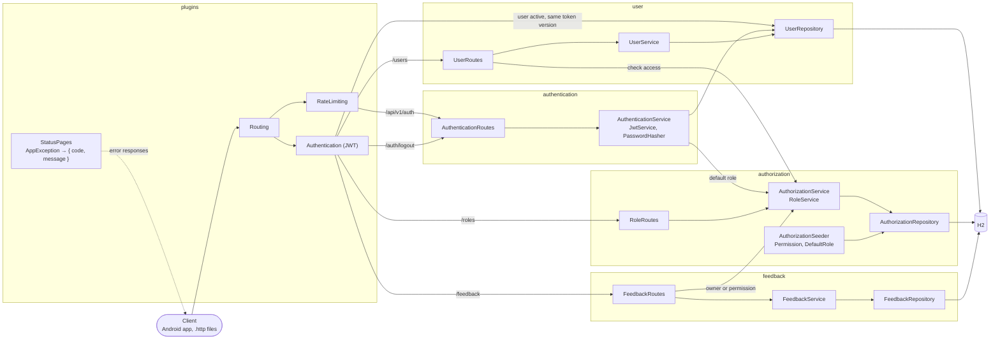
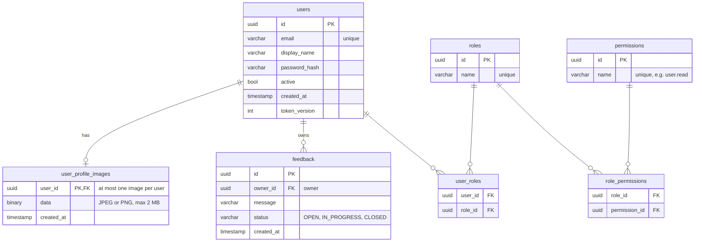

# Technical Design

A REST API in Kotlin with Ktor that provides users, authentication and role-based access control (RBAC)
as the foundation for later domain features. A future Android app will consume the API.

This document **lists** how the system is built: technology, components, data model, permissions, error codes and
endpoints. It does not explain; the learning guide (`docs/guide/`) does. Decisions and their reasons:
`docs/implementation-plan.md`. The exact API contract: `backend/resources/openapi/openapi.yaml`.

## 1. Technology

| Concern | Choice |
|---|---|
| Language / runtime | Kotlin, JVM 21 |
| Web framework | Ktor (Netty engine) |
| Build | JetBrains Amper (`project.yaml`, `backend/module.yaml`) |
| Database | H2 (file-based), accessed with the Exposed SQL DSL (`exposed-java-time` for timestamps) |
| JSON | kotlinx.serialization |
| Authentication | JWT (Auth0 java-jwt, HMAC256), passwords hashed with BCrypt |
| Configuration | Environment variables, `.env` for local development |
| Logging | SLF4J + Logback |
| Tests | Kotlin Test, Ktor `testApplication` |

## 2. Architecture

A **feature-first modular monolith**: one deployable application, with code grouped by feature. Every feature uses the
same layers (`route/` → `service/` → `repository/` → `database/`, plus `model/`, `dto/` and `mapper/`). The layers,
the wiring in `Application.kt` and the path of one request are explained in
`docs/guide/03-architecture-and-requests.md`; the folder structure is in the root `README.md`.



Naming: code uses the full words `authentication` and `authorization`; only the URL keeps the conventional short
prefix `/auth`.

## 3. Data model



- A user has one or more roles; a role has one or more permissions (many-to-many).
- IDs are UUIDs generated by the server; clients never send an id when creating a resource.
- Users are deactivated (`active = false`), never deleted; an admin can reactivate them.
- A feedback item belongs to one user (foreign key) and is deleted for good.
- A user has at most one profile image: `user_id` is the primary key of `user_profile_images`. Its type (JPEG or PNG)
  is not stored, because it follows from the first bytes of `data`. Images are stored with the feature they belong
  to; there is no central `images` table.
- `created_at` is set by the server at registration and returned as ISO 8601 UTC (`2026-11-04T14:25:07Z`).
- The schema is created with `SchemaUtils.create`; roles and permissions are seeded at startup.

## 4. Security

**Authentication**
- Passwords: 12–72 characters, hashed with BCrypt (cost 12); hashes never leave the server.
- On login or registration the client receives a JWT. It contains only `sub` (user id), `ver` (token
  version), `iss`, `aud`, `iat` and `exp`; no personal data and no roles.
- Protected routes are inside `authenticate(JWT_AUTHENTICATION)`. Verification checks the signature,
  issuer, audience and expiration, and that the user still exists, is active and has the same token version.
- A JWT cannot be revoked on its own, so every user has a `token_version` in the database. Logout
  (`POST /api/v1/auth/logout`), deactivation and a password change increment it, which invalidates every
  earlier token at once. Trade-off: logout ends the sessions on every device.
- Changing the password (`POST /api/v1/users/me/password`) requires the current password, so a stolen token
  alone cannot take over the account. The response holds a new token, so the device that changed it stays
  logged in.
- Login and registration are rate limited (10 per minute), password changes separately (5 per minute). A failed
  login always returns the same error, so callers cannot discover which emails are registered.

**Authorization (RBAC)**
- Permissions are a Kotlin `enum class Permission`; `enum class DefaultRole` is the permission matrix.
  `AuthorizationSeeder` stores both in the database at startup.
- Each protected route starts with one call to `AuthorizationService`: `requirePermission(...)`, or
  `requireOwnerOrPermission(...)` when the owner is always allowed. For that check the route always reads the owner
  first (`getOwnerId`), so an unknown id gives 404; ids are random UUIDs, so this reveals nothing useful. Users own
  their account, so for `/users/{id}` the owner is the account itself.
- Permissions are read from the database on every request, so assigning or revoking a role takes effect
  immediately, also for a token that was issued earlier.
- Deny by default. No or invalid token → 401; valid token without the permission → 403.
- New users get `USER`; the account registering with `BOOTSTRAP_ADMIN_EMAIL` also gets `ADMIN`.
- New features add their permissions to `Permission`; ADMIN gets every permission through `Permission.entries`.

The permission matrix (the code is the source: `DefaultRole.kt`; "own" means `requireOwnerOrPermission`):

| Permission | ADMIN | USER |
|---|:---:|:---:|
| `user.read` | ✅ | own account |
| `user.update` | ✅ | own account |
| `user.delete` | ✅ | ❌ |
| `role.read` | ✅ | own roles |
| `role.assign` | ✅ | ❌ |
| `feedback.read` | ✅ | own items |
| `feedback.update` | ✅ | own message; never the status |
| `feedback.delete` | ✅ | own items |

**Other measures**
- Secrets come from the environment; `.env` is never committed.
- Request logging records only method, path and status (no headers, tokens or bodies).
- Users cannot deactivate their own account, and admins cannot remove their own ADMIN role. Together these
  keep at least one active admin: only another admin can take the role away.

## 5. Error handling

Services and routes throw a subtype of the sealed class `AppException`; `StatusPages` maps it to a status
code and returns one consistent body:

```json
{ "code": "EMAIL_ALREADY_REGISTERED", "message": "Email address is already registered" }
```

| Exception / situation | Status | Codes |
|---|---|---|
| `BadRequest`, malformed JSON, invalid UUID or query parameter | 400 | `INVALID_REQUEST`, `INVALID_CURRENT_PASSWORD`, `INVALID_IMAGE_TYPE`, `IMAGE_TOO_LARGE` |
| `Unauthorized`, missing or invalid JWT | 401 | `UNAUTHORIZED`, `INVALID_CREDENTIALS` |
| `Forbidden` | 403 | `FORBIDDEN` |
| `NotFound`, unknown route | 404 | `USER_NOT_FOUND`, `ROLE_NOT_FOUND`, `FEEDBACK_NOT_FOUND`, `PROFILE_IMAGE_NOT_FOUND`, `NOT_FOUND` |
| `Conflict` (also enforced by a unique index) | 409 | `EMAIL_ALREADY_REGISTERED` |
| Rate limit exceeded | 429 | `TOO_MANY_REQUESTS` |
| Any other exception (logged, no details to the client) | 500 | `INTERNAL_ERROR` |

Codes are stable: clients may depend on them. Add a new code to this table.

## 6. API

The overview; parameters and schemas are in `openapi.yaml`.

| Method | Path | Access |
|---|---|---|
| `GET` | `/health` | Public |
| `POST` | `/api/v1/auth/register` | Public, rate limited |
| `POST` | `/api/v1/auth/login` | Public, rate limited |
| `POST` | `/api/v1/auth/logout` | Authenticated |
| `GET` | `/api/v1/users/me` | Authenticated |
| `POST` | `/api/v1/users/me/password` | Authenticated, rate limited; requires the current password |
| `GET` | `/api/v1/users` | `user.read`; search, filter, sort, page (see below) |
| `GET` / `PATCH` | `/api/v1/users/{id}` | Own account, or `user.read` / `user.update` |
| `DELETE` | `/api/v1/users/{id}` | `user.delete` (deactivates) |
| `POST` | `/api/v1/users/{id}/reactivate` | `user.delete` (undoes a deactivation) |
| `PUT` / `DELETE` | `/api/v1/users/{id}/profile-image` | Own account, or `user.update`; the body of `PUT` is the image file (JPEG or PNG, max 2 MB) |
| `GET` | `/api/v1/users/{id}/profile-image` | Authenticated; responds with the image file |
| `GET` | `/api/v1/roles` | `role.read` |
| `GET` | `/api/v1/users/{id}/roles` | Own account, or `role.read` |
| `POST` / `DELETE` | `/api/v1/users/{id}/roles[/{roleId}]` | `role.assign` |
| `POST` | `/api/v1/feedback` | Authenticated; the caller becomes the owner |
| `GET` | `/api/v1/feedback` | Own items, or all with `feedback.read`; search, filter, sort, page |
| `GET` / `PATCH` / `DELETE` | `/api/v1/feedback/{id}` | Owner, or `feedback.read` / `feedback.update` / `feedback.delete` |
| `PATCH` | `/api/v1/feedback/{id}/status` | `feedback.update` |

### Lists: search, filter, sort and paging

Every list endpoint takes optional query parameters and returns one page:

```text
GET /api/v1/feedback?q=slow&status=OPEN&sort=createdAt&order=desc&limit=20&offset=0

{ "items": [ ... ], "total": 42, "limit": 20, "offset": 0 }
```

The parameters (`q`, filters, `sort`, `order`, `limit`, `offset`) and how they flow through the layers are explained
in `docs/guide/06-lists.md`. Per list:

| | `GET /users` | `GET /feedback` |
|---|---|---|
| `q` searches in | email and display name | message |
| filters | `active=true\|false` | `status=OPEN\|IN_PROGRESS\|CLOSED`, `ownerId` (only with `feedback.read`) |
| `sort` | `createdAt` (default), `displayName`, `email` | `createdAt` (default), `status` |

- An invalid value gives 400 with the parameter name; a missing one means "no filter" or the default.
- Filters only narrow a result. A regular user's feedback search is always limited to their own items, whatever
  `ownerId` they send.

The contract is documented in `backend/resources/openapi/openapi.yaml`; requests for manual testing are
in `backend/http/`: numbered files that assert their expected status codes (see `backend/http/README.md`).

## 7. Testing

Services are tested with fakes, repositories against in-memory H2, and endpoints with `testApplication`; how is in
`docs/guide/07-testing.md`. Every endpoint is tested for the happy flow and the relevant error flows (400, 401, 403,
404, 409). Run all tests with `./kotlin test`.

## 8. Adding a feature

Copy `features/feedback/` (an item owned by a user) or follow the `categories` tutorial (a global resource):
`docs/guide/08-tutorial-categories.md`.
