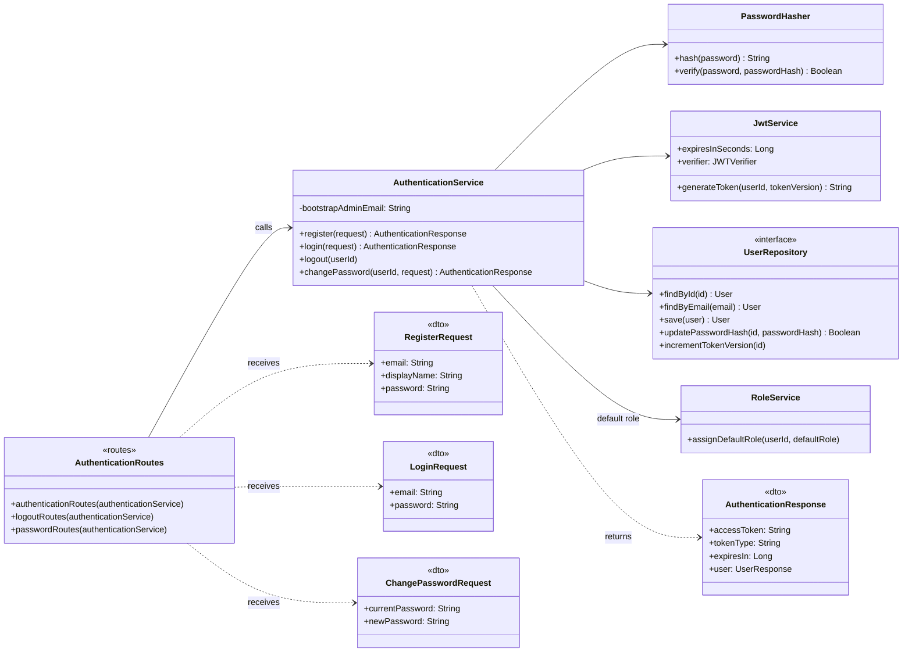
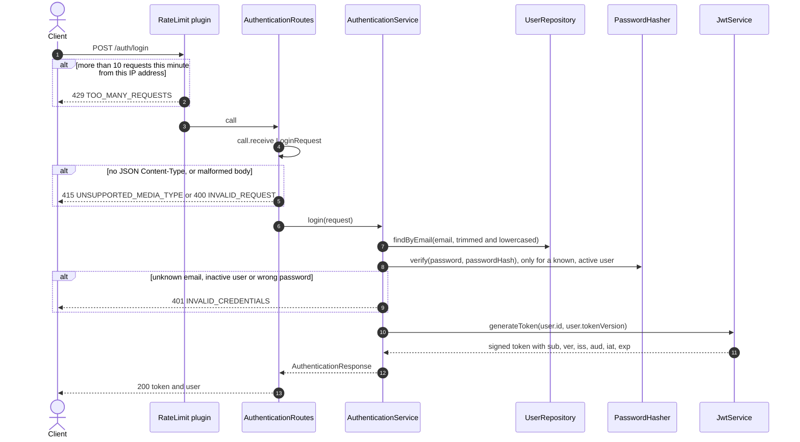

# Authentication

Answers *who is the caller?*: registering, logging in, logging out and changing the password. It creates the tokens;
checking an incoming token on every request happens in `plugins/Authentication.kt`. What the caller may do is decided
by the `authorization` feature.

This feature has no table of its own: it stores users through `UserRepository` from the `user` feature. Concepts
(BCrypt, JWT, token version): `docs/guide/04-security.md`. Endpoints: `TECHNICAL_DESIGN.md` §6.

## Class diagram

`UserRepository` (feature `user`) and `RoleService` (feature `authorization`) are drawn with only the functions this
feature uses.

## Files

| File | What it does |
|---|---|
| `route/AuthenticationRoutes.kt` | Three route groups: `authenticationRoutes` (register, login; public and rate limited), `logoutRoutes` and `passwordRoutes` (both need a token). `plugins/Routing.kt` places each group |
| `service/AuthenticationService.kt` | The rules. `register` checks email, display name and password, refuses a known email (409), hashes the password, gives the role USER (and ADMIN for `BOOTSTRAP_ADMIN_EMAIL`) and returns a token. `login` gives the same error for every failure. `logout` and `changePassword` raise the token version |
| `service/PasswordHasher.kt` | `hash` and `verify` with BCrypt, cost 12 |
| `service/JwtService.kt` | `generateToken(userId, tokenVersion)` signs a JWT with `sub`, `ver`, `iss`, `aud`, `iat`, `exp`; `verifier` is used by the plugin to check tokens |
| `dto/RegisterRequest.kt`, `dto/LoginRequest.kt`, `dto/ChangePasswordRequest.kt` | The JSON bodies the client sends |
| `dto/AuthenticationResponse.kt` | The answer after register, login or password change: the token, its type and lifetime, and the user |
| `mapper/AuthenticationMapper.kt` | `User.toAuthenticationResponse(token, expiresIn)` |

## How a request flows

`POST /api/v1/auth/login` with `{ "email": ..., "password": ... }`:

- The three failures in the 401 branch give the **same** error, so a caller cannot find out which emails are registered.
- On every later request, `plugins/Authentication.kt` checks the signature and expiry, and that the user still
  exists, is active and has the same token version as the `ver` in the token. Logout and a password change raise the
  version, so every earlier token stops working.

## Tests

In `backend/test/features/authentication/`:

| File | Kind | What it tests |
|---|---|---|
| `AuthenticationServiceTest.kt` | unit, with fakes | register (normalising, roles, the bootstrap admin, 409, invalid input), login, logout, change password |
| `PasswordHasherTest.kt` | unit | a hash can be verified, a wrong password is refused, every hash has its own salt |
| `JwtServiceTest.kt` | unit | the subject of a token, and that a token with another secret, another issuer or an expired date is refused |
| `AuthenticationRoutesTest.kt` | routes, test host | register, login, logout and password change with 200/201/204 and 400/401/409/429, and the limit per user |
