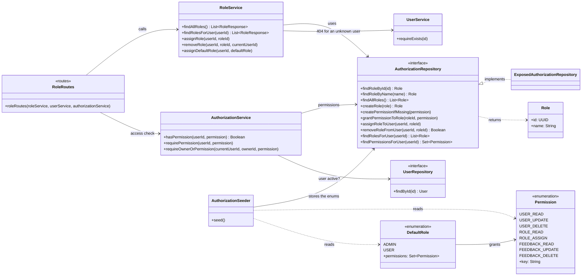
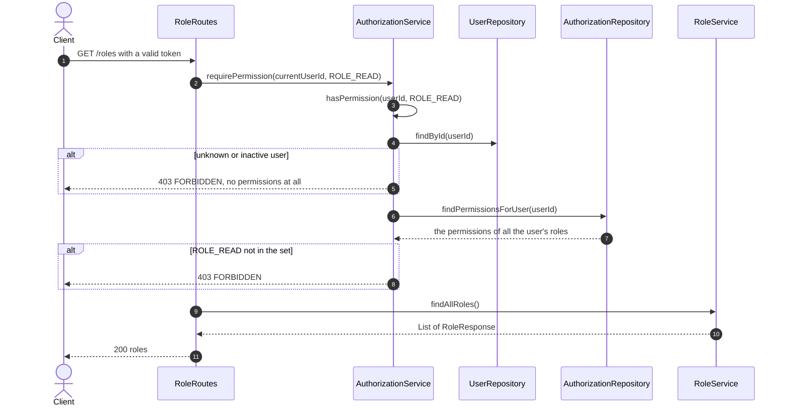

# Authorization

Answers *what may the caller do?* with role-based access control: users have roles, roles have permissions, and
everything is denied unless a rule allows it. Every other feature uses `AuthorizationService` for its access checks.

Concepts (owners, 401 versus 403): `docs/guide/04-security.md`. The permission matrix: `TECHNICAL_DESIGN.md` §4.

## Class diagram

The two enums are the source of truth; `AuthorizationSeeder` copies them into the database at startup. Tables,
mappers and DTOs are left out; see *Files*.

`AuthorizationService` reads `UserRepository` directly instead of `UserService`: it runs on every request and needs
the `active` flag, not a response DTO (rule in `docs/guide/llm-context.md` §3).

## Files

| File | What it does |
|---|---|
| `model/Permission.kt` | Every permission the code checks, as an enum with the key stored in the database (`user.read`). A new feature adds its permissions here |
| `model/DefaultRole.kt` | The permission matrix: ADMIN gets `Permission.entries` (all, also new ones), USER gets none |
| `model/Role.kt` | A role as stored in the database: id and name |
| `service/AuthorizationService.kt` | The access checks. `requirePermission` throws 403 without the permission; `requireOwnerOrPermission` lets the owner through and checks the permission for anyone else; `hasPermission` answers yes or no (used to narrow a list) |
| `service/AuthorizationSeeder.kt` | Runs at startup: stores every `Permission` and `DefaultRole` and links them. It only adds what is missing, so it is safe to run every time |
| `service/RoleService.kt` | Lists, assigns and removes roles. An admin cannot remove their own ADMIN role, so at least one admin remains. `assignDefaultRole` is used at registration. It checks that a user exists through `UserService.requireExists`, not through the user repository |
| `route/RoleRoutes.kt` | `GET /roles`, and the roles of a user: list, assign, remove |
| `repository/AuthorizationRepository.kt` | The interface for roles, permissions and the links between them |
| `repository/ExposedAuthorizationRepository.kt` | The Exposed implementation. `findPermissionsForUser` joins `user_roles` and `role_permissions` with explicit join columns |
| `database/RolesTable.kt`, `PermissionsTable.kt` | The `roles` and `permissions` tables, each with a unique name |
| `database/UserRolesTable.kt`, `RolePermissionsTable.kt` | The link tables: which user has which role, which role has which permission |
| `dto/RoleResponse.kt`, `dto/AssignRoleRequest.kt` | The JSON of a role, and the body to assign one (`{ "roleId": ... }`) |
| `mapper/RoleMapper.kt` | `ResultRow.toRole()` and `Role.toResponse()` |
| `mapper/PermissionMapper.kt` | `ResultRow.toPermission()`; returns `null` for a key that no longer exists in `Permission` |

## How a check works

`GET /api/v1/roles`, which needs `role.read`:

- The permissions are read from the database **on every request**. A role that was just revoked counts
  immediately, even for a token issued before. The token itself carries no roles.
- `requireOwnerOrPermission` adds one step in front: when the caller is the owner, it returns at once and the
  permission is never looked up.
- Roles and permissions are never created through the API; they come from the two enums.

## Tests

In `backend/test/features/authorization/`:

| File | Kind | What it tests |
|---|---|---|
| `AuthorizationServiceTest.kt` | unit, with fakes | permissions per role, users without a role, deactivated users, revoking a role, the owner rule, and that an admin cannot remove their own ADMIN role |
| `AuthorizationRepositoryTest.kt` | repository, against H2 | seeding twice, the permission join across the link tables, removing a role |
| `RoleRoutesTest.kt` | routes, test host | the role endpoints with 200/204 and 400/401/403/404, and that a revoked role counts at once for an existing token |
| `FakeAuthorizationRepository.kt` | fake | keeps roles, permissions and links in maps and behaves like the Exposed repository |
