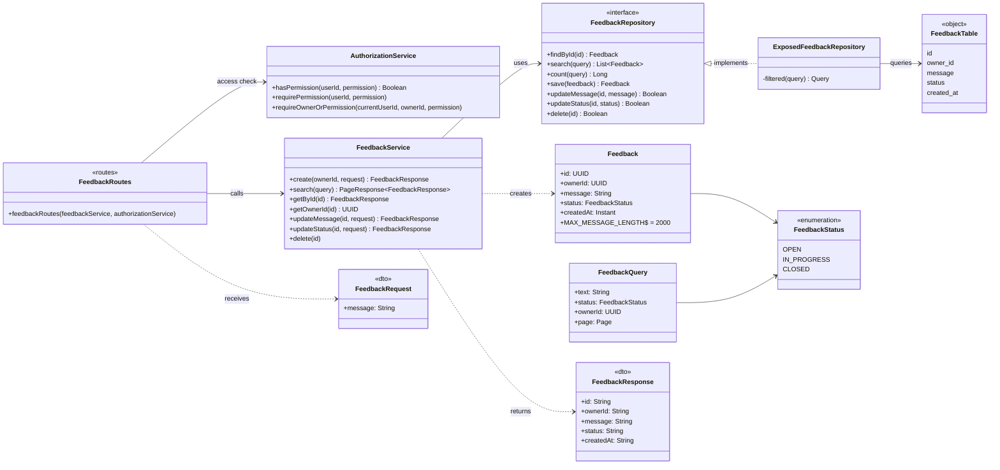
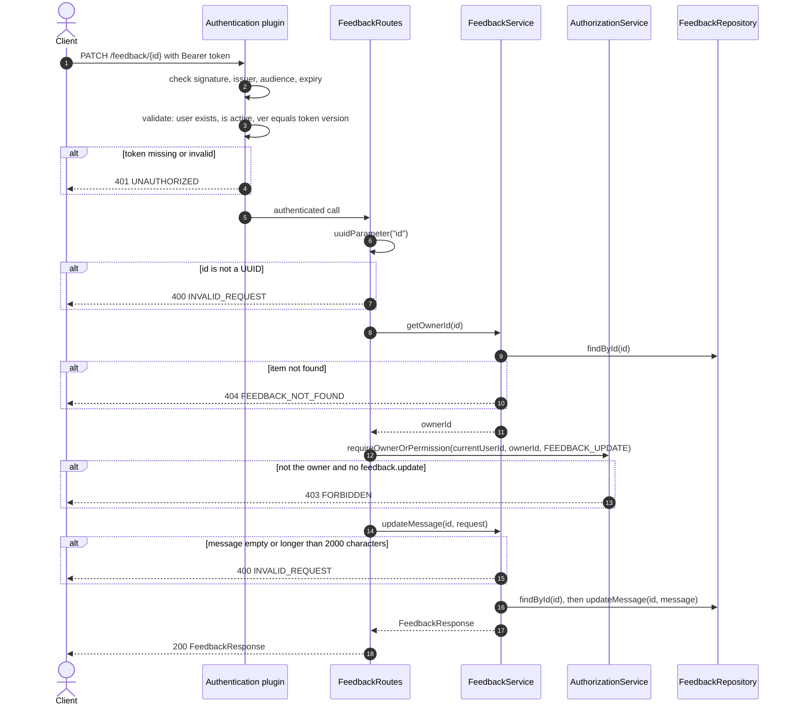

# Feedback

The **reference feature**: users write feedback about the app, and an admin reads it and changes its status. Copy this
feature when you add something that belongs to a user. It shows every common pattern in one place: the caller becomes
the owner, access with `getOwnerId` + `requireOwnerOrPermission`, an admin-only field on its own endpoint, a list
that narrows to the caller's own items, one repository function per changed column, and a hard delete.

Endpoints and permissions: `TECHNICAL_DESIGN.md` §4 and §6. Error codes: §5.

## Class diagram

The service only knows the `FeedbackRepository` interface: `AppServices` gives it the Exposed implementation, the
tests give it `FakeFeedbackRepository`. Mappers and `FeedbackSortField` are left out; see *Files*.

Nullable types (`Feedback?`, `String?`) are drawn without the `?`; the code shows which values may be `null`.

## Files

| File | What it does |
|---|---|
| `route/FeedbackRoutes.kt` | The six endpoints under `/feedback`. Each one reads the request, does one access check, calls the service and responds. No business rules |
| `service/FeedbackService.kt` | The rules: the message is trimmed and 1–2000 characters, a new item starts as `OPEN`, the server sets the id and `createdAt`. `getOwnerId(id)` gives the owner for the access check, or 404 |
| `repository/FeedbackRepository.kt` | The interface the service uses: find, search, count, save, `updateMessage`, `updateStatus`, delete. Each update writes only its own column, so an admin closing an item and the owner editing it at the same time cannot undo each other |
| `repository/ExposedFeedbackRepository.kt` | The real implementation with Exposed. `search` and `count` share `filtered(query)`, so the total always uses the same filters |
| `database/FeedbackTable.kt` | The `feedback` table. `owner_id` is a foreign key to `users`; the status is stored by its name |
| `model/Feedback.kt` | The domain object the service works with |
| `model/FeedbackStatus.kt` | `OPEN`, `IN_PROGRESS`, `CLOSED` |
| `model/FeedbackQuery.kt` | What a list request asks for: text, status, owner, sort and page. `null` means "no filter" |
| `model/FeedbackSortField.kt` | The fields a client may sort on, with the name used in the URL (`createdAt`, `status`) |
| `dto/FeedbackRequest.kt` | JSON body to create an item or change its message: `{ "message": ... }` |
| `dto/UpdateFeedbackStatusRequest.kt` | JSON body to change the status: `{ "status": ... }` |
| `dto/FeedbackResponse.kt` | The JSON the client receives |
| `mapper/FeedbackMapper.kt` | `Feedback.toResponse()`: model → JSON |
| `mapper/FeedbackDatabaseMapper.kt` | `ResultRow.toFeedback()`: database row → model |
| `mapper/FeedbackQueryMapper.kt` | `Parameters.toFeedbackQuery()`: query parameters → `FeedbackQuery`; an invalid value gives 400 |

## How a request flows

`PATCH /api/v1/feedback/{id}` with `{ "message": "..." }`, by the owner or by someone with `feedback.update`:

- Every error is an `AppException`; `plugins/StatusPages.kt` turns it into `{ "code", "message" }`. The diagram
  draws the answer straight to the client to stay readable.
- The owner is read **before** the access check, so an unknown id gives 404, not 403. The service reads the item once
  more for the 404 and the response, then writes only the message column.
- The list (`GET /feedback`) is the one route that narrows instead of refusing: without `feedback.read`, the route
  sets `ownerId` to the caller, whatever filter was sent.

## Tests

In `backend/test/features/feedback/`:

| File | Kind | What it tests |
|---|---|---|
| `FeedbackServiceTest.kt` | unit, with the fake | validation, the starting status, both updates, delete, 404 |
| `FeedbackMapperTest.kt` | unit | `Feedback.toResponse()` |
| `FeedbackRepositoryTest.kt` | repository, against H2 | search, filters, a `%` in the text matched literally, sort, paging, each update changing only its own column, delete, the foreign key |
| `FeedbackRoutesTest.kt` | routes, test host | every endpoint with 200/201/204 and 400/401/403/404, and the list narrowing |
| `FakeFeedbackRepository.kt` | fake | keeps items in a map and behaves like the Exposed repository |

The numbers per run: `docs/test-report.md`.

## Copying it

The step-by-step version, for a feature without an owner: `docs/guide/08-tutorial-categories.md`.
