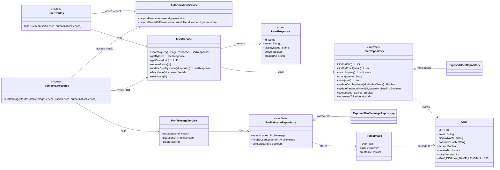
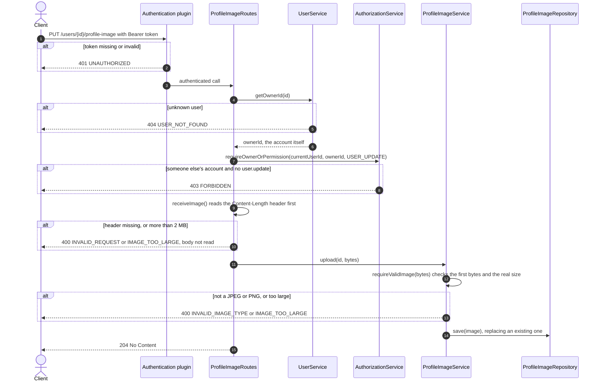

# User

User accounts: the `User` model, its storage, the profile image and the `/users` endpoints. The `authentication`
feature reuses `UserRepository` to register and log in, so there is only one place where users are stored.

Users differ from the reference feature (`feedback`), so do not copy this one:

- an account is created through `/auth/register` (in `authentication`), not through `/users`;
- an account is **deactivated**, never deleted (`active = false`), and can be reactivated;
- users **own their account**: the owner of `/users/{id}` is the account itself.

Endpoints and permissions: `TECHNICAL_DESIGN.md` §4 and §6.

## Class diagram

Two parts share this feature: the account (`UserService`, `UserRepository`) and its profile image
(`ProfileImageService`, `ProfileImageRepository`). Each service only knows its repository interface. Mappers and the
query classes are left out; see *Files*.

`User` is a `data class`; `ProfileImage` is a normal class, because a data class compares a `ByteArray` by
reference. Nullable return types (`User?`) are drawn without the `?`.

## Files

| File | What it does |
|---|---|
| `route/UserRoutes.kt` | `GET /users/me`, the list, `GET`/`PATCH /users/{id}`, deactivate (`DELETE`) and reactivate. Each route does one access check before the work |
| `service/UserService.kt` | The rules: the display name is 1–120 characters; you cannot deactivate yourself; deactivating raises the token version so old tokens stop working. `getOwnerId(id)` returns the account id, or 404; `requireExists(id)` gives the same 404 for other features (`RoleService`). The 120 is `User.MAX_DISPLAY_NAME_LENGTH`, also used by `UsersTable` |
| `repository/UserRepository.kt` | The interface: find by id or email, search, count, save, and one function per change (`updateDisplayName`, `updatePasswordHash`, `setActive`, `incrementTokenVersion`). Each writes only its own column, so two requests at the same time cannot undo each other's change |
| `repository/ExposedUserRepository.kt` | The Exposed implementation. `save` turns a duplicate email into 409; `incrementTokenVersion` is one atomic SQL update |
| `database/UsersTable.kt` | The `users` table, with a unique index on `email` |
| `model/User.kt` | The domain object, including `passwordHash` and `tokenVersion` (never sent to the client) |
| `model/UserQuery.kt`, `model/UserSortField.kt` | What a list request asks for, and the fields a client may sort on |
| `dto/UserResponse.kt` | The JSON the client receives: no password hash, no token version |
| `dto/UpdateUserRequest.kt` | JSON body of `PATCH /users/{id}`: `{ "displayName": ... }` |
| `mapper/UserMapper.kt` | `User.toResponse()`: model → JSON |
| `mapper/UserDatabaseMapper.kt` | `ResultRow.toUser()`: database row → model |
| `mapper/UserQueryMapper.kt` | `Parameters.toUserQuery()`: query parameters → `UserQuery`; an invalid value gives 400 |

### Profile image

| File | What it does |
|---|---|
| `database/UserProfileImagesTable.kt` | The `user_profile_images` table. `user_id` is the primary key and a foreign key to `users`, so a user has at most one image. The bytes are stored in `data`; the type (JPEG or PNG) is not stored, because it follows from the bytes (`ImageType.detect` in `shared/image/`) |
| `model/ProfileImage.kt` | The image of one user: `userId`, `data`, `createdAt`. A normal class, not a data class, because a data class compares a `ByteArray` by reference |
| `repository/ProfileImageRepository.kt` | The interface: `save` (replaces an existing image), `findByUserId`, `delete` |
| `repository/ExposedProfileImageRepository.kt` | The Exposed implementation. `save` deletes the old row and inserts the new one in one transaction |
| `mapper/ProfileImageDatabaseMapper.kt` | `ResultRow.toProfileImage()`: database row → model |
| `mapper/ProfileImageMapper.kt` | `ProfileImage.contentType()`: the `Content-Type` to send with the image, read from its first bytes (`ImageType.detect`). `null` would mean a stored image is damaged, a bug, so it gives a 500 |
| `route/ProfileImageRoutes.kt` | `PUT`, `GET` and `DELETE /users/{id}/profile-image`. Changing or deleting needs the account itself or `user.update`, like `PATCH /users/{id}`; every logged-in user may see an image. The upload body is the image file itself, read with `receiveImage()` from `shared/image/` |
| `service/ProfileImageService.kt` | The rules: `upload` checks the image with `requireValidImage` (400 `INVALID_IMAGE_TYPE` or `IMAGE_TOO_LARGE`), sets `createdAt` and saves it; `get` and `delete` give 404 `PROFILE_IMAGE_NOT_FOUND` when the user has no image. The route checks that the user exists first |

## How a request flows

`PUT /api/v1/users/{id}/profile-image` with the image file as the body:

- The size is checked **before** the body is read, so a client cannot make the server load a huge file into memory.
  The type comes from the first bytes, never from the `Content-Type` header or the file name.
- A later `GET` sends the bytes back with `image.contentType()`. It does not look the user up first: an unknown user
  simply has no image (404 `PROFILE_IMAGE_NOT_FOUND`).
- `PATCH /users/{id}` follows the same order as the reference feature: owner first (`getOwnerId`, 404), then
  `requireOwnerOrPermission(..., USER_UPDATE)` (403), then `updateDisplayName`, which writes only that column.
- Changing the password is in `authentication`, because hashing belongs there, even though its URL is
  `/users/me/password`.

## Tests

In `backend/test/features/user/`:

| File | Kind | What it tests |
|---|---|---|
| `UserServiceTest.kt` | unit, with the fake | display name rules, deactivate and reactivate, `getOwnerId`, `requireExists`, 404 |
| `UserMapperTest.kt` | unit | `User.toResponse()`, and that the JSON never contains the password hash |
| `UserRepositoryTest.kt` | repository, against H2 | search, filters, paging, each update changing only its own column, the token version, 409 for a duplicate email |
| `UserRoutesTest.kt` | routes, test host | every `/users` endpoint with 200/204 and 400/401/403/404, and that old tokens stop working after deactivation |
| `ProfileImageServiceTest.kt` | unit, with the fake | upload checks, replace, get and delete, 404 |
| `ProfileImageMapperTest.kt` | unit | `ProfileImage.contentType()` |
| `ProfileImageRepositoryTest.kt` | repository, against H2 | the bytes come back unchanged (also an image of exactly 2 MB), replace, delete |
| `ProfileImageRoutesTest.kt` | routes, test host | upload, download and delete with 200/204 and 400/401/403/404 |
| `FakeUserRepository.kt`, `FakeProfileImageRepository.kt` | fakes | keep data in a map and behave like the Exposed repositories |
