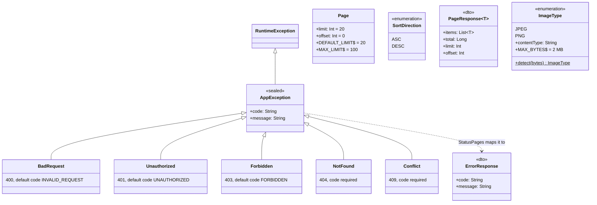

# Shared

Code that more than one feature uses. It never depends on a feature: if only one feature needs something, it belongs
in that feature.

## Class diagram

The classes here, without the top-level functions (`requireValid`, the query parameter readers, `receiveImage`,
`containsIgnoringCase`); those are listed in *Files*.

`AppException` is a `sealed class`: the compiler knows every subclass, so the `when` in `plugins/StatusPages.kt` that
picks the status code needs no `else`. `PageResponse<T>` is generic: one class for every list
(`PageResponse<UserResponse>`, `PageResponse<FeedbackResponse>`).

## Files

| File | What it does |
|---|---|
| `error/AppException.kt` | The expected errors as a sealed class: `BadRequest` (400), `Unauthorized` (401), `Forbidden` (403), `NotFound` (404), `Conflict` (409). Also `requireValid(condition) { message }`, which throws a 400; use it instead of Kotlin's `require()` |
| `error/ErrorResponse.kt` | The error body every failure returns: `{ "code": ..., "message": ... }` |
| `http/RequestParameters.kt` | `call.uuidParameter("id")` reads a path parameter as a UUID; an invalid one gives 400 |
| `http/QueryParameters.kt` | Readers for query parameters: `searchText`, `oneOf`, `booleanOrNull`, `uuidOrNull`, `sortDirection`, `page`. Each returns `null` or a default when the parameter is missing, and throws 400 with the parameter name when it is invalid |
| `paging/Page.kt` | `limit` (1–100, default 20) and `offset` of one page |
| `paging/SortDirection.kt` | `ASC` or `DESC` |
| `paging/PageResponse.kt` | The response of every list: `items`, `total`, `limit`, `offset` |
| `image/ImageType.kt` | Checks uploaded images for every feature that stores them. `ImageType.detect(bytes)` recognises a JPEG or PNG by its first bytes (never by the header or file name); `requireValidImage(bytes)` throws 400 `IMAGE_TOO_LARGE` above 2 MB or `INVALID_IMAGE_TYPE` for anything else. Each feature stores its own images |
| `image/ImageRequest.kt` | `call.receiveImage()` reads the raw request body as image bytes. It checks the `Content-Length` header first (400 when missing, `IMAGE_TOO_LARGE` above 2 MB), so a huge body is refused before it is read. Ktor 3.6 has no built-in body limit |
| `database/QueryConditions.kt` | Exposed helpers for repositories: `containsIgnoringCase(text)` (a `LIKE` search where `%` and `_` match literally) and `SortDirection.toSortOrder()` |

## How a feature uses it

A list request goes through every folder here: the feature's query mapper reads the parameters with
`http/QueryParameters.kt` (400 on a bad value), the repository filters with `database/QueryConditions.kt`, and the
service returns a `paging/PageResponse`. Any `AppException` thrown on the way becomes an `ErrorResponse` in
`plugins/StatusPages.kt`. The sequence of a whole request is in the README of each feature.

Explained step by step: `docs/guide/06-lists.md` (lists) and `docs/guide/05-errors-and-database.md` (errors).

## Tests

In `backend/test/shared/`:

| File | Kind | What it tests |
|---|---|---|
| `http/QueryParametersTest.kt` | unit | the readers: defaults, valid values, and 400 with the parameter name for invalid ones |
| `image/ImageTypeTest.kt` | unit | JPEG and PNG recognised by their first bytes, anything else refused, the 2 MB limit |

`StatusPages` (turning each `AppException` into its status) is tested in `backend/test/plugins/StatusPagesTest.kt`.
