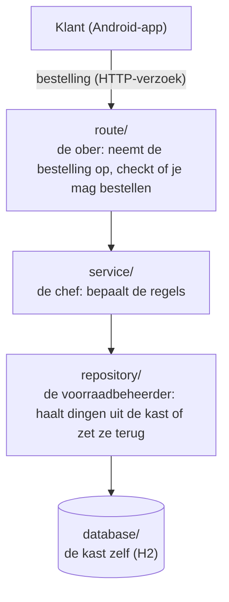
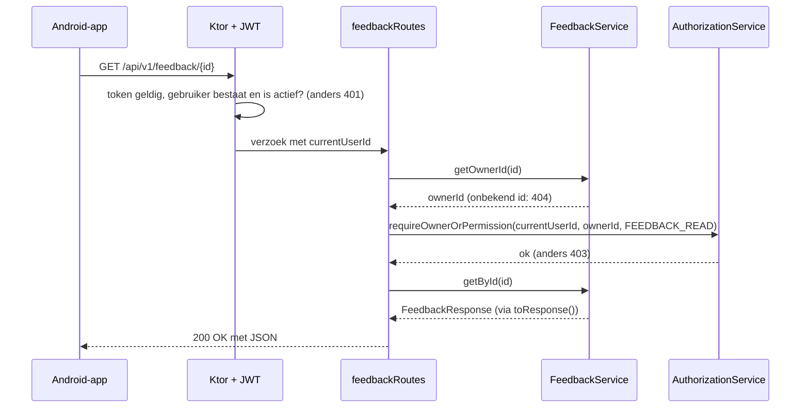

# Brul Backend: uitleg voor beginners

Dit document legt in gewone taal uit waar het project over gaat, hoe het in elkaar zit en hoe een verzoek
(request) door de code loopt. Voor de officiële, Engelstalige referentie: `TECHNICAL_DESIGN.md` en `docs/guide/`.

---

## 1. Waar gaat het project over?

Brul is een **REST API**: een programma op een server dat vragen via internet (HTTP) beantwoordt met JSON.
Later gaat een **Android-app** deze API gebruiken. De app zelf bestaat nog niet; dit project is de backend
(de "achterkant").

De API regelt nu de basis die bijna elke app nodig heeft:

| Onderdeel | Wat het doet |
|---|---|
| **Gebruikers** | Account aanmaken, gegevens opvragen en wijzigen, account deactiveren |
| **Authenticatie** | *Wie ben jij?* Registreren, inloggen, uitloggen, wachtwoord wijzigen |
| **Autorisatie** | *Wat mag jij?* Rollen (ADMIN, USER) en permissies (zoals `user.read`) |
| **Feedback** | Een voorbeeldfeature: gebruikers sturen feedback, een admin beheert die |
| **Health** | `GET /health`: een simpele check of de server draait |

De feature **feedback** is bewust simpel gehouden: het is het **voorbeeld (template)** dat je kopieert als je
een nieuwe feature bouwt.

---

## 2. De gebruikte technieken

| Techniek | Wat is het? | Vergelijking |
|---|---|---|
| **Kotlin** | De programmeertaal (draait op de JVM, net als Java) | De taal waarin je schrijft |
| **Ktor** | Webframework: ontvangt HTTP-verzoeken en stuurt antwoorden | De receptie van een hotel |
| **Exposed** | Bibliotheek om met Kotlin-code SQL-queries te maken | Tolk tussen Kotlin en de database |
| **H2** | Een kleine database die als bestand in `data/` staat | De archiefkast |
| **Amper** | Build-tool (in plaats van Gradle/Maven) | Bouwt en start het project |
| **JWT** | Een "toegangspasje" (token) dat je na inloggen krijgt | Polsbandje op een festival |
| **BCrypt** | Versleutelt (hasht) wachtwoorden | Wachtwoorden worden nooit leesbaar opgeslagen |

Starten: `kotlin.bat run` (Windows) en testen: `kotlin.bat test`.

---

## 3. De mappenstructuur

```text
brul/
├── README.md, TECHNICAL_DESIGN.md   # overzicht en technische referentie
├── project.yaml                     # Amper: welke modules er zijn
├── docs/                            # leergids (guide/), beslissingen (implementation-plan.md)
└── backend/
    ├── module.yaml                  # Amper: afhankelijkheden (Ktor, Exposed, H2, ...)
    ├── .env.example                 # voorbeeld-configuratie (kopieer naar .env)
    ├── http/                        # handmatige testverzoeken voor IntelliJ
    ├── resources/                   # logging-config en openapi.yaml (het API-contract)
    ├── src/                         # de broncode
    └── test/                        # de tests (zelfde indeling als src/)
```

### Binnen `backend/src/`

```text
src/
├── Application.kt   # startpunt: maakt alle objecten aan en koppelt ze aan elkaar
├── config/          # instellingen (AppConfig) en databaseverbinding (DatabaseFactory)
├── plugins/         # Ktor instellen: JSON, foutafhandeling, logging, rate limiting, JWT, routes
├── shared/          # hulpcode die álle features gebruiken (fouten, paging, parameters)
└── features/        # de echte functionaliteit, per onderwerp
    ├── authentication/
    ├── authorization/
    ├── user/
    ├── feedback/
    └── health/
```

Dit heet een **feature-first modular monolith**:

- **Monolith**: het is één programma dat je in één keer start.
- **Modular / feature-first**: de code is ingedeeld **per onderwerp** (feature), niet per techniek. Alles wat
  met feedback te maken heeft staat bij elkaar in `features/feedback/`.

---

## 4. De lagen binnen een feature

Elke feature gebruikt dezelfde mapjes. Neem `features/feedback/` als voorbeeld:

| Map | Taak | Voorbeeld |
|---|---|---|
| `route/` | HTTP-verzoek lezen, toegang checken, service aanroepen, antwoord sturen | `FeedbackRoutes.kt` |
| `service/` | Bedrijfsregels en validatie (bv. "bericht max 2000 tekens") | `FeedbackService.kt` |
| `repository/` | Praten met de database; een interface + een Exposed-versie | `FeedbackRepository.kt`, `ExposedFeedbackRepository.kt` |
| `database/` | Beschrijving van de tabel | `FeedbackTable.kt` |
| `model/` | De "echte" data in Kotlin (data classes, enums) | `Feedback.kt`, `FeedbackStatus.kt` |
| `dto/` | Wat er als JSON binnenkomt en uitgaat | `FeedbackRequest.kt`, `FeedbackResponse.kt` |
| `mapper/` | Omzetten tussen vormen (databaserij → model → JSON) | `FeedbackMapper.kt` |

Zie het als een restaurant:



Elke laag doet **alleen zijn eigen taak**. De ober kookt niet, de chef loopt niet naar de klant.
Daardoor is elk stuk code klein en goed uit te leggen.

**Waarom DTO's en modellen apart?** Een `User`-model bevat een wachtwoord-hash. Die mag nooit naar de app.
De `UserResponse` (DTO) heeft dat veld simpelweg niet, dus het *kan* niet uitlekken.

---

## 5. Hoe alles aan elkaar hangt: `Application.kt`

Er is **geen** framework dat automatisch objecten aanmaakt. `Application.kt` doet het met de hand:

```kotlin
val feedbackRepository = ExposedFeedbackRepository()      // 1. repository maken
val feedbackService = FeedbackService(feedbackRepository) // 2. service krijgt de repository
configureRouting(..., feedbackService)                     // 3. routes krijgen de service
```

Dit heet **constructor injection**: je geeft een object wat het nodig heeft via de constructor.
Voordeel: je ziet precies wat waarvan afhangt, en in tests geef je een **nep-repository** (fake) mee in plaats
van een echte database.

Bij het starten gebeurt dit:

1. `AppConfig.load()` leest de instellingen uit `.env` of omgevingsvariabelen.
2. `DatabaseFactory.init()` maakt verbinding met H2 en maakt ontbrekende tabellen aan.
3. `AuthorizationSeeder` zet de rollen en permissies in de database.
4. Plugins worden ingesteld en de routes worden geregistreerd.
5. De server luistert op poort 8080.

---

## 6. Een verzoek van begin tot eind

Voorbeeld: een gebruiker vraagt zijn eigen feedbackitem op met `GET /api/v1/feedback/{id}`.



Zo ziet dat er in de code uit (`features/feedback/route/FeedbackRoutes.kt`):

```kotlin
get("/{id}") {
    val id = call.uuidParameter("id")
    authorizationService.requireOwnerOrPermission(
        call.currentUserId(), feedbackService.getOwnerId(id), Permission.FEEDBACK_READ
    )
    call.respond(feedbackService.getById(id))
}
```

Kort: id lezen → toegang checken → werk doen → antwoorden. Elke beschermde route volgt dit patroon.

---

## 7. Authenticatie: wie ben jij?

1. Je **registreert** of **logt in** via `/api/v1/auth/register` of `/api/v1/auth/login`.
2. De server controleert je wachtwoord (opgeslagen als BCrypt-hash) en geeft je een **JWT-token**.
3. Bij elk volgend verzoek stuur je dat token mee in de header `Authorization: Bearer <token>`.

Het token bevat alleen je gebruikers-id (`sub`), een versienummer (`ver`) en technische velden. **Geen**
naam, e-mail of rollen.

**Uitloggen met een token-versie.** Een JWT kun je niet "intrekken". Daarom heeft elke gebruiker een
`token_version` in de database. Bij uitloggen, wachtwoord wijzigen of deactiveren gaat dat nummer +1. Oude
tokens hebben dan het verkeerde nummer en worden geweigerd.

**Rate limiting.** Inloggen en registreren mag maximaal 10 keer per minuut, zodat niemand eindeloos
wachtwoorden kan raden.

---

## 8. Autorisatie: wat mag jij? (RBAC)

RBAC = *Role-Based Access Control*: je rechten komen uit je **rol**.

- **Permissies** staan in `Permission.kt` als enum, bv. `USER_READ("user.read")`.
- **Rollen** staan in `DefaultRole.kt`:
  - `ADMIN` krijgt alle permissies (`Permission.entries`).
  - `USER` krijgt geen permissies, maar mag wél altijd bij zijn **eigen** account en feedback.

Twee checks in `AuthorizationService`:

| Functie | Betekenis |
|---|---|
| `requirePermission(userId, Permission.X)` | Je moet permissie X hebben |
| `requireOwnerOrPermission(userId, ownerId, Permission.X)` | Je bent de eigenaar, óf je hebt permissie X |

Belangrijk: permissies worden bij **elk verzoek uit de database** gelezen, niet uit het token. Haalt een admin
iemands rol weg, dan werkt dat direct.

De eerste admin: het account dat registreert met het e-mailadres uit `BOOTSTRAP_ADMIN_EMAIL` (in `.env`) krijgt
automatisch de rol ADMIN.

Meer over het verschil tussen `userId`, `currentUserId` en `ownerId`: zie
[02-ownerid-en-userid.md](02-ownerid-en-userid.md).

---

## 9. Foutafhandeling

Code gooit een `AppException` (in `shared/error/AppException.kt`). De plugin `StatusPages` maakt daar
automatisch een net antwoord van:

| Exception | Statuscode | Wanneer |
|---|---|---|
| `BadRequest` | 400 | Ongeldige invoer |
| `Unauthorized` | 401 | Geen of ongeldig token |
| `Forbidden` | 403 | Wel ingelogd, maar geen recht |
| `NotFound` | 404 | Bestaat niet |
| `Conflict` | 409 | Bv. e-mailadres al geregistreerd |

Het antwoord heeft altijd dezelfde vorm:

```json
{ "code": "FEEDBACK_NOT_FOUND", "message": "Feedback not found" }
```

Voor invoercontrole gebruik je `requireValid(...)` in plaats van Kotlins `require(...)`. Waarom? `require`
geeft een 500-fout (serverfout), `requireValid` een nette 400.

---

## 10. Lijsten: zoeken, filteren, sorteren, pagineren

Elke lijst (bv. `GET /api/v1/feedback`) accepteert dezelfde parameters:

```text
?q=traag&status=OPEN&sort=createdAt&order=desc&limit=20&offset=0
```

Het antwoord is altijd een `PageResponse`:

```json
{ "items": [ ... ], "total": 42, "limit": 20, "offset": 0 }
```

Met `total` kan de app "pagina 1 van 3" tonen. Filters kunnen je **nooit meer laten zien** dan je mag: een
gewone gebruiker ziet bij `GET /feedback` altijd alleen zijn eigen items.

---

## 11. Tests

Tests staan in `backend/test/` met dezelfde mappen als `src/`.

- **Route-tests** starten een nep-server met `testApplication` en fakes (`TestServices` in `TestFixtures.kt`).
- **Fakes** zoals `FakeFeedbackRepository` bewaren data in een `Map` in plaats van een database.
- **Repository-tests** gebruiken een H2-database in het geheugen.

Er worden zowel de goede situatie als de fouten getest: 400, 401, 403, 404 en 409.

---

## 12. Een nieuwe feature toevoegen (in het kort)

1. Kopieer de structuur van `features/feedback/`.
2. Voeg eventuele permissies toe aan `Permission.kt`.
3. Koppel de nieuwe repository en service in `Application.kt`, `Routing.kt`, en in de tests in `TestFixtures.kt`.
4. Schrijf tests.
5. Werk `openapi.yaml`, `TECHNICAL_DESIGN.md` en `docs/implementation-plan.md` bij.
6. Nieuwe kolom in een bestaande tabel? Stop de server en verwijder `data/brul*`.

De volledige stap-voor-stap-tutorial staat in `docs/guide/12-tutorial-categories.md`.

---

## 13. Waar vind je wat?

| Je zoekt | Kijk in |
|---|---|
| Beginnen en installeren | `docs/guide/01-getting-started.md` |
| Uitleg Kotlin / Ktor / Exposed | `docs/guide/02-...` en `03-...` |
| Alle endpoints en wie wat mag | `TECHNICAL_DESIGN.md` §4 en §6 |
| Het exacte API-contract | `backend/resources/openapi/openapi.yaml` |
| Waarom iets zo gekozen is | `docs/implementation-plan.md` |
| Begrippenlijst en oefenquiz | `docs/guide/15-glossary.md`, `docs/guide/14-quiz.md` |
