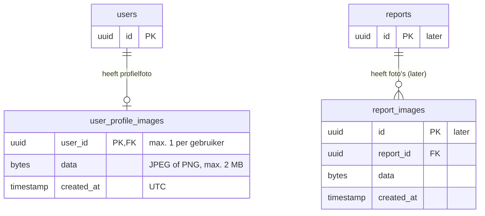

# Plan: afbeeldingen

Status: **profielfoto gebouwd** (fase 16 in `docs/implementation-plan.md`); foto's bij reports volgen later. Dit
bestand is het ontwerp; de stappen staan in [06-roadmap-afbeeldingen.md](06-roadmap-afbeeldingen.md). De
beslissingen staan, met hun alternatief, ook in de tabel "Images" van het implementatieplan.

Uitgangspunt: alleen de branch `Base`. Reports bestaan daar nog niet, dus eerst komt de **profielfoto**. De foto's
bij reports volgen pas als de feature reports er is ([05-domein-reports.md](05-domein-reports.md)).

---

## 1. De keuze in één zin

**Elke feature bewaart zijn eigen foto's; alleen de controle "is dit een geldige foto?" is gedeeld.**

Er komt dus **geen** centrale feature `images`, en geen "eerst uploaden, dan koppelen". Een foto hoort bij precies
één gebruiker of één report.

Waarom dit voor medestudenten het makkelijkst is:

1. **Eén verzoek per foto.** Je stuurt de foto naar `/users/{id}/profile-image`, en klaar.
2. **Geen nieuwe toegangsregels.** Wie de gebruiker mag wijzigen, mag ook zijn profielfoto wijzigen. Dat is
   dezelfde `getOwnerId` + `requireOwnerOrPermission` als bij `PATCH /users/{id}`.
3. **Klein gedeeld stuk.** In `shared/image/` staat één bestand: welke typen mogen (JPEG, PNG) en hoe groot een
   foto mag zijn.
4. **Het patroon komt twee keer terug.** De reportfoto's worden later bijna een kopie van de profielfoto.

Nadeel, bewust geaccepteerd: krijgt een derde feature ooit foto's, dan krijgt die ook een eigen tabel.

### Frontend en aannames

**Besloten:** de frontend is minimaal Android en mag multiplatform worden (bijvoorbeeld ook web of desktop).

Voor de server verandert dat niets. Foto's blijven achter de login, net als de rest van de API. Elke client haalt
een foto op met de header `Authorization: Bearer ...`. Op Android en desktop is dat gewoon een HTTP-verzoek. Een
webclient kan geen kale `` gebruiken, omdat die geen token meestuurt. Hij haalt de foto op met
`fetch` en toont hem via een blob-URL. Dat is werk voor de client, niet voor de server.

| Aanname (nog bevestigen) | Gevolg als het anders blijkt |
|---|---|
| Een report met foto's gaat in **twee verzoeken**: eerst het report, dan de foto's | Eén verzoek vraagt multipart; dat is lastiger uit te leggen |

---

## 2. Datamodel



- **Nieuwe tabel**, `users` verandert niet. Er is dus geen reset van `data/brul*` nodig.
- **`user_id` is de primaire sleutel.** Daardoor dwingt de database af dat elke gebruiker maximaal één
  profielfoto heeft. Een nieuwe foto **vervangt** de oude; er blijft geen oude foto achter.
- **Geen `content_type` en geen `size`.** Die volgen uit de bytes (zie §3).

---

## 3. Toets aan de normaalvormen

| Normaalvorm | Regel | Toepassing |
|---|---|---|
| **1NF** | Elke cel bevat één waarde | Eén rij per foto, geen lijst met foto's in één kolom |
| **2NF** | Bij een samengestelde sleutel hangt niets af van maar een deel ervan | Beide tabellen hebben een enkele sleutel (`user_id`, `id`), dus dat speelt hier niet |
| **3NF** | Een kolom hangt alleen af van de sleutel, niet van een andere kolom | `content_type` en `size` hangen af van `data`, dus die slaan we niet op |

Over `content_type`: het type staat in de eerste bytes van het bestand. PNG begint met `89 50 4E 47`, JPEG met
`FF D8 FF`. Er geldt `data → content_type`, en `data` is geen sleutel. Daarom berekent `ImageType.detect(bytes)`
het type, zowel bij het uploaden (controle) als bij het downloaden (header).

> **Voor het assessment:** wie `content_type` wél opslaat, moet dat verdedigen als bewuste denormalisatie.

---

## 4. Endpoints van de profielfoto

| Endpoint | Toegang | Antwoord |
|---|---|---|
| `PUT /api/v1/users/{id}/profile-image` | Eigenaar van het account, of `user.update` | 204 |
| `GET /api/v1/users/{id}/profile-image` | Elke ingelogde gebruiker | 200 met de foto, of 404 |
| `DELETE /api/v1/users/{id}/profile-image` | Eigenaar van het account, of `user.update` | 204, of 404 zonder foto |

- **De body is het bestand zelf** (raw body), met `Content-Type: image/jpeg` of `image/png`.
- **Alleen JPEG en PNG.** Gecontroleerd op de eerste bytes; de header vertrouwen we niet. **Geen SVG** (XSS-risico).
- **Maximaal 2 MB.** Verkleinen doet de app vóór het uploaden.
- **Geen nieuwe permissies.** De rechten van `user.update` gelden ook voor de foto.

### Foutcodes

| Situatie | Status | Code |
|---|---|---|
| Lege body, of geen JPEG/PNG | 400 | `INVALID_IMAGE_TYPE` |
| Groter dan 2 MB (al aan de header `Content-Length` te zien) | 400 | `IMAGE_TOO_LARGE` |
| Upload zonder header `Content-Length` | 400 | `INVALID_REQUEST` (bestaat al) |
| `PUT`/`DELETE` voor een gebruiker die niet bestaat | 404 | `USER_NOT_FOUND` (bestaat al) |
| Gebruiker heeft geen profielfoto; ook `GET` voor een onbekende gebruiker | 404 | `PROFILE_IMAGE_NOT_FOUND` |
| Geen of ongeldige token | 401 | bestaat al |
| Andermans foto wijzigen zonder `user.update` | 403 | bestaat al |

We gebruiken 400 en geen 413 voor een te grote foto, zodat er geen nieuwe `AppException` nodig is.

---

## 5. Code-indeling

```text
shared/image/
  ImageType.kt                   ← JPEG/PNG, contentType, MAX_BYTES + detect (companion), requireValidImage
  ImageRequest.kt                ← call.receiveImage(): leest de body, checkt eerst Content-Length
features/user/
  database/UserProfileImagesTable.kt
  model/ProfileImage.kt          ← userId, data, createdAt (gewone class, geen data class)
  mapper/ProfileImageDatabaseMapper.kt, ProfileImageMapper.kt ← row → model; model → Content-Type
  repository/ProfileImageRepository.kt, ExposedProfileImageRepository.kt
  service/ProfileImageService.kt ← controleert de foto, zet createdAt
  route/ProfileImageRoutes.kt    ← de drie endpoints
test/
  shared/image/ImageTypeTest.kt
  features/user/FakeProfileImageRepository.kt, ProfileImageRepositoryTest.kt,
  ProfileImageServiceTest.kt, ProfileImageMapperTest.kt, ProfileImageRoutesTest.kt
```

Een eigen `ProfileImageService` houdt `UserService` klein. De route gebruikt `userService.getOwnerId(id)` voor de
toegangscheck, net als de andere user-routes. De `Content-Type` bij het downloaden komt uit een mapper
(`ProfileImage.contentType()`), omdat elke conversie in `mapper/` staat; zo blijft de route dun.

---

## 6. Roadmap

De volgorde van het werk, met een commit als checkpoint na elke stap, staat in
[06-roadmap-afbeeldingen.md](06-roadmap-afbeeldingen.md).

---

## 7. Valkuilen

1. **`ByteArray` in een data class.** `data class ProfileImage(..., val data: ByteArray)` vergelijkt arrays op
   *referentie*, niet op inhoud. **Opgelost:** `ProfileImage` is een gewone `class`, en de tests vergelijken met
   `assertContentEquals`.
2. **Kolomtype in Exposed:** `binary(name, length)` geeft een `ByteArray`, `blob(name)` een `ExposedBlob`.
   `binary` is makkelijker uit te leggen. **Gecontroleerd in checkpoint 3:** 2 MB past (er is een test voor).
3. **Geen `upsert` op een `binary`-kolom.** Gevonden in checkpoint 3: op H2 komt elke byte boven `7F` terug als
   `EF BF BD` (het UTF-8-teken voor "onbekend"). Vervangen gaat daarom met `deleteWhere` + `insert` in één
   transactie. Staat ook in `docs/guide/llm-context.md` §9.
4. **De grootte van de body begrenzen in Ktor 3.** **Gecontroleerd in checkpoint 5:** Ktor 3.6 heeft hier geen
   ingebouwde plugin voor. `call.receiveImage()` (`shared/image/ImageRequest.kt`) controleert de header
   `Content-Length` vóór het lezen (zonder header: 400; boven 2 MB: `IMAGE_TOO_LARGE`), en de service
   controleert daarna de echte grootte nog eens. `receive<ByteArray>()` werkt naast de JSON-plugin, omdat die
   `ByteArray` overslaat.
5. **EXIF-gegevens** (onder andere de GPS-locatie in foto's) blijven in het bestand staan, tenzij de app ze
   weghaalt. Dat is een privacy-risico; we schrijven het op als beperking.
6. **Alleen het begin wordt gecontroleerd.** Een bestand dat met de JPEG-bytes begint en daarna onzin bevat, komt
   erdoor. Geen veiligheidsprobleem: de server opent of voert het bestand nooit uit, en stuurt het terug als
   `image/jpeg` of `image/png`. In het slechtste geval toont de app een kapot plaatje. De hele afbeelding
   decoderen (`ImageIO`) zou dat vangen, maar kost veel geheugen en is lastiger uit te leggen.

---

## 8. Open punten

| # | Punt | Voorstel |
|---|---|---|
| 1 | ~~Alleen Android, of ook een website?~~ | **Besloten:** minimaal Android, mag multiplatform (§1) |
| 2 | Een report met foto's in één of twee verzoeken? | Twee (aanname in §1) |
| 3 | Mag iedereen die ingelogd is een profielfoto zien? | Ja; het is een buurtapp |
| 4 | Foto van een gedeactiveerde gebruiker | Blijft staan; `GET` geeft hem gewoon terug |
| 5 | `hasProfileImage` in `UserResponse`? | Voorlopig niet (vraagt een extra query); de app probeert `GET` en krijgt 404 |
