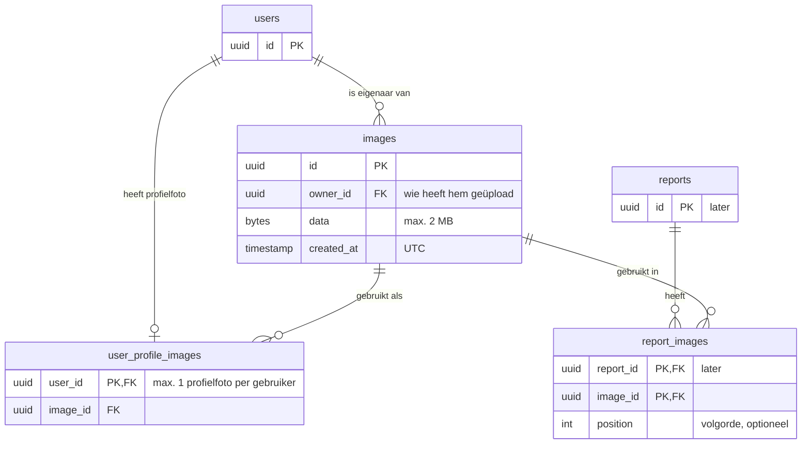

# Plan: afbeeldingen (concept)

Status: **brainstorm, nog niet gebouwd.** Sommige besluiten wachten op het domein van de feature *reports*, die
ook afbeeldingen gaat gebruiken.

---

## 1. Doel

- Gebruikers kunnen een **profielfoto** hebben.
- Later kan **reports** (en eventueel andere features) ook afbeeldingen gebruiken.
- Het datamodel voldoet aan de **derde normaalvorm (3NF)**.
- De code blijft simpel, beginnersvriendelijk en zonder nieuwe libraries.

---

## 2. Wat al besloten is

| Besluit | Keuze | Reden |
|---|---|---|
| Soort afbeeldingen | **Algemeen** (een eigen feature `image`), niet alleen een profielfoto | Profielfoto's én reports gebruiken afbeeldingen |
| Naam van de eigenaarskolom | `owner_id` / `ownerId` | Zelfde naam als in feedback en als de parameter van `requireOwnerOrPermission` |
| Toegangscheck | Eerst de eigenaar ophalen (`getOwnerId`), dan `requireOwnerOrPermission` | De regel die sinds fase 14 overal geldt |

---

## 3. Het idee

**Een afbeelding is een eigen ding met een eigenaar. Een feature die een afbeelding gebruikt, verwijst ernaar met
een eigen koppeltabel.**

De tabel `images` weet dus niet waar een afbeelding gebruikt wordt: geen kolom `kind`, geen `is_profile_photo`,
geen `report_id`.

---

## 4. Datamodel



- **Twee nieuwe tabellen** (`images`, `user_profile_images`), en `users` verandert niet. Er is dus **geen reset**
  van `data/brul*` nodig.
- **Geen kringverwijzing.** Een kolom `users.profile_image_id` zou dat wel geven: `images` → `users` → `images`.
- **`user_id` als primaire sleutel** in `user_profile_images`: maximaal één profielfoto per gebruiker, en dat dwingt
  de database zelf af.
- **Reports** krijgt later een eigen koppeltabel `report_images`, met meerdere foto's per report.

---

## 5. Toets aan de normaalvormen

| Normaalvorm | Regel | Toepassing |
|---|---|---|
| **1NF** | Elke cel bevat één waarde; geen herhalende groepen | Geen kolom `image_ids = "a,b,c"`; één rij per afbeelding of koppeling |
| **2NF** | Bij een samengestelde sleutel hangt niets af van maar een deel van die sleutel | In `report_images (report_id, image_id)` geen `content_type` (hangt alleen af van `image_id`). `position` mag wel: die hangt af van beide samen |
| **3NF** | Een kolom hangt alleen af van de sleutel, niet van een andere kolom | Geen `owner_email` in `images` (hangt af van `owner_id`). Geen `kind` of `is_profile_photo` (dat is een feit over de gebruiker of het report, niet over de afbeelding) |

### Het lastige geval: `content_type` en `size`

Deze volgen uit de bytes zelf:

- het type staat in de eerste bytes: PNG begint met `89 50 4E 47`, JPEG met `FF D8 FF`;
- de grootte is `data.size`.

Er geldt dus `data → content_type` en `data → size`, terwijl `data` geen sleutel is. Dat is een transitieve
afhankelijkheid, en die past niet in 3NF.

**Keuze:** we slaan ze **niet op**. Eén functie, bijvoorbeeld `ImageType.detect(bytes)`, controleert het type bij
het uploaden en bepaalt de `Content-Type`-header bij het downloaden.

> **Voor het assessment:** wie `content_type` wél opslaat, moet dat verdedigen als bewuste denormalisatie: één
> keer controleren in plaats van bij elke download.

---

## 6. Endpoints (eerste versie)

| Endpoint | Toegang | Antwoord |
|---|---|---|
| `POST /api/v1/images` | Elke ingelogde gebruiker; die wordt de eigenaar | 201 + `{ id, ownerId, contentType, createdAt }` |
| `GET /api/v1/images/{id}` | Eigenaar, of `image.read` | 200 + de bytes met de juiste `Content-Type` |
| `DELETE /api/v1/images/{id}` | Eigenaar, of `image.delete` | 204 |
| `PUT /api/v1/users/{id}/profile-image` | Eigenaar van het account, of `user.update`; body `{ "imageId": "..." }` | 204 |
| `GET /api/v1/users/{id}/profile-image` | Elke ingelogde gebruiker | 200 + de bytes, of 404 |

Regels:

- **Upload als raw body:** de body is het bestand zelf, met `Content-Type: image/jpeg` of `image/png`.
- **Alleen JPEG en PNG.** Dat wordt gecontroleerd op de eerste bytes; de header vertrouwen we niet. **Geen SVG**
  (XSS-risico).
- **Maximaal 2 MB**, anders 400.
- **Verkleinen** doet de Android-app voor het uploaden, niet de server.
- **Koppelen** mag alleen met een afbeelding van die gebruiker zelf, anders 400.
- **`contentType` in het antwoord** wordt door de mapper berekend, niet uit de database gelezen.
- **Elke feature bepaalt zelf** wie zijn afbeeldingen mag zien:
  - profielfoto via `/users/{id}/profile-image`;
  - reportfoto's later via `/reports/{id}/images/{imageId}`, met de toegangscheck van het report.

---

## 7. Code-indeling

```text
features/image/                        ← nieuw, volgens het patroon van feedback
  database/ImagesTable.kt
  model/Image.kt
  model/ImageType.kt                   ← JPEG/PNG + detect(bytes)
  repository/ImageRepository.kt, ExposedImageRepository.kt
  service/ImageService.kt              ← validatie, getOwnerId
  route/ImageRoutes.kt
  dto/ImageResponse.kt
  mapper/ImageMapper.kt
features/user/
  database/UserProfileImagesTable.kt   ← de profielfoto is een feit over de gebruiker
```

Nieuwe permissies in `Permission.kt`: `IMAGE_READ` en `IMAGE_DELETE`. ADMIN krijgt ze automatisch via
`Permission.entries`.

Koppelen in `Application.kt`, `Routing.kt`, `TestServices` en `configureTestApp`, plus een
`FakeImageRepository` voor de tests.

---

## 8. Valkuilen

1. **`ByteArray` in een data class.** `data class Image(..., val data: ByteArray)` vergelijkt arrays op
   *referentie*, niet op inhoud. `assertEquals` faalt dan, ook als de bytes hetzelfde zijn. Vergelijk in tests met
   `contentEquals`.
2. **Kolomtype in Exposed:** `binary(name, length)` geeft een `ByteArray`, `blob(name)` een `ExposedBlob`.
   `binary` is makkelijker uit te leggen. **Nog te controleren:** of H2 2 MB in zo'n kolom toestaat.
3. **Grootte van de body begrenzen in Ktor 3:** **nog te controleren** hoe dat precies gaat, voordat de hele body
   in het geheugen staat.
4. **`getOwnerId` laadt de hele afbeelding.** Voor kleine foto's is dat geen probleem; eventueel later een query
   die alleen `owner_id` leest.
5. **EXIF-gegevens** (onder andere de GPS-locatie in foto's) blijven in het bestand staan, tenzij de app ze
   weghaalt.

---

## 9. Open besluiten

| # | Besluit | Advies | Wacht op reports? |
|---|---|---|---|
| 1 | Wie mag een afbeelding zien? | De feature die hem gebruikt bepaalt dat; `/images/{id}` alleen voor de eigenaar of `image.read` | Ja: bevestigen |
| 2 | `content_type` opslaan of berekenen? | Berekenen (zuiver 3NF) | Nee |
| 3 | Afbeelding verwijderen die in gebruik is | Profielfoto: cascade (de koppeling verdwijnt). Reports: misschien blokkeren met 409, als foto's bewijs zijn | Ja |
| 4 | Oude profielfoto bij vervangen | Laten staan; de gebruiker kan hem zelf verwijderen. Opschrijven als beperking | Nee |
| 5 | `profileImageId` in `UserResponse`? | Voorlopig niet (dat vergt een join in de user-repository) | Nee |
| 6 | Mag één afbeelding op meerdere plekken gebruikt worden? | Liever niet ("een upload hoort bij één gebruik"), maar de database dwingt dat niet vanzelf af | Ja |
| 7 | EXIF-privacy | De app haalt het weg, of je accepteert het als beperking | Nee |

---

## 10. Vragen over het reports-domein

1. Wie maakt een report, en wie mag het zien? Alleen de maker, een admin, of een groep?
2. Hoeveel foto's per report? Is de volgorde belangrijk?
3. Mag een report of een foto later nog veranderen of verwijderd worden? Of moet het blijven staan, als een soort
   bewijs?
4. Wie voegt de foto's toe? Alleen de maker van het report, of ook anderen?

---

## 11. Volgende stappen

1. Het reports-domein bekijken en besluiten 1, 3 en 6 vastleggen.
2. De open punten controleren: `binary` in Exposed en H2 (2 MB), en de begrenzing van de body in Ktor 3.
3. Bouwen in deze volgorde: `image` (upload, ophalen, verwijderen), dan de profielfoto, daarna `report_images`
   samen met reports.
4. Tests voor 201, 200, 204, 400 (verkeerd type, te groot, andermans afbeelding), 401, 403 en 404.
5. Bijwerken: `openapi.yaml`, `TECHNICAL_DESIGN.md` (§3 datamodel, §4 permissies, §5 foutcodes, §6 endpoints),
   de beslissingentabel in `docs/implementation-plan.md` en `backend/http/`.
