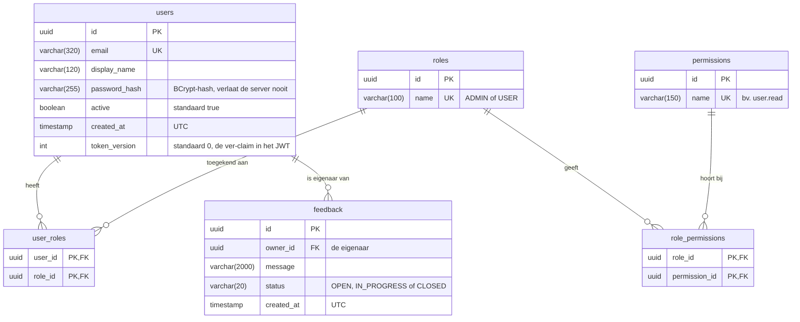
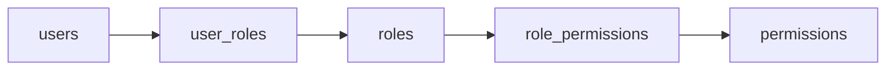

# Relationeel diagram (huidige database)

De database zoals hij nu in de code staat (na fase 14). De tabellen zijn gemaakt met Exposed in de `database/`-mappen
van de features. De officiële bron voor het datamodel is `TECHNICAL_DESIGN.md` §3; dit is een Nederlandse uitleg
erbij.

---

## 1. Diagram

**Legenda:** `PK` = primaire sleutel, `FK` = foreign key (verwijzing naar een andere tabel), `UK` = uniek.
`||--o{` betekent "één tegen nul of meer".

---

## 2. De tabellen

| Tabel | Wat staat erin | Code |
|---|---|---|
| `users` | De accounts | `features/user/database/UsersTable.kt` |
| `roles` | De rollen, aangemaakt bij het opstarten (`AuthorizationSeeder`) | `features/authorization/database/RolesTable.kt` |
| `permissions` | De permissies, aangemaakt bij het opstarten uit `enum class Permission` | `features/authorization/database/PermissionsTable.kt` |
| `user_roles` | Welke gebruiker welke rol heeft | `features/authorization/database/UserRolesTable.kt` |
| `role_permissions` | Welke rol welke permissie geeft | `features/authorization/database/RolePermissionsTable.kt` |
| `feedback` | Feedbackitems, elk van één eigenaar | `features/feedback/database/FeedbackTable.kt` |

---

## 3. De relaties

| Relatie | Soort | Hoe |
|---|---|---|
| Gebruiker ↔ rol | **veel-op-veel** | Koppeltabel `user_roles`. Een gebruiker kan meerdere rollen hebben, een rol meerdere gebruikers |
| Rol ↔ permissie | **veel-op-veel** | Koppeltabel `role_permissions` |
| Gebruiker → feedback | **één-op-veel** | `feedback.owner_id` verwijst naar `users.id` |

Er is **geen** directe koppeling tussen gebruiker en permissie. Permissies komen alleen via rollen:

---

## 4. Regels die je niet in het diagram ziet

- **Ids zijn UUID's** die de server maakt; de client stuurt nooit zelf een id mee bij het aanmaken.
- **Gebruikers worden nooit verwijderd**, alleen gedeactiveerd (`active = false`). Daarom is een foreign key naar
  `users` altijd veilig.
- **Feedback wordt wél echt verwijderd** (een "hard delete").
- **Elke gebruiker krijgt bij registratie de rol `USER`.** Dat regelt de code (`AuthenticationService`); de database
  zou ook een gebruiker zonder rol toestaan. Daarom staat er in het diagram "nul of meer".
- **Wie welke permissie heeft** (de permissiematrix) staat in de code: `DefaultRole.kt`. De seeder zet die bij elk
  opstarten in `roles` en `role_permissions`.
- **`email` is uniek** via een unique index. Dat is de laatste bewaking tegen dubbele registraties; botst het toch,
  dan wordt het 409 `EMAIL_ALREADY_REGISTERED`.
- **Het schema** wordt gemaakt met `SchemaUtils.create`. Dat maakt alleen ontbrekende tabellen aan. Verandert er
  een bestaande tabel, stop dan de server en verwijder `data/brul*`.

---

## 5. Toets aan 3NF

| Tabel | Oordeel | Waarom |
|---|---|---|
| `users` | ✅ 3NF | Alle kolommen hangen af van `id`. `email` is ook uniek (een kandidaatsleutel), dus dat is geen probleem |
| `roles`, `permissions` | ✅ 3NF | Alleen `id` en een unieke naam |
| `user_roles`, `role_permissions` | ✅ 3NF | Alleen de samengestelde sleutel, geen andere kolommen. Er kan dus niets van een deel van de sleutel afhangen (2NF) |
| `feedback` | ✅ 3NF | Geen gegevens van de eigenaar (zoals naam of e-mail) in de tabel, alleen `owner_id` |

---

## 6. Wat er straks bijkomt

Zie [03-plan-afbeeldingen.md](03-plan-afbeeldingen.md): de tabellen `images` en `user_profile_images`, en later
`reports` en `report_images`.
