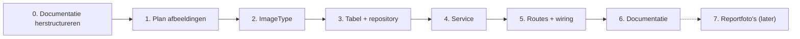

# Roadmap: afbeeldingen (profielfoto)

Het **waarom** (keuzes, datamodel, 3NF, endpoints, foutcodes) staat in
[03-plan-afbeeldingen.md](03-plan-afbeeldingen.md). Dit bestand is het **hoe**: de volgorde van het werk, met een
commit als checkpoint na elke stap.

Uitgangspunt: de branch `Base`. Reports bestaan daar nog niet, dus deze roadmap bouwt de **profielfoto**. Foto's
bij reports staan als vooruitblik onderaan.

---

## Zo gebruik je deze roadmap

1. Werk de checkpoints **in volgorde** af. Begin pas aan de volgende als de vorige gecommit is.
2. Een checkpoint is klaar als **alle vakjes** zijn afgevinkt en `kotlin.bat test` slaagt.
3. Commit dan **alleen** de bestanden van dat checkpoint, met het commitbericht dat erbij staat.
4. Werk in elk checkpoint ook de **README** bij van de map die je verandert (regel in
   `docs/guide/llm-context.md` §1).
5. Gaat iets anders dan gepland, schrijf het dan op in 03 (ontwerp) of hier (volgorde), niet alleen in de code.

| # | Checkpoint | Commitbericht |
|---|---|---|
| 0 | Documentatie herstructureren ✅ | `Restructure documentation: one job per document, a README per feature` |
| 1 | Plan afbeeldingen ✅ | `Plan profile images` |
| 2 | `ImageType` in `shared/image/` ✅ | `Add ImageType with JPEG/PNG detection and size check` |
| 3 | Tabel en repository (klaar, nog committen) | `Add user_profile_images table and repository` |
| 4 | Service | `Add ProfileImageService` |
| 5 | Routes en koppelen | `Add profile image endpoints` |
| 6 | Documentatie | `Document profile images` |
| 7 | Later: foto's bij reports | — |

---

## Checkpoint 0: documentatie herstructureren

**Doel:** elk soort document heeft één taak en elke uitleg staat op één plek, voordat er nieuwe code bijkomt. De
nieuwe feature volgt dan meteen de nieuwe regels.

Gedaan (fase 15 in `docs/implementation-plan.md`):

- [x] `README.md` (root) is het enige startpunt: opstarten, "Where to find what" (één bron per feit) en de
      mappenstructuur. `backend/README.md` en `docs/README.md` zijn opgegaan in de root-README
- [x] De korte READMEs in `config/`, `plugins/`, `features/` en `test/` zijn weg; de root-README beschrijft die mappen
- [x] Elke feature en `shared/` heeft een README die per bestand uitlegt wat de code doet, plus het verloop van één
      verzoek
- [x] Gids van 15 naar 10 hoofdstukken; de quiz is gebleven, met koppen per hoofdstuk
- [x] Gids-hoofdstuk 13 (ontwerpkeuzes) is de kolom *Alternative* in de beslissingentabellen van het implementatieplan
- [x] `TECHNICAL_DESIGN.md` somt alleen op: architectuur en datamodel als Mermaid, de PlantUML is weg
- [x] De regels in `docs/guide/llm-context.md` §1 en §10, en in `CLAUDE.md` (alleen `conversatie/` is Nederlands)

Klaar als:

- [ ] Je hebt de root-README, de gids-README en de README van `feedback` doorgelezen en vindt ze duidelijk
- [ ] `kotlin.bat test` slaagt (er is geen code veranderd, alleen documentatie)

**Commit:** `Restructure documentation: one job per document, a README per feature` (samen met checkpoint 1
gecommit als `docs restructure`)

---

## Checkpoint 1: plan afbeeldingen

**Doel:** het ontwerp staat op papier, voordat er code komt.

Gedaan:

- [x] `conversatie/03-plan-afbeeldingen.md`: het ontwerp
- [x] `conversatie/05-domein-reports.md`: het reports-domein
- [x] `conversatie/06-roadmap-afbeeldingen.md`: deze roadmap

Klaar als:

- [ ] Je hebt 03 en 06 doorgelezen en bent het eens met de keuzes

**Commit:** `Plan profile images`

---

## Checkpoint 2: `ImageType` in `shared/image/`

**Doel:** één plek die zegt of bytes een geldige foto zijn. Pure Kotlin, zonder Ktor en zonder database, dus
makkelijk te testen.

Beginnersvriendelijk: een `when` en een `for`-lus. `detect` staat in een `companion object`, net als
`Permission.fromKey`: een functie die bij het type hoort en de juiste enum-waarde zoekt.

Nieuw:

- [x] `backend/src/shared/image/ImageType.kt`
  - [x] `enum class ImageType(val contentType: String)` met `JPEG("image/jpeg")` en `PNG("image/png")`
  - [x] `ImageType.MAX_BYTES = 2 * 1024 * 1024` (in het `companion object`)
  - [x] `ImageType.detect(bytes): ImageType?` (in het `companion object`): herkent JPEG (`FF D8 FF`) en PNG (`89` + de letters `PNG`) aan de
        eerste bytes, anders `null`
  - [x] `requireValidImage(bytes): ImageType`: gooit `AppException.BadRequest` met code `IMAGE_TOO_LARGE` (groter
        dan 2 MB) of `INVALID_IMAGE_TYPE` (leeg of geen JPEG/PNG)
- [x] `backend/test/shared/image/ImageTypeTest.kt` (5 tests)

Tests:

- [x] JPEG en PNG worden herkend
- [x] Tekst, een GIF, lege bytes en te korte bytes geven `null`
- [x] Precies 2 MB mag; 2 MB + 1 byte geeft `IMAGE_TOO_LARGE`
- [x] Geen afbeelding geeft `INVALID_IMAGE_TYPE`

README:

- [x] `image/ImageType.kt` toegevoegd aan `backend/src/shared/README.md`

Klaar als:

- [x] `kotlin.bat test` slaagt (137 tests)

**Commit:** `Add ImageType with JPEG/PNG detection and size check`

---

## Checkpoint 3: tabel en repository

**Doel:** de profielfoto kan worden opgeslagen, opgehaald, vervangen en verwijderd.

Nieuw in `backend/src/features/user/`:

- [x] `database/UserProfileImagesTable.kt`: `user_id` (primaire sleutel, verwijst naar `users`), `data`
      (`binary`, max. `ImageType.MAX_BYTES`), `created_at`
- [x] `model/ProfileImage.kt`: `userId`, `data`, `createdAt`; een **gewone class**, geen data class (valkuil 1)
- [x] `mapper/ProfileImageDatabaseMapper.kt`: `ResultRow.toProfileImage()`
- [x] `repository/ProfileImageRepository.kt`: `save(image)`, `findByUserId(userId)`, `delete(userId): Boolean`
- [x] `repository/ExposedProfileImageRepository.kt`: `save` vervangt met `deleteWhere` + `insert` in één
      transactie, **niet** met `upsert` (valkuil 3)

Gewijzigd:

- [x] `backend/src/config/DatabaseFactory.kt`: `UserProfileImagesTable` in `SchemaUtils.create`

Eerst controleren:

- [x] Past een foto van 2 MB in de `binary`-kolom van H2? **Ja.**
- [x] Onverwacht gevonden: `upsert` beschadigt binaire data op H2. Opgeschreven in 03 en in `llm-context.md` §9

Tests in `backend/test/features/user/ProfileImageRepositoryTest.kt` (H2 in het geheugen):

- [x] Opslaan en ophalen geeft dezelfde bytes (`assertContentEquals`)
- [x] Een tweede `save` vervangt de eerste
- [x] `findByUserId` zonder foto geeft `null`
- [x] `delete` geeft `true`, daarna `false`
- [x] Een foto van 2 MB past

README:

- [x] Een blok "Profile image" in `backend/src/features/user/README.md`

Klaar als:

- [x] `kotlin.bat test` slaagt (142 tests)
- [x] Geen reset van `data/brul*` nodig (alleen een nieuwe tabel)

**Commit:** `Add user_profile_images table and repository`

---

## Checkpoint 4: service

**Doel:** de regels voor de profielfoto staan in één service.

Nieuw:

- [ ] `backend/src/features/user/service/ProfileImageService.kt`
  - [ ] `upload(userId, bytes)`: roept `requireValidImage` aan, zet `createdAt`
        (`Instant.now().truncatedTo(ChronoUnit.SECONDS)`), slaat op
  - [ ] `get(userId): ProfileImage`: 404 `PROFILE_IMAGE_NOT_FOUND` zonder foto
  - [ ] `delete(userId)`: 404 `PROFILE_IMAGE_NOT_FOUND` zonder foto
- [ ] `backend/test/features/user/FakeProfileImageRepository.kt`: een map met `userId` als sleutel; `save`
      vervangt, net als de echte versie
- [ ] `backend/test/features/user/ProfileImageServiceTest.kt`

Tests:

- [ ] Uploaden en ophalen van een JPEG en een PNG
- [ ] Een nieuwe upload vervangt de oude
- [ ] Verkeerd type en te groot geven 400 met de juiste code
- [ ] Ophalen en verwijderen zonder foto geven 404

README:

- [ ] `ProfileImageService` in `backend/src/features/user/README.md`

Klaar als:

- [ ] `kotlin.bat test` slaagt

**Commit:** `Add ProfileImageService`

---

## Checkpoint 5: routes en koppelen

**Doel:** de app kan de profielfoto uploaden, ophalen en verwijderen.

Nieuw:

- [ ] `backend/src/features/user/route/ProfileImageRoutes.kt`, binnen `authenticate(JWT_AUTHENTICATION)`:
  - [ ] `PUT /users/{id}/profile-image`: `getOwnerId` + `requireOwnerOrPermission(..., Permission.USER_UPDATE)`,
        body lezen als `ByteArray`, `upload`, 204
  - [ ] `GET /users/{id}/profile-image`: `getOwnerId` (404 voor een onbekende gebruiker), foto ophalen,
        antwoorden met de bytes en de `Content-Type` van `ImageType`
  - [ ] `DELETE /users/{id}/profile-image`: zelfde toegangscheck als `PUT`, `delete`, 204

Eerst controleren (valkuil 3 in 03):

- [ ] Hoe begrens je in Ktor 3 de grootte vóór de hele body in het geheugen staat? Eerste idee: `Content-Length`
      controleren vóór het lezen. Schrijf de gekozen oplossing op in 03.

Koppelen (vier plekken):

- [ ] `backend/src/Application.kt`: `ExposedProfileImageRepository` en `ProfileImageService` maken
- [ ] `backend/src/plugins/Routing.kt`: `profileImageService` als parameter, `profileImageRoutes(...)` aanroepen
- [ ] `backend/test/TestFixtures.kt`: `TestServices` krijgt de fake repository en de service
- [ ] `backend/test/TestFixtures.kt`: `configureTestApp` geeft de service door

Tests in `backend/test/features/user/ProfileImageRoutesTest.kt`:

- [ ] 204 bij uploaden van de eigen foto; daarna 200 met dezelfde bytes en `Content-Type: image/png`
- [ ] Een andere ingelogde gebruiker kan de foto zien (200)
- [ ] 204 bij verwijderen; daarna 404 `PROFILE_IMAGE_NOT_FOUND`
- [ ] 400 `INVALID_IMAGE_TYPE` en 400 `IMAGE_TOO_LARGE`
- [ ] 401 zonder token
- [ ] 403 bij andermans foto wijzigen of verwijderen; een admin mag het wel
- [ ] 404 `USER_NOT_FOUND` voor een onbekende gebruiker

README:

- [ ] De routes en het verloop van een upload in `backend/src/features/user/README.md`

Klaar als:

- [ ] `kotlin.bat test` slaagt
- [ ] De server start (`kotlin.bat run`) en de nieuwe tabel bestaat

**Commit:** `Add profile image endpoints`

---

## Checkpoint 6: documentatie

**Doel:** elk feit staat in zijn eigen bron ("Where to find what" in de root-`README.md`).

- [ ] `backend/resources/openapi/openapi.yaml`: de drie endpoints, met `image/jpeg` en `image/png` als body en
      antwoord
- [ ] `TECHNICAL_DESIGN.md` §3 datamodel: `user_profile_images`
- [ ] `TECHNICAL_DESIGN.md` §5 foutcodes: `INVALID_IMAGE_TYPE`, `IMAGE_TOO_LARGE`, `PROFILE_IMAGE_NOT_FOUND`
- [ ] `TECHNICAL_DESIGN.md` §6 endpoints: de drie endpoints met hun toegang
- [ ] `docs/implementation-plan.md`: besluit "Images per feature" in de tabel, fase 15 en de status bijwerken
- [ ] `backend/http/`: een nieuw request-bestand met een kleine testfoto; tokens hergebruiken (rate limit)
- [ ] `docs/guide/llm-context.md` §9: alleen de valkuilen die echt tijd kostten, bijvoorbeeld `ByteArray` in een
      data class
- [ ] Controleren of `backend/src/features/user/README.md` en `backend/src/shared/README.md` nog kloppen

Klaar als:

- [ ] De `.http`-requests werken tegen de draaiende server
- [ ] `kotlin.bat test` slaagt

**Commit:** `Document profile images`

---

## Checkpoint 7 (later): foto's bij reports

Pas als de feature reports op `Base` staat. Dit wordt dan een eigen roadmap met eigen checkpoints. Hetzelfde
patroon als de profielfoto, met deze verschillen:

- Tabel `report_images` met een eigen `id`, omdat een report meerdere foto's kan hebben.
- `POST /reports/{id}/images` (201), `GET` en `DELETE /reports/{id}/images/{imageId}`.
- De toegang volgt het report: de eigenaar of `report.update`.
- Verwijder je een report, dan verdwijnen zijn foto's mee (cascade).
- `ImageType` uit `shared/image/` wordt hergebruikt; er komt geen nieuwe controle.
- Open punt: het maximum aantal foto's per report (voorstel 5, daarboven 409).
