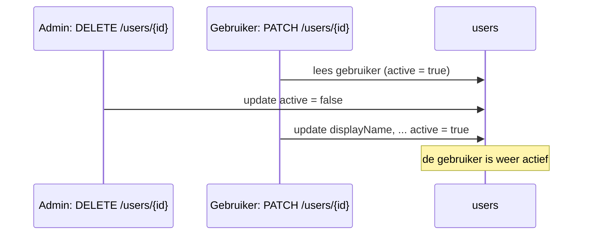

# Projectreview na fase 16 (profielfoto's)

Datum: 2026-11-16. Branch `Base`, 158 tests groen.

Een rondgang door de hele backend vóór we aan `reports` beginnen: **fouten en kleine verbeteringen in de code**.
Het fundament is sterk: lagen worden overal netjes gerespecteerd, elke beslissing staat in
`docs/implementation-plan.md`, en de bekende valkuilen (Exposed-retries, `upsert` op binaire data, `LIKE`-escaping)
zijn al opgelost. Niets hiervan is een grote verbouwing. De volgorde van het werk staat in
[02-roadmap-hardening.md](02-roadmap-hardening.md).

---

## A. Echte fouten

### A1. De rate limit is één emmer voor iedereen

`plugins/RateLimiting.kt` geeft geen `requestKey` op. In de broncode van Ktor 3.6 is de standaard
`requestKey = { }`: **alle clients delen samen 10 logins per minuut** (en alle gebruikers samen 5
wachtwoordwijzigingen).

Gevolg: één persoon (of een klas die tegelijk test) blokkeert het inloggen voor iedereen. Dat is precies het
omgekeerde van wat de limiet moet doen.

Oplossing (twee regels per limiter):

```kotlin
register(AUTHENTICATION_RATE_LIMIT) {
    rateLimiter(limit = 10, refillPeriod = 1.minutes)
    requestKey { call -> call.request.origin.remoteHost }
}
```

Voor `PASSWORD_CHANGE_RATE_LIMIT` kan de sleutel ook het user-id uit de token zijn. Kanttekening: achter een proxy is
`remoteHost` het adres van de proxy; voor dit project is dat geen probleem.

### A2. `update(user)` schrijft álle kolommen terug (lost update)

`ExposedUserRepository.update` schrijft `email`, `displayName`, `passwordHash` én `active`, ook als alleen de naam
verandert. De service leest de gebruiker eerst, past één veld aan en schrijft alles terug. Twee verzoeken tegelijk
kunnen elkaars wijziging zo ongedaan maken:



Hetzelfde kan met `passwordHash`: een naamwijziging tegelijk met een wachtwoordwijziging zet de oude hash terug.
Het venster is klein, maar het gaat om beveiligingsvelden. `FeedbackRepository.update` heeft hetzelfde patroon
(`message` en `status`): een statuswijziging door een admin kan verdwijnen als de eigenaar tegelijk de tekst aanpast.

Oplossing: kleine, gerichte repository-functies die alleen hun eigen kolom schrijven:

| Nu | Voorstel |
|---|---|
| `UserRepository.update(user)` | `updateDisplayName(id, name)`, `updatePasswordHash(id, hash)`, `setActive(id, active)` |
| `FeedbackRepository.update(feedback)` | `updateMessage(id, message)`, `updateStatus(id, status)` |

Elke functie is één `UPDATE ... SET kolom = ? WHERE id = ?`, makkelijker uit te leggen dan "lees, kopieer, schrijf
alles". De fakes worden ook eenvoudiger. **Belangrijkste reden om het nú te doen:** `feedback` is de
referentie-feature. Reports kopieert dit patroon; dan erft het de fout.

### A3. Een verkeerde of ontbrekende `Content-Type` geeft 500

Nagelopen met een tijdelijke test tegen `configureTestApp`:

| Verzoek | Nu | Hoort |
|---|---|---|
| `POST /auth/login` met JSON-body, **zonder** `Content-Type` | 500 `INTERNAL_ERROR` + stacktrace in de log | 415 of 400 |
| `POST /auth/login` met `Content-Type: text/plain` | 500 `INTERNAL_ERROR` + stacktrace | 415 of 400 |
| `PUT /health` (verkeerde methode) | 405 met **lege** body | 405 met `{ code, message }` |
| JSON met een onbekend veld | 400 `INVALID_REQUEST` | in orde (zie C) |

Oorzaak: Ktor gooit dan een `CannotTransformContentToTypeException` (een `ContentTransformationException`), geen
`BadRequestException`. `StatusPages` vangt hem met `exception<Throwable>` en maakt er 500 van. De Android-ontwikkelaar
krijgt zo "server kapot" voor een fout aan zijn eigen kant, die hij makkelijk maakt.

Oplossing in `plugins/StatusPages.kt`:

- `exception<ContentTransformationException>` → 415 `UNSUPPORTED_MEDIA_TYPE`, met de melding
  "Content-Type must be application/json";
- `status(HttpStatusCode.MethodNotAllowed)` → 405 `METHOD_NOT_ALLOWED`, zodat elke fout dezelfde vorm heeft.

Plus twee tests in `StatusPagesTest`.

### A4. Het jaartal in de log klopt rond nieuwjaar niet

`resources/logback.xml` gebruikt `%d{YYYY-MM-dd ...}`. Hoofdletter `YYYY` is het **weekjaar**, niet het kalenderjaar.
Op bijvoorbeeld 28–31 december 2026 schrijft de log al `2027-12-28`. Oplossing: `yyyy`. Eén teken, maar een klassieke
valkuil die je in de beoordeling kunt noemen.

---

## B. Kleine verbeteringen

| # | Wat | Waarom | Moeite |
|---|---|---|---|
| B1 | `AppConfig.load()` weigert een `JWT_SECRET` korter dan 32 tekens (`error(...)` bij het opstarten) | HMAC256 is pas sterk met een sleutel van minstens 256 bits; nu start de server ook met `JWT_SECRET=a` | 3 regels |
| B2 | De regel voor de weergavenaam (1–120 tekens, zelfde melding) staat twee keer: `AuthenticationService.register` en `UserService.updateDisplayName` | Eén bron, zoals `MAX_MESSAGE_LENGTH` bij feedback; bijv. een `validDisplayName()` die `UserService` deelt, of een constante bij `User` | klein |
| B3 | `llm-context.md` §4 zegt "elke beveiligde route begint met precies één toegangscontrole", maar `GET /users/me`, `POST /feedback` en `GET .../profile-image` hebben er bewust geen | Een AI-assistent van een medestudent volgt de regel letterlijk. Formuleer het als: "één controle, of een commentaar dat de route open is voor elke ingelogde gebruiker" | tekst |
| B4 | `register` slaat de gebruiker op en kent daarna in aparte transacties de rollen toe | Mislukt de rol-toekenning, dan bestaat er een gebruiker zonder rol. USER heeft geen permissies, dus het risico is klein. Opschrijven als bewuste trade-off is genoeg | tekst |

---

## C. Bewust zo laten (wel kunnen verdedigen)

- **Twee keer lezen per verzoek** (`getOwnerId` en daarna `getById`). Iets trager, maar één vaste volgorde is
  makkelijker te leren.
- **Services geven DTO's terug** en **blokkerende JDBC- en BCrypt-aanroepen**: zie 03 (L4 en S6).
- **Token van 1 uur zonder refresh token.** Staat al onder "Out of scope". Voor de Android-app betekent het elk uur
  opnieuw inloggen; een configureerbare `JWT_EXPIRES_IN` is de simpelste tussenstap als dat gaat irriteren.
- **Profielfoto van een gedeactiveerde gebruiker blijft zichtbaar.** Prima, maar zet het als één regel bij de
  beslissingen.
- **Onbekende JSON-velden geven 400** (de standaard van kotlinx.serialization). Streng, en het vangt typfouten in
  veldnamen. Nadeel: stuurt een nieuwere app een veld mee dat de server nog niet kent, dan faalt het verzoek. Laat
  het zo, en schrijf het als beslissing op (alternatief: `ignoreUnknownKeys = true`).
- **Nagelopen en in orde:** `openapi.yaml` dekt precies de routes die bestaan; de log bevat geen headers, bodies of
  query strings; de `.http`-bestanden sturen overal een `Content-Type` mee.
