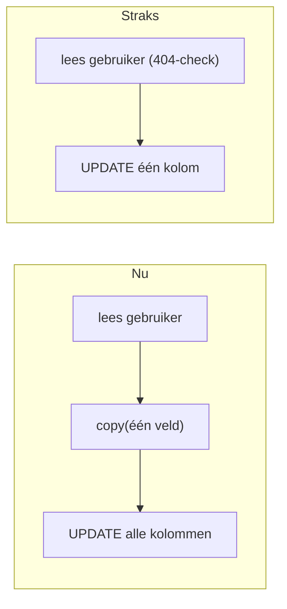

# Roadmap: hardening van de Base (fase 17)

Het **waarom** staat in [01-projectreview.md](01-projectreview.md) (fouten),
[03-leesbaarheid-en-schaalbaarheid.md](03-leesbaarheid-en-schaalbaarheid.md) (leesbaarheid en schaalbaarheid) en
[04-toets-aan-stof-en-criteria.md](04-toets-aan-stof-en-criteria.md) (wat de beoordeling vraagt). Dit bestand is
het **hoe**: de volgorde van het werk, met een commit als checkpoint na elke stap.

Uitgangspunt: de branch `Base`, 158 tests groen. Er verandert **geen tabel**, dus `data/brul*` hoeft nergens weg.
Na deze roadmap begint reports (`conversatie/reports/`).

**Waarom "hardening" en niet "refactor".** Een refactor verandert de structuur zonder het gedrag te veranderen. Dat
geldt hier alleen voor checkpoint 3, 4 en 6. Checkpoint 1, 2 en 5 herstellen fouten (ander gedrag), 7, 8 en 9 zijn
documentatie. *Hardening* (de Base verstevigen) dekt het geheel: de basis betrouwbaar, veilig en goed uit te leggen
maken voordat er grote features bijkomen. Het voorvoegsel `Hardening:` maakt de fase herkenbaar in `git log`.

---

## Zo gebruik je deze roadmap

1. Werk de checkpoints **in volgorde** af. Begin pas aan de volgende als de vorige gecommit is.
2. Een checkpoint is klaar als **alle vakjes** zijn afgevinkt en `kotlin.bat test` slaagt.
3. Commit dan **alleen** de bestanden van dat checkpoint, met het commitbericht dat erbij staat.
4. Werk in elk checkpoint ook de **README** bij van de map die je verandert (regel in
   `docs/guide/llm-context.md` §1).
5. Elke keuze krijgt een rij in de beslissingentabel van `docs/implementation-plan.md` (beslissing, alternatief,
   reden), zodat je hem bij de beoordeling kunt verdedigen.
6. Speelde AI een echte rol (een gevonden fout, een verworpen advies)? Eén regel in het logboek van
   `docs/ai-usage.md`.
7. Gaat iets anders dan gepland, schrijf het dan op in 01 (waarom) of hier (volgorde), niet alleen in de code.

```mermaid
flowchart LR
    C0["0. Review + plan"] --> C1["1. Rate limit per client"]
    C1 --> C2["2. Foutafhandeling + log"]
    C2 --> C3["3. Gerichte updates: user"]
    C3 --> C4["4. Gerichte updates: feedback"]
    C4 --> C5["5. Kleine verbeteringen"]
    C5 --> C6["6. AppServices"]
    C6 --> C7["7. Diagrammen per feature"]
    C7 --> C8["8. Testrapport + AI-log"]
    C8 --> C9["9. Documentatie fase 17"]
    C9 -.-> R["Daarna: reports"]
```

| # | Checkpoint | Commitbericht | Ook voor een teamgenoot? |
|---|---|---|---|
| 0 | Review en plan | `Hardening: review the base and plan phase 17` | — |
| 1 | Rate limit per client | `Hardening: rate limit per client instead of one shared bucket` | — |
| 2 | Foutafhandeling van Ktor en het jaartal in de log | `Hardening: return 415 and 405 as error responses, fix log year` | — |
| 3 | Gerichte updates in `user` | `Hardening: update single user columns instead of the whole row` | — |
| 4 | Gerichte updates in `feedback` | `Hardening: update single feedback columns, not the whole row` | — |
| 5 | Kleine verbeteringen | `Hardening: check JWT secret, share limits and user-exists check` | — |
| 6 | Services op één plek gebouwd (`AppServices`) | `Hardening: build services once and share the wiring with tests` | — |
| 7 | Diagrammen per feature, vaste README-indeling | `Hardening: add class and sequence diagrams per feature` | **Ja**: use case-diagram, user stories |
| 8 | Testrapport en AI-logboek afmaken | `Hardening: add test report, complete AI usage log` | **Ja**: testrapport |
| 9 | Documentatie fase 17 | `Hardening: document phase 17` | — |

---

## Checkpoint 0: review en plan

**Doel:** de bevindingen en de volgorde staan op papier, voordat er code verandert.

Gedaan:

- [x] `conversatie/` ingedeeld in mappen, elk met een `README.md`: `basis/` (uitleg van het project),
      `images/` (afbeeldingen, klaar), `hardening/` (dit werk), `reports/` (volgende stap)
- [x] `basis/03-relationeel-diagram.md` en `basis/01-projectuitleg-voor-beginners.md` bijgewerkt tot fase 16;
      `images/` afgerond (open punten besloten, foto's bij reports verplaatst naar `reports/`)
- [x] `conversatie/hardening/`: `README.md`, 01 (review), 02 (deze roadmap), 03 (leesbaarheid en schaalbaarheid),
      04 (toets aan stof en criteria), 05 (stand van zaken en open beslissingen)
- [x] `conversatie/reports/02-advies-uit-hardening.md`: het advies voor reports uit deze review
- [x] `docs/ai-usage.md` (verantwoording AI-gebruik) en de regel in de tabel *Where to find what* van het root-README

Klaar als:

- [x] Je hebt 01, 03 en 04 gelezen en bent het eens met de punten, of je hebt geschrapt wat je niet wilt
- [x] `kotlin.bat test` slaagt (er is geen code veranderd)

**Commit:** `Hardening: review the base and plan phase 17`

---

## Checkpoint 1: rate limit per client

**Doel:** elke client krijgt een eigen emmer. Nu delen alle clients samen 10 logins per minuut (standaard
`requestKey = { }` in Ktor 3.6), zodat één persoon het inloggen voor iedereen blokkeert (01, A1).

Bestanden: `backend/src/plugins/RateLimiting.kt`, `backend/test/features/authentication/AuthenticationRoutesTest.kt`.

- [x] `AUTHENTICATION_RATE_LIMIT`: `requestKey { call -> call.request.origin.remoteHost }`
      (import `io.ktor.server.plugins.origin`)
- [x] `PASSWORD_CHANGE_RATE_LIMIT`: sleutel op de gebruiker uit de token (`call.principal<JWTPrincipal>()?.subject`),
      met `remoteHost` als terugval. Deze limiter zit binnen `authenticate`, dus de token is er al
- [x] KDoc boven de limiters: *waarom* een sleutel nodig is (anders één gedeelde emmer)
- [x] De bestaande tests voor 429 slagen nog (de test host gebruikt steeds hetzelfde adres); 159 tests groen
- [x] Nieuwe test: na 5 wachtwoordwijzigingen van gebruiker A kan gebruiker B nog steeds zijn wachtwoord wijzigen
- [x] `docs/guide/04-security.md`: "10 per minuut" wordt "10 per minuut per client"
- [x] `docs/guide/llm-context.md` §9 (*Manual testing*): idem
- [x] Ook bijgewerkt (zelfde feit): `TECHNICAL_DESIGN.md` (security), `openapi.yaml` (wachtwoord wijzigen),
      `docs/guide/01-getting-started.md`, de beslissingentabel *Security* en `docs/ai-usage.md`

Uit te leggen: wat is een *request key*, en waarom is `remoteHost` achter een proxy het adres van de proxy?

**Commit:** `Hardening: rate limit per client instead of one shared bucket`

---

## Checkpoint 2: foutafhandeling van Ktor en het jaartal in de log

**Doel:** elke fout heeft de vorm `{ code, message }` en de juiste status; geen 500 voor een fout van de client
(01, A3 en A4).

Bestanden: `backend/src/plugins/StatusPages.kt`, `backend/resources/logback.xml`,
`backend/test/plugins/StatusPagesTest.kt`.

- [x] `exception<ContentTransformationException>` → 415 `UNSUPPORTED_MEDIA_TYPE`,
      "Content-Type must be application/json". Zet hem **boven** `exception<Throwable>` en schrijf in een
      commentaar wanneer Ktor hem gooit (geen of een verkeerde `Content-Type`)
- [x] Controleer of `BadRequestException` (kapotte JSON, ontbrekend veld) nog steeds 400 geeft: Ktor kiest de
      handler van de meest specifieke klasse
- [x] `status(HttpStatusCode.MethodNotAllowed)` → 405 `METHOD_NOT_ALLOWED`, "Method not allowed"
- [x] Tests: login zonder `Content-Type` geeft 415, `text/plain` geeft 415, `PUT /health` geeft 405 met een
      foutcode, kapotte JSON geeft nog steeds 400
- [x] `logback.xml`: `YYYY` wordt `yyyy`
- [x] `TECHNICAL_DESIGN.md` en `openapi.yaml`: de nieuwe foutcodes `UNSUPPORTED_MEDIA_TYPE` en
      `METHOD_NOT_ALLOWED` in de lijst van foutcodes
- [x] `docs/guide/05-errors-and-database.md`: één zin bij de `StatusPages`-uitleg over 415 en 405
- [x] Tests staan in `StatusPagesTest` met een eigen `POST /json`-route en `PUT /crash`, zodat ze alleen de plugin
      testen. Ook gecorrigeerd: de gids zei dat `StatusPages` "de eerste passende handler" kiest; het is de meest
      specifieke klasse (`selectNearestParentClass` in de Ktor-bron). 163 tests groen

Uit te leggen: waarom een fout van de client nooit 500 mag zijn, en wat het verschil is tussen `yyyy` en `YYYY`.

**Commit:** `Hardening: return 415 and 405 as error responses, fix log year`

---

## Checkpoint 3: gerichte updates in `user`

**Doel:** elke wijziging schrijft alleen haar eigen kolom. Nu schrijft `update(user)` ook `passwordHash` en `active`
terug, zodat twee verzoeken tegelijk elkaars wijziging ongedaan kunnen maken (01, A2).

Bestanden: `features/user/repository/UserRepository.kt`, `ExposedUserRepository.kt`, `service/UserService.kt`,
`features/authentication/service/AuthenticationService.kt`, `test/features/user/FakeUserRepository.kt` en de tests.

- [x] `UserRepository`: `update(user)` vervangen door
  - [x] `updateDisplayName(id: UUID, displayName: String): Boolean`
  - [x] `updatePasswordHash(id: UUID, passwordHash: String): Boolean`
  - [x] `setActive(id: UUID, active: Boolean): Boolean`
- [x] `ExposedUserRepository`: elke functie is één `UsersTable.update({ UsersTable.id eq id }) { it[kolom] = waarde } > 0`
- [x] `email` krijgt geen update-functie: de API kan een e-mailadres niet wijzigen
- [x] `UserService.updateDisplayName`, `deactivate`, `reactivate` gebruiken de nieuwe functies. Ze lezen de gebruiker
      nog steeds eerst (`findUser`, voor de 404) en geven het resultaat terug met `copy(...)`
- [x] `AuthenticationService.changePassword` gebruikt `updatePasswordHash`
- [x] `FakeUserRepository`: dezelfde drie functies; elk past alleen haar eigen veld aan
- [x] `UserRepositoryTest` tegen H2: per functie een test dat **alleen** die kolom verandert
      (bijv. `updateDisplayName` laat `passwordHash` en `active` staan)
- [x] `features/user/README.md` en de KDoc van `UserRepository` bijgewerkt
- [x] Zoek naar `update(` in `backend/` en `docs/`: geen aanroep van de oude functie meer
- [x] Ook: de rij in de beslissingentabel *Architecture*, `docs/ai-usage.md`, en een `!!` weg uit
      `AuthenticationServiceTest` (nu `assertNotNull`). De gidsvoorbeelden volgen in checkpoint 4. 167 tests groen

Uit te leggen: waarom "lezen, kopiëren, alles terugschrijven" fout gaat bij twee verzoeken tegelijk, en waarom één
kolom per `UPDATE` dat oplost zonder transacties over meerdere functies.

**Commit:** `Hardening: update single user columns instead of the whole row`

---

## Checkpoint 4: gerichte updates in `feedback`

**Doel:** hetzelfde patroon in de referentie-feature, zodat reports het goede patroon kopieert. Nu kan een
statuswijziging verdwijnen als de eigenaar tegelijk de tekst aanpast.

Bestanden: `features/feedback/repository/*`, `service/FeedbackService.kt`,
`test/features/feedback/FakeFeedbackRepository.kt` en de tests.

- [ ] `FeedbackRepository`: `update(feedback)` vervangen door
  - [ ] `updateMessage(id: UUID, message: String): Boolean`
  - [ ] `updateStatus(id: UUID, status: FeedbackStatus): Boolean`
- [ ] `FeedbackService.updateMessage` en `updateStatus` gebruiken ze
- [ ] `FakeFeedbackRepository` past alleen het eigen veld aan
- [ ] `FeedbackRepositoryTest`: `updateMessage` laat de status staan en andersom
- [ ] `features/feedback/README.md` bijgewerkt
- [ ] **Gids** (`docs/guide/`), want die toont de oude code als voorbeeld:
  - [ ] `05-errors-and-database.md` (rond regel 179 en 193)
  - [ ] `02-kotlin-ktor-exposed.md` (rond regel 494, `UsersTable.update`)
  - [ ] `08-tutorial-categories.md`: heeft een categorie maar één veld dat verandert, dan mag `update` blijven;
        zet er één zin bij waarom
- [ ] `docs/guide/llm-context.md` §6/§8: de fake moet "fields that `update` never changes" bewaren; herschrijven naar
      de nieuwe functies, en in §9 een valkuil toevoegen: *schrijf alleen de kolom die verandert*

**Commit:** `Hardening: update single feedback columns, not the whole row`

---

## Checkpoint 5: kleine verbeteringen

**Doel:** de losse punten B1–B4 uit 01, plus L1 en S2 uit 03, in één opruimcommit.

- [ ] **B1** `AppConfig.load()`: `JWT_SECRET` korter dan 32 tekens geeft bij het opstarten
      `error("JWT_SECRET must contain at least 32 characters")`. De check staat in `load()`, niet in de
      constructor: tests bouwen `AppConfig` zelf (`testConfig()`, en `"a-different-secret"` in `JwtServiceTest`)
      en blijven dus werken
- [ ] `.env.example`: één regel commentaar dat het geheim minstens 32 tekens moet zijn
- [ ] **B2 + L1** Eén constante per grens in de `companion object` van het model (`User.MAX_DISPLAY_NAME_LENGTH`,
      `Feedback.MAX_MESSAGE_LENGTH`), gebruikt door de tabel **en** de service. De regel voor de weergavenaam staat
      dan op één plek, gedeeld door `AuthenticationService.register` en `UserService.updateDisplayName`
- [ ] Test: registreren met een lege naam en wijzigen naar een naam van 121 tekens geven allebei 400
- [ ] **S2** `UserService.requireExists(id)`; `RoleService` gebruikt die in plaats van `UserRepository`, zodat
      `USER_NOT_FOUND` op minder plekken staat. Regel in `llm-context.md` §3: een feature gebruikt van een andere
      feature de service, niet de repository (uitzondering: `authentication` en `AuthorizationService`, met reden)
- [ ] **B3** `docs/guide/llm-context.md` §4: "precies één toegangscontrole, *of* een commentaar dat de route open is
      voor elke ingelogde gebruiker" (`/users/me`, `POST /feedback`, `GET .../profile-image`)
- [ ] **B4** Rij in de beslissingentabel: registratie en roltoekenning zijn aparte transacties, met de reden
      (USER heeft geen permissies, het risico is klein)
- [ ] Rij in de beslissingentabel *Images*: de profielfoto van een gedeactiveerde gebruiker blijft zichtbaar
- [ ] Rij in de beslissingentabel *API design*: onbekende JSON-velden geven 400 (alternatief: `ignoreUnknownKeys`)

**Commit:** `Hardening: check JWT secret, share limits and user-exists check`

---

## Checkpoint 6: services op één plek gebouwd (`AppServices`)

**Doel:** de services worden één keer gebouwd en de tests gebruiken exact de echte bedrading (03, S1 en L2).

- [ ] `class AppServices(...)` bouwt alle services uit de repositories en de configuratie
- [ ] `fun Application.configureApp(services: AppServices)` installeert plugins en routes
- [ ] `module()` maakt de Exposed-repositories en roept `configureApp` aan; de standaardwaarde van `config` gaat weg
- [ ] Tests: `TestServices` geeft fake repositories aan `AppServices`; `configureTestApp` gebruikt `configureApp`
      (de tests krijgen daarmee ook CallLogging, net als de echte app)
- [ ] `configureRouting(services)` met één parameter
- [ ] `docs/guide/08-tutorial-categories.md` en `llm-context.md` §3 en §10: de nieuwe plekken om een feature te
      koppelen
- [ ] Beslissing bijwerken: in fase 13 werd een `Services`-houder afgewezen; schrijf op waarom het nu wel zinvol is
      (de testbedrading liep uiteen met de echte)
- [ ] Alle tests slagen zonder dat er een test inhoudelijk verandert

**Commit:** `Hardening: build services once and share the wiring with tests`

---

## Checkpoint 7: diagrammen per feature en een vaste README-indeling

**Doel:** de UML voor het ontwikkeldocument staat bij de code die hij beschrijft, in het Engels, en elke README heeft
dezelfde indeling (04 §5 en §9). Volgens "één bron per feit": een diagram van een feature hoort in de README van die
feature; alleen wat over meerdere features gaat, staat centraal.

**Vaste indeling van elke feature-README** (en `shared/README.md`):

| # | Kop | Inhoud |
|---|---|---|
| 1 | *(titel + inleiding)* | Wat de feature doet, in twee tot vier regels; verwijzing naar endpoints, permissies en foutcodes in `TECHNICAL_DESIGN.md` |
| 2 | `## Class diagram` | Mermaid `classDiagram` van **deze** feature: route, service, repository-interface met de Exposed-implementatie, model, DTO's. Laat de OO-relaties zien (interface ↔ implementatie, overerving, compositie) |
| 3 | `## Files` | De bestaande tabel: per bestand wat het doet |
| 4 | `## How a request flows` | Een Mermaid `sequenceDiagram` van één typisch verzoek, met de fouttakken (401/403/404). Vervangt de genummerde lijst; korte noten eronder mogen |
| 5 | `## Tests` | Welke testbestanden er zijn en wat elk test (unit, repository tegen H2, routes) |

Per README:

- [ ] `features/authentication/README.md`: klassen + **sequence 1: inloggen** (`AuthenticationService` →
      `UserRepository` → `PasswordHasher` → `JwtService`)
- [ ] `features/feedback/README.md`: klassen + **sequence 2: beveiligd verzoek met eigenaarscontrole**
      (`PATCH /feedback/{id}`: JWT `validate` met tokenversie → `getOwnerId` → `requireOwnerOrPermission` → service →
      repository). `## Copying it` blijft als zesde kop
- [ ] `features/user/README.md`: klassen (ook profielfoto) + **sequence 3: profielfoto uploaden**
      (`Content-Length` → `requireValidImage` → opslaan)
- [ ] `features/authorization/README.md`: klassen (`Permission`, `DefaultRole`, seeder, de twee services) +
      sequence van een permissiecontrole
- [ ] `shared/README.md`: klassen (`AppException`-hiërarchie als `sealed`, `Page`, `PageResponse<T>`, `ImageType`);
      geen sequence (niet nodig)
- [ ] `features/health/README.md`: blijft kort, geen diagrammen (één route)
- [ ] De regel voor READMEs in `docs/guide/llm-context.md` §1 beschrijft deze vaste indeling, zodat nieuwe features
      (reports) hem volgen

Centraal, in `TECHNICAL_DESIGN.md`:

- [ ] §2: het architectuurdiagram bijwerken tot een **packagediagram** van de features en hun afhankelijkheden. Het
      huidige diagram mist de profielfoto (`ProfileImageRoutes`, `ProfileImageService`) en is dus verouderd
- [ ] §2: een korte lijst *Class diagrams per feature* met links naar de READMEs, in plaats van een eigen kopie
- [ ] Tabel *Kotlin concepts in this project* (concept → bestand), uit 04 §9
- [ ] Geen gekunstelde code voor concepten die ontbreken; die komen met reports of in het individuele portfolio

Voor het ontwikkeldocument (buiten de backend-code), **geschikt voor een teamgenoot**:

- [ ] **Use case-diagram** voor de hele app (ook Android): draw.io of PlantUML, bron in `docs/`. De enige uitzondering
      op "diagrammen in Mermaid", omdat Mermaid geen echt use case-diagram kent
- [ ] **User stories** voor de hele app, in `docs/user-stories.md`
- [ ] Root-README, tabel *Where to find what*: use cases, user stories, en "class and sequence diagrams: the README
      of each feature"

Uit te leggen: waarom een klassendiagram bij de feature staat en het packagediagram centraal.

**Commit:** `Hardening: add class and sequence diagrams per feature`

---

## Checkpoint 8: testrapport en AI-logboek afmaken

**Doel:** de eis "testrapportage van alle relevante API-requests" krijgt een bron die met de code meegroeit, en het
AI-logboek is compleet (04 §6 en §7). **Geschikt voor een teamgenoot** (testrapport).

- [ ] `docs/test-report.md`: per endpoint de request, de verwachte status, het resultaat en welke test of welk
      `.http`-request het aantoont; bovenaan de samenvatting van `./kotlin test`
- [ ] Root-README, tabel *Where to find what*: `docs/test-report.md` toevoegen
- [ ] `docs/ai-usage.md`: de punten **(to confirm)** invullen (naam van de orchestrator, modellen van eerdere
      sessies, de Codex-sessies, het ChatGPT-gebruik voor de lesstof, en of de docent een vermelding in
      commitberichten wil). Weet je iets niet meer, haal de regel weg in plaats van te gokken
- [ ] `docs/ai-usage.md`: de regels van checkpoint 1 tot en met 7 in het logboek

**Commit:** `Hardening: add test report, complete AI usage log`

---

## Checkpoint 9: documentatie fase 17

**Doel:** de geschiedenis klopt en de volgende stap is duidelijk.

- [ ] `docs/implementation-plan.md`: **Phase 17 — Hardening** met per checkpoint één bullet en het nieuwe aantal
      tests; *Status* bijgewerkt (`Phases 1–17 are done`, next: reports)
- [ ] Beslissingentabellen: rate limit per client (alternatief: één emmer), 415 voor een verkeerde `Content-Type`
      (alternatief: 400), gerichte updates (alternatief: hele rij terugschrijven, of optimistic locking met een
      versiekolom)
- [ ] Beslissingentabellen, afwijkingen van de lesstof die nog niet beschreven zijn (04 §8): Exposed DSL in plaats
      van DAO, `java.time.Instant` in plaats van `kotlinx.datetime`
- [ ] *Out of scope*: de grenzen uit 03 (S5 foto's in de database, S6 blokkerende aanroepen, S7 één serverproces,
      S8 offset-paging), elk met wanneer je het wél zou doen
- [ ] `TECHNICAL_DESIGN.md` nagelopen: alleen de twee foutcodes uit checkpoint 2 zijn nieuw; geen endpoints of
      tabellen gewijzigd
- [ ] `backend/resources/openapi/openapi.yaml`: bij 429 "per client" in de beschrijving, als daar de limiet staat
- [ ] In deze roadmap alle checkpoints op ✅

**Commit:** `Hardening: document phase 17`

---

## Daarna: reports

Niet in deze roadmap. Alles staat klaar in `conversatie/reports/`: het domein (`01-domein-reports.md`) en het
advies en de open beslissingen uit deze review (`02-advies-uit-hardening.md`). Maak daar eerst een eigen roadmap.
