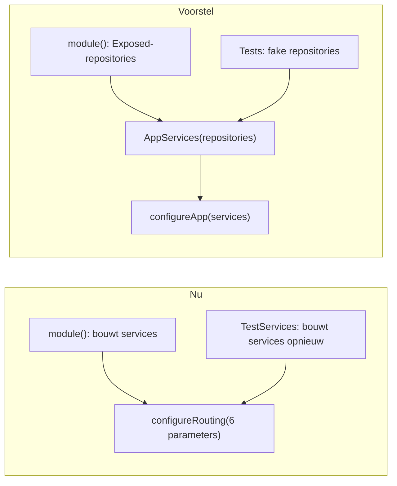
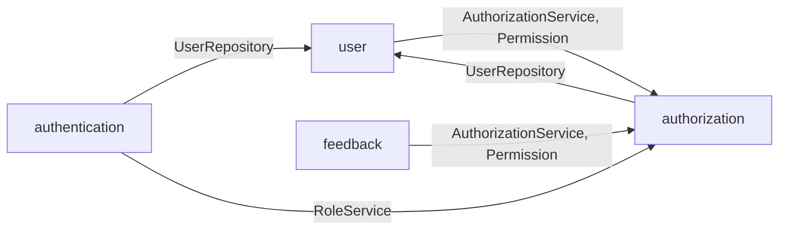

# Leesbaarheid en schaalbaarheid

Datum: 2026-11-16. Aanvulling op [01-projectreview.md](01-projectreview.md). Gemaakt met CodeGraph (index in
`.codegraph/`, staat in `.gitignore`), naast het lezen van de code.

01 ging over **fouten**. Dit bestand gaat over twee vragen:

- **Leesbaarheid (L):** kan een medestudent de code lezen en kun jij elke regel uitleggen?
- **Schaalbaarheid (S):** blijft het werkbaar als er features bij komen (reports, likes, vrijwilligers), en als er
  meer data en gebruikers komen?

"Schaalbaar" betekent hier vooral **schaalbaar in code**: hoeveel plekken je moet aanraken voor een nieuwe feature.
Schaalbaar in belasting (duizenden gebruikers) is voor dit project geen doel; die punten staan er om te kunnen
uitleggen *waar de grens ligt*.

Elk punt heeft: wat er nu is, de alternatieven, mijn aanbeveling en wanneer. Advies dat alleen over reports gaat
(maxima met tellen, indexen) staat in `conversatie/reports/02-advies-uit-hardening.md`.

---

## Overzicht

| # | Onderwerp | Aanbeveling | Wanneer |
|---|---|---|---|
| S1 | Bedrading op vijf plekken per feature | Eén `AppServices`-klasse en één `configureApp`, gedeeld met de tests | **Hardening** checkpoint 6 |
| S2 | Features gebruiken elkaars repository | Afhankelijkheidsregel opschrijven; `USER_NOT_FOUND` op één plek | **Hardening** checkpoint 5 |
| L1 | Grenzen (120, 2000, 254) staan los in tabel en service | Eén constante per grens, gebruikt door tabel én service | **Hardening** checkpoint 5 (met B2 uit 01) |
| L2 | `module(config = AppConfig.load())` | Standaardwaarde weghalen | **Hardening** checkpoint 6 (met S1) |
| S5 | Afbeeldingen in de database | Zo laten, grens opschrijven | Documenteren in checkpoint 9 |
| S6 | Blokkerende aanroepen | Zo laten, grens opschrijven | Documenteren in checkpoint 9 |
| S7 | Rate limit en tokenversie in één proces | Zo laten, grens opschrijven | Documenteren in checkpoint 9 |
| S8 | Offset-paging en `LIKE '%…%'` | Zo laten | Documenteren in checkpoint 9 |
| L3 | Opbouw van `PageResponse` herhaald | Zo laten | — |
| L4 | Services geven DTO's terug | Zo laten | — |
| L5 | Toegangscontrole drie regels per route | Zo laten | — |
| L6 | `features/user/` bevat ook profielfoto's | Zo laten | — |

---

## S1. Bedrading op vijf plekken per feature

**Nu.** Een nieuwe feature raakt `Permission.kt`, `DatabaseFactory.kt`, `Application.kt`, `Routing.kt` en
`TestFixtures.kt` (zie ook de checklist in `docs/guide/08-tutorial-categories.md`). De services worden **twee keer**
op dezelfde manier gebouwd: in `Application.module()` en in `TestServices`. En `configureRouting` krijgt elke service
als losse parameter; met reports worden dat er zeven of acht.

Die twee kopieën lopen nu al uiteen: `configureTestApp` roept `configureCallLogging()` niet aan, `module()` wel. Dat
is onschuldig, maar het laat zien wat er gebeurt: de tests testen niet precies de bedrading van de echte app.

**Alternatieven.**

| | Aanpak | Voor | Tegen |
|---|---|---|---|
| a | Laten zoals het is | Niets te doen; alles staat expliciet | Elke feature: lijst langer, twee kopieën blijven uit elkaar lopen |
| b | `class AppServices(userRepository, ..., config)` bouwt alle services; `fun Application.configureApp(services)` installeert plugins en routes. `module()` geeft Exposed-repositories, tests geven fakes | Services op **één** plek gebouwd; tests gebruiken exact de echte bedrading; `configureRouting(services)` heeft één parameter | Eén klasse erbij om uit te leggen |
| c | DI-framework (Koin) | Geen handmatige bedrading | Nieuwe dependency, "magie"; botst met de beslissing *Manual wiring* |

**Aanbeveling: b.** Het blijft constructor injection zonder framework. Je verplaatst alleen de code die nu twee keer
bestaat naar één klasse. Een feature toevoegen wordt: repository in `module()` en in de test-fakes, service in
`AppServices`, routes in `Routing.kt`. Werk `08-tutorial-categories.md` en `llm-context.md` §3 bij (de regel
"wired in `Application.kt` **and** `TestServices`").

---

## S2. Features gebruiken elkaars repository

**Nu.** CodeGraph laat deze afhankelijkheden tussen features zien:

- `user` en `authorization` hangen in beide richtingen van elkaar af.
- "Bestaat deze gebruiker?" staat drie keer, met dezelfde foutcode `USER_NOT_FOUND`: in `UserService.findUser`,
  `AuthenticationService.findUser` en `RoleService.requireUserExists`.

Voor een modulaire monoliet is dat niet erg, maar reports maakt het erger als er geen regel is: dan gaat
`ReportService` misschien ook rechtstreeks `UserRepository` gebruiken.

**Alternatieven.**

| | Aanpak | Voor | Tegen |
|---|---|---|---|
| a | Laten, niets opschrijven | — | Elke nieuwe feature kiest zelf; de pijlen worden een web |
| b | Regel: *een feature gebruikt van een andere feature alleen de service en de modellen, niet de repository.* Uitzondering: `authentication` en `AuthorizationService` lezen `UserRepository`, omdat ze `passwordHash`, `active` en `tokenVersion` nodig hebben, die `UserService` bewust niet naar buiten geeft. `RoleService` gebruikt `userService.requireExists(id)` | Eén bron voor `USER_NOT_FOUND`; de uitzondering is uitlegbaar | Kleine wijziging in `RoleService` en de bedrading |
| c | Een aparte module `account` voor alles wat met inloggen en rechten te maken heeft | Geen kringafhankelijkheid | Grote verbouwing, niet nodig |

**Aanbeveling: b.** Zet de regel in `llm-context.md` §3. Reports heeft alleen `AuthorizationService` nodig, en
`UserService` als het iets over de eigenaar wil laten zien.

---

## L1. Grenzen staan los in tabel en service

**Nu.** `FeedbackTable` zegt `varchar("message", 2000)` en `FeedbackService` zegt `MAX_MESSAGE_LENGTH = 2000` met het
commentaar "same as the column". De weergavenaam staat als `120` in `UsersTable`, `AuthenticationService` en
`UserService`. E-mail: `320` in de tabel, `254` in de service. Reports brengt er weer drie bij (titel 120,
beschrijving 2000, vrijwilligers 1–50).

**Alternatieven.**

| | Aanpak | Voor | Tegen |
|---|---|---|---|
| a | Laten, met commentaar "same as the column" | Niets te doen | Pas je één getal aan, dan klopt het commentaar niet meer, en de compiler zegt niets |
| b | Eén constante in de `companion object` van het model (`User.MAX_DISPLAY_NAME_LENGTH`), gebruikt door de tabel **en** de service | Eén bron, de compiler bewaakt het | Model krijgt constanten (geen logica, dus past bij de regel voor `model/`) |
| c | Een gedeelde `Limits`-klasse in `shared/` | Alles op één plek | `shared/` gaat features kennen; botst met "shared must not depend on any feature" in de geest |

**Aanbeveling: b.** Samen met B2 uit 01: de functie die de weergavenaam controleert, gebruikt dezelfde constante.

---

## L2. `module(config: AppConfig = AppConfig.load())`

**Nu.** `main` geeft de configuratie al mee; de standaardwaarde wordt nooit gebruikt. Wie hem leest, denkt dat
`module()` zonder `main` kan draaien, maar dan is de database niet verbonden (`DatabaseFactory.init` staat in `main`).

**Alternatieven:** laten / standaardwaarde weghalen / `DatabaseFactory.init` ook in `module()`.

**Aanbeveling:** standaardwaarde weghalen. Eén regel; neem het mee in S1.

---

## S5. Afbeeldingen in de database

**Nu.** Binaire kolom van maximaal 2 MB. Met reports: tot 5 × 2 MB = 10 MB per report.

| | Aanpak | Voor | Tegen |
|---|---|---|---|
| a | In de database (nu) | Eén back-up, transacties, verwijderen met cascade | Database groeit snel; elke download gaat door de database |
| b | Bestand op schijf, pad in de database | Database blijft klein | Twee dingen die uit elkaar kunnen lopen (rij weg, bestand niet) |
| c | Object storage (S3 e.d.) | Schaalt echt | Nieuwe dienst en dependency |

**Aanbeveling: a laten**, en onder *Out of scope* zetten: "bij productie: object storage, de database bewaart alleen
de sleutel".

---

## S6. Blokkerende aanroepen

**Nu.** JDBC (`transaction {}`) en BCrypt blokkeren de thread van de route.

**Alternatieven:** laten / `newSuspendedTransaction(Dispatchers.IO)` in elke repository / alleen BCrypt in
`withContext(Dispatchers.IO)`.

**Aanbeveling: laten.** Ktor heeft genoeg threads voor een klas vol testers. Schrijf de grens op: bij veel
gelijktijdige gebruikers is `Dispatchers.IO` de eerste stap.

---

## S7. Alles in één proces

**Nu.** De rate limiter onthoudt tellers in het geheugen van de server. Start je twee servers achter een load
balancer, dan heeft elke server eigen tellers. (De tokenversie staat in de database, die werkt wel met meerdere
servers.)

**Aanbeveling:** laten, één zin in *Out of scope*: "één serverproces; meerdere processen vragen een gedeelde
rate-limitopslag".

---

## S8. Offset-paging en `LIKE '%…%'`

**Nu.** `LIMIT/OFFSET` plus een aparte `count`, en zoeken met `LOWER(kolom) LIKE '%tekst%'` (geen index mogelijk).

**Alternatieven:** cursor-paging; full-text search. Allebei al afgewezen in de beslissingentabel *Lists*.

**Aanbeveling: laten.** Tot tienduizenden rijen merk je niets.

---

## L3. Opbouw van `PageResponse` herhaald

**Nu.** `UserService.search` en `FeedbackService.search` bouwen dezelfde zes regels `PageResponse(items, total,
limit, offset)`. Met reports drie keer.

**Alternatief:** een hulpfunctie `fun <T> Page.toResponse(items: List<T>, total: Long)` in `shared/paging/`.

**Aanbeveling: laten.** Zes regels die je in één oogopslag leest, tegenover een extra generieke functie die je moet
uitleggen. Pas bij vier of meer lijsten opnieuw bekijken.

---

## L4. Services geven DTO's terug

**Nu.** `FeedbackService` neemt `FeedbackRequest` aan en geeft `FeedbackResponse` terug. `ProfileImageService` geeft
het model terug, omdat de route de bytes nodig heeft.

**Alternatief:** services geven altijd modellen terug, de route mapt naar DTO's.

**Aanbeveling: laten.** Het patroon is consistent genoeg en de routes blijven dun. Reports volgt feedback.

---

## L5. Toegangscontrole drie regels per route

**Nu.** Elke route met een eigenaar herhaalt `authorizationService.requireOwnerOrPermission(call.currentUserId(),
service.getOwnerId(id), Permission.X)`.

**Alternatief:** een route-plugin of een hulpfunctie die dit verbergt. Al afgewezen (beslissing *Security*).

**Aanbeveling: laten.** Juist omdat het in elke route zichtbaar is, kun je bij de beoordeling direct aanwijzen waar
de controle zit.

---

## L6. `features/user/` bevat ook profielfoto's

**Nu.** Twee services, twee repositories en twee routebestanden in één feature.

**Alternatief:** een eigen feature `profileimage/`.

**Aanbeveling: laten.** De foto hoort bij het account (zelfde toegangsregel als `PATCH /users/{id}`). Reports doet
hetzelfde: foto's van een report blijven in `features/report/`.
