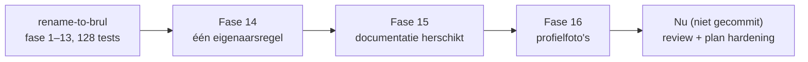

# Stand van zaken en open beslissingen

Datum: 2026-11-17. Branch `Base`. Vergeleken met commit `f03f6c1 rename-to-brul` (2026-11-06).

| | Bij `rename-to-brul` | Nu |
|---|---|---|
| Fases klaar | 1–13 | 1–16 |
| Tests | 128 | 158 (allemaal groen) |
| Gewijzigd (gecommit) | — | 89 bestanden, +4165 / −1620 regels in 7 commits |
| Niet gecommit | — | de notities in `conversatie/`, `docs/ai-usage.md`, één regel in het root-README |

---

## 1. Gedaan sinds `rename-to-brul`

### Fase 14: één eigenaarsregel (commit `bd4777c`)

Eén vaste volgorde voor elke toegangscontrole met een eigenaar: **eerst de eigenaar ophalen, dan controleren.**

- `UserService.getOwnerId(id)`: de eigenaar van een account is het account zelf; een onbekend id geeft 404.
  `GET`/`PATCH /users/{id}` en `GET /users/{id}/roles` gebruiken het. Gevolg: een gewone gebruiker krijgt voor een
  onbekend id nu **404 in plaats van 403**.
- Feedback: `user_id` heet nu **`owner_id`** (in model, JSON en het filter van `GET /feedback`).
- 4 nieuwe tests.

### Fase 15: documentatie herschikt (commit `6582ebe`)

Doel: **elk soort document één taak, elke uitleg op één plek.**

- De gids `docs/guide/` ging van 15 naar 10 hoofdstukken; de ontwerpkeuzes zitten nu in de kolom *Alternative* van
  de beslissingentabellen in `docs/implementation-plan.md`.
- Het root-`README.md` is het enige startpunt, met de tabel *Where to find what*.
- `TECHNICAL_DESIGN.md` somt alleen op (Mermaid in plaats van PlantUML).
- Elke feature en `shared/` heeft een README die per bestand uitlegt wat de code doet.

### Fase 16: profielfoto's (commits `b65107d` tot en met `de61485`)

| Commit | Wat |
|---|---|
| `b65107d` | `shared/image/ImageType.kt`: JPEG en PNG herkennen aan de eerste bytes, maximaal 2 MB |
| `7cd8c4e` | Tabel `user_profile_images`, `ProfileImage` (gewone klasse, geen data class), repository met H2-tests |
| `58b5952` | `ProfileImageService` en de fake. Het commitbericht is per ongeluk dat van `7cd8c4e`; bedoeld was `Add ProfileImageService` |
| `840f294` | Endpoints `PUT`, `GET` en `DELETE /users/{id}/profile-image`, `receiveImage()` (controleert `Content-Length` vóór het lezen) |
| `de61485` | `openapi.yaml`, `TECHNICAL_DESIGN.md`, `5-profile-image.http`, fase 16 in het plan |

Gevonden tijdens het bouwen: `upsert` beschadigt binaire data op H2. 26 nieuwe tests (128 + 4 + 26 = 158).

### Nu, nog niet gecommit (checkpoint 0)

- `conversatie/` in mappen, elk met een `README.md`: `basis/` (uitleg van het project), `images/` (klaar),
  `hardening/` (dit werk), `reports/` (volgende stap).
- `docs/ai-usage.md`: verantwoording van het AI-gebruik, met de punten **(to confirm)** nog open.
- CodeGraph-index (`.codegraph/`, staat in `.gitignore`, komt niet in git).

---

## 2. Wat er nu ligt

| Bestand | Inhoud |
|---|---|
| [01-projectreview.md](01-projectreview.md) | Vier echte fouten (A1–A4), kleine verbeteringen (B1–B4), wat bewust blijft |
| [02-roadmap-hardening.md](02-roadmap-hardening.md) | **Het werk**: checkpoints 0–9 met vinkjes en commitberichten |
| [03-leesbaarheid-en-schaalbaarheid.md](03-leesbaarheid-en-schaalbaarheid.md) | Structuur (S1, S2, L1, L2) en de grenzen die je opschrijft (S5–S8) |
| [04-toets-aan-stof-en-criteria.md](04-toets-aan-stof-en-criteria.md) | Wat de beoordeling vraagt en wat de Base nog mist |
| `conversatie/reports/02-advies-uit-hardening.md` | Alles voor reports: het sealed model, demodata, open beslissingen |

---

## 3. Open beslissingen (hardening)

**Vet** is de aanbeveling.

### Vóór checkpoint 1

| # | Beslissing | Opties | Aanbeveling | Waarom |
|---|---|---|---|---|
| 1 | Akkoord met de roadmap? | Volgen / punten schrappen / volgorde wijzigen | **Volgen**; schrap gerust wat je niet kunt uitleggen | Elk checkpoint is klein en heeft eigen tests |
| 2 | Checkpoint 0 committen | Nu / later | **Nu** | Daarna zijn de checkpoints los te committen |
| 3 | Het verkeerde commitbericht van `58b5952` | Laten / herschrijven | **Laten** | Herschrijven kan alleen met een interactieve rebase; het risico is groter dan de winst |
| 4 | De teamsituatie (5 personen, tot nu toe heeft één persoon alles gebouwd) | Zelf oplossen / bij de docent melden | **Nu melden bij de docent**, feitelijk | De criteria rekenen per student af; de docent kan alleen op tijd ingrijpen als hij het weet |
| 5 | Werk voor teamgenoten tijdens de hardening | Wachten tot reports / nu al iets geven | **Nu**: checkpoint 7 (use case-diagram, user stories) en 8 (testrapport) | Werk dat niet op reports wacht; ze leren de Base kennen voordat ze erin bouwen |

### Tijdens de checkpoints

| # | Beslissing | Checkpoint | Opties | Aanbeveling | Waarom |
|---|---|---|---|---|---|
| 6 | Sleutel voor de rate limit van wachtwoord wijzigen | 1 | IP-adres / user-id | **User-id**, met het IP-adres als terugval | De route zit al achter `authenticate`; één gebruiker blokkeert dan alleen zichzelf |
| 7 | Status bij een verkeerde `Content-Type` | 2 | 400 / 415 | **415** `UNSUPPORTED_MEDIA_TYPE` | Het juiste REST-antwoord; de app ziet meteen wat er mis is |
| 8 | Onbekende JSON-velden | 5 | Streng (400, nu) / `ignoreUnknownKeys` | **Streng houden**, opschrijven | Vangt typfouten in veldnamen; er is maar één client |
| 9 | Race-condities bij wijzigen | 3, 4 | Hele rij terugschrijven / gerichte updates / versiekolom | **Gerichte updates** | Eén `UPDATE` per kolom; geen tabelwijziging |
| 10 | `AppServices` | 6 | Laten / `AppServices` + `configureApp` / Koin | **`AppServices`** | Services op één plek, tests gebruiken de echte bedrading, geen nieuwe dependency |
| 11 | Tool voor het use case-diagram | 7 | Mermaid-flowchart / draw.io / PlantUML | **draw.io of PlantUML**, bron in de repo | Mermaid heeft geen echt use case-diagram |
| 12 | Waar het testrapport staat | 8 | Alleen in Word / `docs/test-report.md` | **`docs/test-report.md`** | Groeit mee met de code; Word neemt het over |
| 13 | Admin-wachtwoordreset (staat al open in het plan) | — | Bouwen / niet bouwen | **Niet nu**, na reports opnieuw bekijken | De criteria vragen er niet om |

### Al besloten

- De fase heet **Hardening** (fase 17), met het voorvoegsel `Hardening:` in elk commitbericht.
- Demodata komt **na reports** (zie `conversatie/reports/02-advies-uit-hardening.md` §5).
- Het report-model wordt een `sealed class` met drie subklassen in één tabel (zelfde bestand, §1).
- De verantwoording van het AI-gebruik staat in `docs/ai-usage.md`.
- Geen AI-agent (Koog): optioneel volgens de modulebeschrijving.
- Klasse- en sequence diagrams staan **per feature** in de README (vaste indeling, checkpoint 7); alleen het
  packagediagram en het use case-diagram staan centraal.
