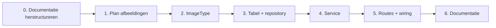

# Roadmap: afbeeldingen (profielfoto)

Het **waarom** (keuzes, datamodel, 3NF, endpoints, foutcodes) staat in
[01-plan-afbeeldingen.md](01-plan-afbeeldingen.md). Dit bestand is het **hoe**: de volgorde van het werk, met een
commit als checkpoint na elke stap.

Status: **klaar** (fase 16, commits `6582ebe` tot en met `de61485`). Deze roadmap bouwde de **profielfoto**. Foto's
bij reports volgen hetzelfde patroon; zie [`conversatie/reports/02-advies-uit-hardening.md`](../reports/02-advies-uit-hardening.md) §2.

---

## Zo gebruik je deze roadmap

1. Werk de checkpoints **in volgorde** af. Begin pas aan de volgende als de vorige gecommit is.
2. Een checkpoint is klaar als **alle vakjes** zijn afgevinkt en `kotlin.bat test` slaagt.
3. Commit dan **alleen** de bestanden van dat checkpoint, met het commitbericht dat erbij staat.
4. Werk in elk checkpoint ook de **README** bij van de map die je verandert (regel in
   `docs/guide/llm-context.md` §1).
5. Gaat iets anders dan gepland, schrijf het dan op in 01 (ontwerp) of hier (volgorde), niet alleen in de code.

| # | Checkpoint | Gecommit als |
|---|---|---|
| 0 | Documentatie herstructureren ✅ | `6582ebe docs restructure` (samen met 1) |
| 1 | Plan afbeeldingen ✅ | `6582ebe docs restructure` (samen met 0) |
| 2 | `ImageType` in `shared/image/` ✅ | `b65107d Add ImageType with JPEG/PNG detection and size check` |
| 3 | Tabel en repository ✅ | `7cd8c4e Add user_profile_images table and repository` |
| 4 | Service ✅ | `58b5952`, per ongeluk met het bericht van checkpoint 3 (bedoeld: `Add ProfileImageService`) |
| 5 | Routes en koppelen ✅ | `840f294 Add profile image endpoints` |
| 6 | Documentatie ✅ | `de61485 Document profile images` |

---

## Checkpoint 0: documentatie herstructureren

**Doel:** elk soort document heeft één taak en elke uitleg staat op één plek, voordat er nieuwe code bijkomt. De
nieuwe feature volgt dan meteen de nieuwe regels.

Gedaan (fase 15 in `docs/implementation-plan.md`):

- [x] `README.md` (root) is het enige startpunt: opstarten, "Where to find what" (één bron per feit) en de
      mappenstructuur. `backend/README.md` en `docs/README.md` zijn opgegaan in de root-README
- [x] De korte READMEs in `config/`, `plugins/`, `features/` en `test/` zijn weg; de root-README beschrijft die mappen
- [x] Elke feature en `shared/` heeft een README die per bestand uitlegt wat de code doet, plus het verloop van één
      verzoek
- [x] Gids van 15 naar 10 hoofdstukken; de quiz is gebleven, met koppen per hoofdstuk
- [x] Gids-hoofdstuk 13 (ontwerpkeuzes) is de kolom *Alternative* in de beslissingentabellen van het implementatieplan
- [x] `TECHNICAL_DESIGN.md` somt alleen op: architectuur en datamodel als Mermaid, de PlantUML is weg
- [x] De regels in `docs/guide/llm-context.md` §1 en §10, en in `CLAUDE.md` (alleen `conversatie/` is Nederlands)

Klaar als:

- [x] Je hebt de root-README, de gids-README en de README van `feedback` doorgelezen en vindt ze duidelijk
- [x] `kotlin.bat test` slaagt (er is geen code veranderd, alleen documentatie)

**Commit:** `Restructure documentation: one job per document, a README per feature` (samen met checkpoint 1
gecommit als `docs restructure`)

---

## Checkpoint 1: plan afbeeldingen

**Doel:** het ontwerp staat op papier, voordat er code komt.

Gedaan:

- [x] `conversatie/images/01-plan-afbeeldingen.md`: het ontwerp
- [x] `conversatie/reports/01-domein-reports.md`: het reports-domein (verplaatst op 2026-11-17)
- [x] `conversatie/images/02-roadmap-afbeeldingen.md`: deze roadmap

Klaar als:

- [x] Je hebt 01 en 02 doorgelezen en bent het eens met de keuzes

**Commit:** `Plan profile images`

---

## Checkpoint 2: `ImageType` in `shared/image/`

**Doel:** één plek die zegt of bytes een geldige foto zijn. Pure Kotlin, zonder Ktor en zonder database, dus
makkelijk te testen.

Beginnersvriendelijk: een `when` en een `for`-lus. `detect` staat in een `companion object`, net als
`Permission.fromKey`: een functie die bij het type hoort en de juiste enum-waarde zoekt.

Nieuw:

- [x] `backend/src/shared/image/ImageType.kt`
  - [x] `enum class ImageType(val contentType: String)` met `JPEG("image/jpeg")` en `PNG("image/png")`
  - [x] `ImageType.MAX_BYTES = 2 * 1024 * 1024` (in het `companion object`)
  - [x] `ImageType.detect(bytes): ImageType?` (in het `companion object`): herkent JPEG (`FF D8 FF`) en PNG (`89` + de letters `PNG`) aan de
        eerste bytes, anders `null`
  - [x] `requireValidImage(bytes): ImageType`: gooit `AppException.BadRequest` met code `IMAGE_TOO_LARGE` (groter
        dan 2 MB) of `INVALID_IMAGE_TYPE` (leeg of geen JPEG/PNG)
- [x] `backend/test/shared/image/ImageTypeTest.kt` (5 tests)

Tests:

- [x] JPEG en PNG worden herkend
- [x] Tekst, een GIF, lege bytes en te korte bytes geven `null`
- [x] Precies 2 MB mag; 2 MB + 1 byte geeft `IMAGE_TOO_LARGE`
- [x] Geen afbeelding geeft `INVALID_IMAGE_TYPE`

README:

- [x] `image/ImageType.kt` toegevoegd aan `backend/src/shared/README.md`

Klaar als:

- [x] `kotlin.bat test` slaagt (137 tests)

**Commit:** `Add ImageType with JPEG/PNG detection and size check`

---

## Checkpoint 3: tabel en repository

**Doel:** de profielfoto kan worden opgeslagen, opgehaald, vervangen en verwijderd.

Nieuw in `backend/src/features/user/`:

- [x] `database/UserProfileImagesTable.kt`: `user_id` (primaire sleutel, verwijst naar `users`), `data`
      (`binary`, max. `ImageType.MAX_BYTES`), `created_at`
- [x] `model/ProfileImage.kt`: `userId`, `data`, `createdAt`; een **gewone class**, geen data class (valkuil 1)
- [x] `mapper/ProfileImageDatabaseMapper.kt`: `ResultRow.toProfileImage()`
- [x] `repository/ProfileImageRepository.kt`: `save(image)`, `findByUserId(userId)`, `delete(userId): Boolean`
- [x] `repository/ExposedProfileImageRepository.kt`: `save` vervangt met `deleteWhere` + `insert` in één
      transactie, **niet** met `upsert` (valkuil 3)

Gewijzigd:

- [x] `backend/src/config/DatabaseFactory.kt`: `UserProfileImagesTable` in `SchemaUtils.create`

Eerst controleren:

- [x] Past een foto van 2 MB in de `binary`-kolom van H2? **Ja.**
- [x] Onverwacht gevonden: `upsert` beschadigt binaire data op H2. Opgeschreven in 01 en in `llm-context.md` §9

Tests in `backend/test/features/user/ProfileImageRepositoryTest.kt` (H2 in het geheugen):

- [x] Opslaan en ophalen geeft dezelfde bytes (`assertContentEquals`)
- [x] Een tweede `save` vervangt de eerste
- [x] `findByUserId` zonder foto geeft `null`
- [x] `delete` geeft `true`, daarna `false`
- [x] Een foto van 2 MB past

README:

- [x] Een blok "Profile image" in `backend/src/features/user/README.md`

Klaar als:

- [x] `kotlin.bat test` slaagt (142 tests)
- [x] Geen reset van `data/brul*` nodig (alleen een nieuwe tabel)

**Commit:** `Add user_profile_images table and repository`

---

## Checkpoint 4: service

**Doel:** de regels voor de profielfoto staan in één service.

Nieuw:

- [x] `backend/src/features/user/service/ProfileImageService.kt`
  - [x] `upload(userId, bytes)`: roept `requireValidImage` aan, zet `createdAt`
        (`Instant.now().truncatedTo(ChronoUnit.SECONDS)`), slaat op
  - [x] `get(userId): ProfileImage`: 404 `PROFILE_IMAGE_NOT_FOUND` zonder foto
  - [x] `delete(userId)`: 404 `PROFILE_IMAGE_NOT_FOUND` zonder foto
- [x] `backend/test/features/user/FakeProfileImageRepository.kt`: een map met `userId` als sleutel; `save`
      vervangt, net als de echte versie
- [x] `backend/test/features/user/ProfileImageServiceTest.kt`

Tests:

- [x] Uploaden en ophalen van een JPEG en een PNG
- [x] Een nieuwe upload vervangt de oude
- [x] Verkeerd type en te groot geven 400 met de juiste code
- [x] Ophalen en verwijderen zonder foto geven 404

README:

- [x] `ProfileImageService` in `backend/src/features/user/README.md`

Klaar als:

- [x] `kotlin.bat test` slaagt (148 tests)

**Commit:** `Add ProfileImageService`

---

## Checkpoint 5: routes en koppelen

**Doel:** de app kan de profielfoto uploaden, ophalen en verwijderen.

Nieuw:

- [x] `backend/src/features/user/route/ProfileImageRoutes.kt`, binnen `authenticate(JWT_AUTHENTICATION)`:
  - [x] `PUT /users/{id}/profile-image`: `getOwnerId` + `requireOwnerOrPermission(..., Permission.USER_UPDATE)`,
        body lezen met `call.receiveImage()`, `upload`, 204
  - [x] `GET /users/{id}/profile-image`: foto ophalen, antwoorden met de bytes en `image.contentType()`. Geen
        opzoeking van de gebruiker: een onbekende gebruiker heeft gewoon geen foto (404 `PROFILE_IMAGE_NOT_FOUND`)
  - [x] `DELETE /users/{id}/profile-image`: zelfde toegangscheck als `PUT`, `delete`, 204
- [x] `backend/src/features/user/mapper/ProfileImageMapper.kt`: `ProfileImage.contentType()` (jouw keuze: in een
      mapper, niet in de route)
- [x] `backend/src/shared/image/ImageRequest.kt`: `call.receiveImage()`

Eerst controleren:

- [x] Grootte begrenzen in Ktor 3.6: **geen ingebouwde plugin** (gecontroleerd in de broncode). Oplossing: de
      header `Content-Length` controleren vóór het lezen. Opgeschreven in 01, valkuil 4
- [x] `receive<ByteArray>()` werkt naast de JSON-plugin (`ByteArray` staat in de lijst die de plugin overslaat)

Koppelen (vier plekken):

- [x] `backend/src/Application.kt`: `ExposedProfileImageRepository` en `ProfileImageService` maken
- [x] `backend/src/plugins/Routing.kt`: `profileImageService` als parameter, `profileImageRoutes(...)` aanroepen
- [x] `backend/test/TestFixtures.kt`: `TestServices` krijgt de fake repository en de service
- [x] `backend/test/TestFixtures.kt`: `configureTestApp` geeft de service door

Tests in `backend/test/features/user/ProfileImageRoutesTest.kt` (9) en `ProfileImageMapperTest.kt` (1):

- [x] 204 bij uploaden; een andere gebruiker ziet de foto (200, dezelfde bytes, `Content-Type: image/png`)
- [x] Een nieuwe upload vervangt de oude en krijgt zijn eigen `Content-Type`
- [x] 204 bij verwijderen; daarna 404 `PROFILE_IMAGE_NOT_FOUND`
- [x] 400 `INVALID_IMAGE_TYPE` (een SVG), 400 `IMAGE_TOO_LARGE`, 400 voor een ongeldige id
- [x] 401 zonder token (`PUT`, `GET`, `DELETE`)
- [x] 403 bij andermans foto wijzigen of verwijderen; een admin mag het wel
- [x] 404 `USER_NOT_FOUND` bij `PUT` voor een onbekende gebruiker

README:

- [x] De routes, de mapper en het verloop van een upload in `backend/src/features/user/README.md`
- [x] `image/ImageRequest.kt` in `backend/src/shared/README.md`

Klaar als:

- [x] `kotlin.bat test` slaagt (158 tests)
- [x] De server start (`kotlin.bat run`) en de nieuwe tabel bestaat (door jou gestart)

**Commit:** `Add profile image endpoints`

---

## Checkpoint 6: documentatie

**Doel:** elk feit staat in zijn eigen bron ("Where to find what" in de root-`README.md`).

- [x] `backend/resources/openapi/openapi.yaml`: `PUT`, `GET` en `DELETE /users/{id}/profile-image`, met
      `image/jpeg` en `image/png` als body en antwoord; de nieuwe foutcodes bij `BadRequest` en `NotFound`
- [x] `TECHNICAL_DESIGN.md` §3 datamodel: `user_profile_images` in het diagram, met de regel "geen centrale
      tabel `images`"
- [x] `TECHNICAL_DESIGN.md` §5 foutcodes: `INVALID_IMAGE_TYPE`, `IMAGE_TOO_LARGE`, `PROFILE_IMAGE_NOT_FOUND`
- [x] `TECHNICAL_DESIGN.md` §6 endpoints: de drie endpoints met hun toegang
- [x] `docs/implementation-plan.md`: tabel "Images" met tien beslissingen (elk met alternatief), fase 16, de
      status, en EXIF bij "Out of scope"
- [x] `backend/http/5-profile-image.http` met `profile-image.png` (een echte PNG van 1 × 1 pixel, 69 bytes);
      `5-logout.http` heet nu `6-logout.http`, omdat logout de tokens ongeldig maakt en dus als laatste moet
- [x] De volgorde van de `.http`-bestanden bijgewerkt in `backend/http/README.md`, `docs/guide/01-getting-started.md`
      en `docs/guide/llm-context.md` §9
- [x] `llm-context.md` §9: de valkuilen (`upsert` op `binary`, `ByteArray` in een data class) stonden er al sinds
      checkpoint 3
- [x] De READMEs van `user` en `shared` kloppen nog

Klaar als:

- [ ] `5-profile-image.http` werkt tegen de draaiende server. **Zelf doen:** start de server, kies `dev`, draai
      `1-authentication.http` en dan `5-profile-image.http`. Alle zes requests moeten groen zijn
- [x] `kotlin.bat test` slaagt (158 tests; alleen documentatie en `.http`-bestanden veranderd)

**Commit:** `Document profile images`

---

## Daarna: foto's bij reports

Niet in deze roadmap. Het patroon en de verschillen met de profielfoto (eigen `id` per foto, toegang volgt het
report, cascade bij verwijderen, maximaal 5) staan in
[`conversatie/reports/02-advies-uit-hardening.md`](../reports/02-advies-uit-hardening.md) §2.
