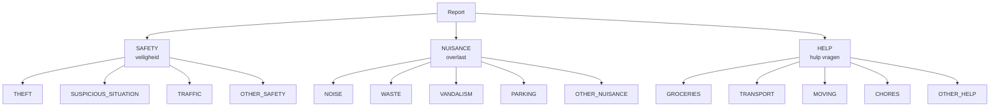
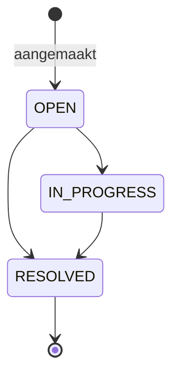
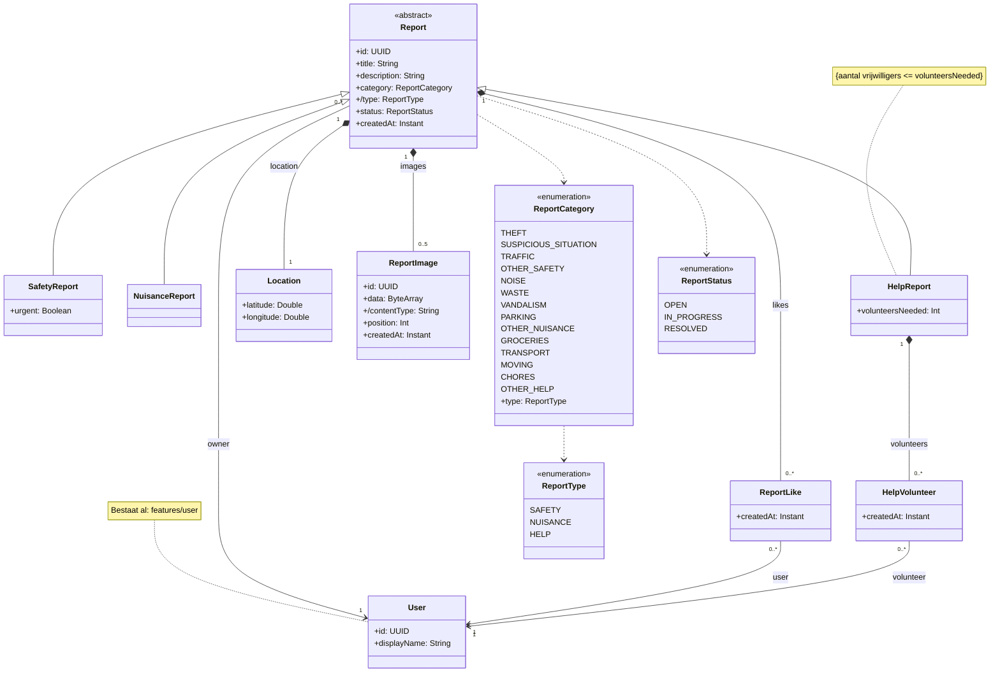
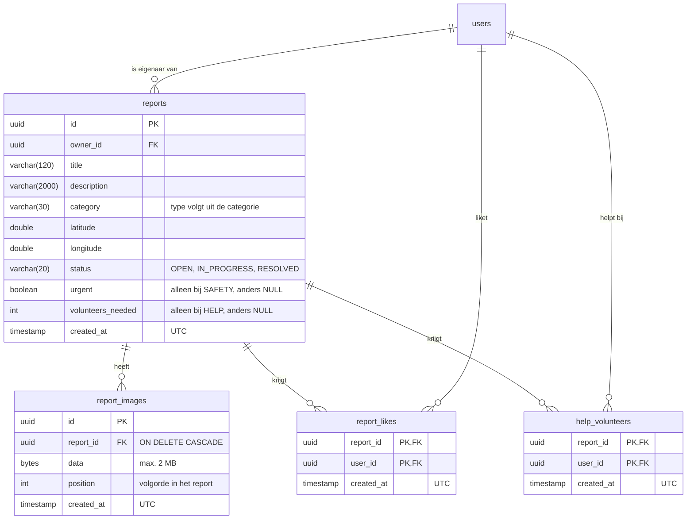

# Domein: reports (voorstel)

Status: **voorstel, nog niet gebouwd.** Gebaseerd op het oude project (Brul2), aangepast aan de regels van dit
project: UUID's, `Instant`, `requireValid`, 3NF en een verplichte eigenaar.

---

## 1. Waar gaat het over?

Brul wordt een **buurtapp**. Bewoners plaatsen **reports** (meldingen) op een plek in de buurt. Andere bewoners
kunnen:

- reports zoeken en bekijken;
- een report **liken**;
- zich bij een hulpvraag aanmelden als **vrijwilliger**;
- **foto's** bij een report zien.

---

## 2. De begrippen

| Begrip | Betekenis |
|---|---|
| **Report** | Een melding met een titel, beschrijving, categorie, locatie en status |
| **Type** | De soort report: `SAFETY`, `NUISANCE` of `HELP`. **Volgt uit de categorie** |
| **Categorie** | Waar het report precies over gaat, bijvoorbeeld `THEFT` of `NOISE` |
| **Eigenaar** | De gebruiker die het report plaatste (`owner_id`), altijd verplicht |
| **Like** | Een gebruiker vindt een report nuttig of belangrijk; maximaal één per gebruiker per report |
| **Vrijwilliger** | Een gebruiker die meehelpt bij een `HELP`-report |
| **Foto** | Een afbeelding bij een report (JPEG of PNG) |

---

## 3. De drie types



| Type | Klasse | Categorieën | Extra veld |
|---|---|---|---|
| `SAFETY` | `SafetyReport` | `THEFT`, `SUSPICIOUS_SITUATION`, `TRAFFIC`, `OTHER_SAFETY` | `urgent` (verplicht): moeten buren extra opletten? |
| `NUISANCE` | `NuisanceReport` | `NOISE`, `WASTE`, `VANDALISM`, `PARKING`, `OTHER_NUISANCE` | — |
| `HELP` | `HelpReport` | `GROCERIES`, `TRANSPORT`, `MOVING`, `CHORES`, `OTHER_HELP` | `volunteersNeeded` (verplicht): hoeveel helpers |

### Definitie per type

De app toont deze definities met voorbeelden, zodat gebruikers weten welk type ze kiezen.

| Type | Definitie | Voorbeelden |
|---|---|---|
| `SAFETY` | Iemand loopt gevaar, of er is een misdrijf gepleegd | Fietsdiefstal, iemand die bij deuren rondkijkt, een gevaarlijk kruispunt |
| `NUISANCE` | Het is vervelend, of het maakt de buurt minder leefbaar | Geluidsoverlast, zwerfafval, graffiti, foutparkeerders |
| `HELP` | Een bewoner vraagt buren om hulp | Boodschappen doen, een ritje naar het ziekenhuis, helpen verhuizen |

`VANDALISM` hoort bij `NUISANCE`: het gaat om de leefbaarheid van de buurt, zoals gemeenten het ook indelen.

### De categorie bepaalt het type

Elke categorie hoort bij precies één type. Daarom slaan we **alleen de categorie op**. Het type volgt uit de enum:

```kotlin
enum class ReportCategory(val type: ReportType) {
    THEFT(ReportType.SAFETY),
    SUSPICIOUS_SITUATION(ReportType.SAFETY),
    TRAFFIC(ReportType.SAFETY),
    OTHER_SAFETY(ReportType.SAFETY),
    NOISE(ReportType.NUISANCE),
    WASTE(ReportType.NUISANCE),
    VANDALISM(ReportType.NUISANCE),
    PARKING(ReportType.NUISANCE),
    OTHER_NUISANCE(ReportType.NUISANCE),
    GROCERIES(ReportType.HELP),
    TRANSPORT(ReportType.HELP),
    MOVING(ReportType.HELP),
    CHORES(ReportType.HELP),
    OTHER_HELP(ReportType.HELP)
}
```

- **3NF:** als je `type` én `category` opslaat, geldt `id → category → type`. Dat is een transitieve
  afhankelijkheid. Door alleen `category` op te slaan verdwijnt die.
- **Simpeler:** de lange `setOf(...)`-controles uit de oude code zijn niet meer nodig. Een categorie kan niet bij
  het verkeerde type horen.
- **Elk type heeft een eigen "overig"** (`OTHER_SAFETY`, `OTHER_NUISANCE`, `OTHER_HELP`). Zo kiest niemand een
  verkeerde categorie omdat de juiste ontbreekt. Een enum-waarde moet uniek zijn, dus drie keer `OTHER` kan niet.
- **`TRAFFIC` en niet `TRAFFIC_SAFETY`:** binnen het type `SAFETY` is "veiligheid" in de naam dubbel.
- **Kies de namen nu goed.** Categorieën worden als tekst opgeslagen (`enumerationByName`, net als de status van
  feedback). Hernoem je later een waarde, dan passen bestaande rijen er niet meer bij. Tijdens het ontwikkelen los
  je dat op door `data/brul*` te verwijderen; met echte data is het een migratie.

---

## 4. Velden en regels van een report

| Veld | Regel (voorstel) |
|---|---|
| `id` | UUID, gemaakt door de server |
| `ownerId` | De gebruiker die het report plaatst; verplicht, verandert nooit |
| `title` | 1–120 tekens, getrimd |
| `description` | 1–2000 tekens, getrimd |
| `category` | Een van de categorieën hierboven |
| `latitude` | -90 tot en met 90 |
| `longitude` | -180 tot en met 180 |
| `status` | `OPEN` bij aanmaken (zie §5) |
| `urgent` | **Verplicht bij `SAFETY`**, verboden bij de andere types |
| `volunteersNeeded` | **Verplicht bij `HELP`**: 1–50; verboden bij de andere types |
| `createdAt` | Gezet door de server, `Instant` afgekapt op seconden, UTC |

- **`urgent` is geen noodknop.** Het betekent "buren, let extra op", niet "er komt hulp". De app toont bij
  `SAFETY`-reports duidelijk: **bij acuut gevaar bel je 112.**
- Ongeldige invoer geeft **400** via `requireValid`, **niet** Kotlins `require()` (dat wordt een 500).
- De controles staan in de **service**, niet in de constructor van het model.
- De grenzen (120, 2000, 50) zijn voorstellen; pas ze aan als het domein iets anders vraagt.

---

## 5. Statusverloop



- `RESOLVED` is definitief.
- Dezelfde status opnieuw zetten mag; dat verandert niets.
- Een verboden overgang geeft **409 `INVALID_STATUS_TRANSITION`**: het verzoek botst met de huidige toestand.

---

## 6. Likes

- Een gebruiker kan een report **één keer** liken. De samengestelde sleutel `(report_id, user_id)` dwingt dat af in
  de database.
- "Unlike" verwijdert de like.
- Je mag ook je eigen report liken (voorstel; dat is het simpelst).
- Alleen likes, **geen dislikes**.

---

## 7. Vrijwilligers (alleen bij `HELP`)

- Een gebruiker kan zich aanmelden als vrijwilliger, en zich weer afmelden.
- Eén aanmelding per gebruiker per report; de samengestelde sleutel `(report_id, user_id)` dwingt dat af.
- Regels:
  - alleen bij reports van het type `HELP`, anders 400;
  - **niet** bij je eigen report, anders 400;
  - niet als het aantal vrijwilligers `volunteersNeeded` al heeft bereikt, anders 409;
  - niet bij een `RESOLVED` report, anders 409;
  - `volunteersNeeded` mag niet lager worden dan het aantal aangemelde vrijwilligers, anders 409.

---

## 8. Foto's

- Bij **alle drie de types**, maximaal **5 per report**.
- Alleen **JPEG en PNG** (gecontroleerd op de eerste bytes van het bestand), maximaal **2 MB** per foto.
- Een foto hoort bij **één** report en wordt niet hergebruikt.
- Wie het report mag zien, mag de foto's zien.
- Verwijder je het report, dan verdwijnen de foto's mee.
- De controle op type en grootte staat één keer in `shared/`. Profielfoto's gebruiken dezelfde controle (zie
  [01-plan-afbeeldingen.md](../images/01-plan-afbeeldingen.md)).

---

## 9. Wie mag wat?

| Actie | Wie |
|---|---|
| Report plaatsen | Elke ingelogde gebruiker; die wordt de eigenaar |
| Reports en hun foto's bekijken | Elke ingelogde gebruiker |
| Report wijzigen | Eigenaar, of `report.update` |
| Status veranderen | Eigenaar, of `report.update` |
| Report verwijderen | Eigenaar, of `report.delete` |
| Foto's toevoegen of verwijderen | Eigenaar, of `report.update` |
| Liken en unliken | Elke ingelogde gebruiker (alleen voor zichzelf) |
| Aanmelden en afmelden als vrijwilliger | Elke ingelogde gebruiker behalve de eigenaar (alleen voor zichzelf) |

- Nieuwe permissies: `REPORT_UPDATE` en `REPORT_DELETE`. ADMIN krijgt ze automatisch via `Permission.entries`.
- Volgens de vaste regel: eerst de eigenaar ophalen (`reportService.getOwnerId(id)`, 404 als het report niet
  bestaat), dan `requireOwnerOrPermission`.

---

## 10. Klassendiagram (UML)



### Hoe lees je dit diagram?

| Notatie | Betekenis | Voorbeeld hier |
|---|---|---|
| `<<abstract>>` | Een abstracte klasse: je maakt er zelf geen object van, alleen van de subklassen | `Report` (in Kotlin: `sealed class`) |
| `<<enumeration>>` | Een enum met een vaste lijst waarden | `ReportStatus` |
| Lijn met open driehoek (`<\|--`) | **Overerving**: "is een" | Een `HelpReport` is een `Report` |
| Lijn met dichte ruit (`*--`) | **Compositie**: het deel bestaat niet zonder het geheel. Weg met het report = weg met het deel | Foto's, likes, locatie |
| Pijl (`-->`) | **Associatie**: het ene object kent het andere | Een report kent zijn eigenaar |
| Stippellijn (`..>`) | **Afhankelijkheid**: gebruikt het type | `Report` gebruikt `ReportCategory` |
| `"1"`, `"0..*"`, `"0..5"` | **Multipliciteit**: hoeveel | Een report heeft 0 tot 5 foto's |
| `+` | Publiek (in Kotlin: een gewone `val`) | `+title` |
| `/` voor een naam | **Afgeleid** attribuut: wordt berekend, niet opgeslagen | `/type` (uit `category`), `/contentType` (uit `data`) |
| `{...}` in een notitie | **Constraint**: een regel die altijd moet gelden | Niet meer vrijwilligers dan nodig |

### Keuzes in dit diagram

- **De eigenaar is een associatie, geen attribuut.** In UML teken je "een report hoort bij een gebruiker" als lijn.
  In de Kotlin-code wordt dat het veld `ownerId: UUID`, in de database de kolom `owner_id`.
- **`Location` is een waardeobject**, met compositie: elk report heeft precies één eigen locatie. In de database
  zijn het gewoon twee kolommen (`latitude`, `longitude`) in `reports`.
- **Vrijwilligers horen alleen bij `HelpReport`**, likes bij elk `Report`. Daarom hangt `HelpVolunteer` aan de
  subklasse en `ReportLike` aan de superklasse.
- **`ReportLike` en `HelpVolunteer` zijn koppelklassen** tussen een report en een gebruiker, met een eigen
  attribuut (`createdAt`). Strikt in UML is dat een *associatieklasse*. Mermaid kan die niet tekenen, daarom staan
  ze als gewone klassen met twee lijnen.
- **Geen methodes.** De regels (statusovergangen, de controles per type, het maximum aantal vrijwilligers) staan in
  `ReportService`, volgens de projectregel "bedrijfsregels in de service".
- **Eén klassehiërarchie, één tabel.** De drie subklassen worden in de database één tabel `reports` (zie §11). UML
  laat het domein zien, niet de opslag.

---

## 11. Datamodel



### Waarom één tabel `reports` voor alle types?

`urgent` en `volunteers_needed` zijn `NULL` als ze niet bij het type horen. De service controleert dat de velden
bij het type passen.

- **3NF klopt nog steeds:** `NULL` breekt geen normaalvorm. Elke kolom hangt alleen af van `id`.
- **Het alternatief** is aparte tabellen per type (`safety_reports`, `help_reports`). Dat is netter, maar elke
  query heeft dan joins nodig. Voor beginners is één tabel duidelijker.

### Toets aan 3NF

| Tabel | Oordeel | Waarom |
|---|---|---|
| `reports` | ✅ | Geen `type`-kolom (volgt uit `category`), geen gegevens van de eigenaar, alleen `owner_id` |
| `report_images` | ✅ | Geen `content_type` of `size`: die volgen uit `data` |
| `report_likes`, `help_volunteers` | ✅ | De samengestelde sleutel plus `created_at`, en `created_at` hangt af van de hele sleutel (wanneer *deze* gebruiker *dit* report likete) |

Ook niet opgeslagen: het **aantal likes** en het **aantal vrijwilligers**. Die tel je met een query. Een
tellerkolom zou een afgeleide waarde zijn, en die kan gaan afwijken.

### Naamgeving

- **`owner_id`** alleen voor de eigenaar van het report.
- **`user_id`** in `report_likes` en `help_volunteers`: de gebruiker die liket of helpt. Dat is hetzelfde patroon als
  `user_roles`.

---

## 12. Wat (voorlopig) niet meekomt uit de oude code

| Oud | Waarom later of anders |
|---|---|
| Zoeken binnen een straal, sorteren op "dichtstbij" | Afstand berekenen is lastig in SQL; eerst een eenvoudige lijst |
| Sorteren op "meest geliket" | De oude code deed één query per report; dat moet later met een `GROUP BY` |
| `viewCount` | Een `GET` die data wijzigt is ongebruikelijk, en elke refresh telt mee |
| `Long`-ids, `createdAt` in milliseconden, `ownerId: Long?` | UUID's, `Instant` en een verplichte eigenaar |
| `require()` in model-constructors | `requireValid` in de service |
| Zoeken in het geheugen (`findAll()` en dan filteren) | In SQL met `PageResponse`, zoals bij feedback |
| Nullable repositories in de service | Afhankelijkheden altijd expliciet meegeven |

---

## 13. Open punten

1. Kloppen de grenzen: titel 120, beschrijving 2000, vrijwilligers 1–50, 5 foto's?
2. Mag je je eigen report liken?
3. Moet "zoeken binnen een straal" in de eerste versie, of mag het later?
4. Als een report een andere categorie krijgt, verandert misschien ook het type. Mag dat bij wijzigen, of ligt het
   type vast na het aanmaken? Voorstel: **het type ligt vast**. Je kunt wel een andere categorie binnen hetzelfde
   type kiezen.
5. Een categorie `PUBLIC_SPACE` bij `NUISANCE` toevoegen, voor kapotte straatverlichting en losse stoeptegels?
   Optioneel; zonder die categorie belandt zo'n melding in `OTHER_NUISANCE`.
