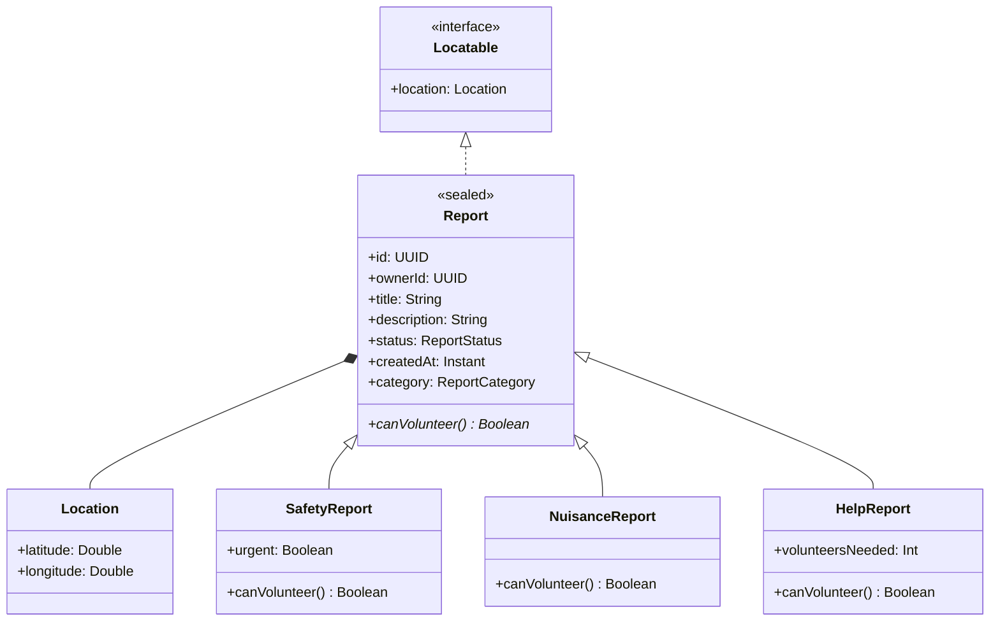

# Advies voor reports (uit de hardening-review)

Datum: 2026-11-17. Tijdens de hardening-review (`conversatie/hardening/`) kwam veel advies voor reports naar
boven. Het staat hier bij elkaar, zodat de hardening-map alleen over hardening gaat. Het domein zelf staat in
[01-domein-reports.md](01-domein-reports.md).

**Wanneer:** pas na de hardening (checkpoint 9 in `conversatie/hardening/02-roadmap-hardening.md`). Begin reports
met een eigen roadmap in deze map.

---

## 1. Het Kotlin-model: `sealed class Report`

De criteria van periode 1 vragen:

- *"minstens 3 soortgelijke klassen (foobars) met een gedeelde functionaliteit"*;
- een klassendiagram met overerving, interfaces en een abstracte klasse;
- bij het assessment: sealed class, abstract class vs. interface, polymorfisme, "waar in je eigen code".

Daarom geen plat model (één `data class` met nullable velden), maar:

| Kotlin-concept | Waar het dan zit |
|---|---|
| `sealed class` (impliciet abstract) | `Report`; de compiler kent alle subklassen |
| overerving, `override` | `SafetyReport`, `NuisanceReport`, `HelpReport` |
| polymorfisme | `report.canVolunteer()`, in plaats van `if (type == HELP)` in de service |
| exhaustive `when` + smart cast | in de mapper: `when (report) { is HelpReport -> report.volunteersNeeded ... }`, zonder `else` |
| interface | `Locatable` (hetzelfde voorbeeld als in les 2) |
| compositie (HAS-A) | `Report` heeft een `Location` |
| `init`-blok | `Location` controleert in `init` met `requireValid` dat de breedtegraad tussen −90 en 90 ligt |

- **De database blijft één tabel `reports`** (*single table inheritance*). De mapper kiest bij het lezen de subklasse
  op basis van `category.type`. Een goede assessmentvraag: "waarom één tabel en toch drie klassen?"
- **`enum class ReportCategory(val type: ReportType)`**: het type volgt uit de categorie, er is geen aparte
  `type`-kolom (3NF).
- **Regel:** in de subklassen alleen gedrag dat echt per type verschilt. Past `canVolunteer()` niet in het ontwerp,
  kies dan een ander echt verschil, bijvoorbeeld de validatie per type. Gekunstelde methodes vallen in een assessment
  meteen op.

## 2. Structuur en API

- Map `features/report/` (enkelvoud, zoals `user`), URL `/api/v1/reports`.
- Gerichte updates (`updateStatus`, `updateDescription`, ...), zoals `user` en `feedback` na de hardening.
- Nieuwe permissies `REPORT_UPDATE` en `REPORT_DELETE`; ADMIN krijgt ze automatisch via `Permission.entries`.
- **Foto's:** hetzelfde patroon als de profielfoto (`conversatie/images/01-plan-afbeeldingen.md`), met deze
  verschillen:
  - `report_images` krijgt een eigen `id`, omdat een report meerdere foto's kan hebben;
  - geen `position`-kolom; sorteer op `created_at`, daarna `id`;
  - de toegang volgt het report: de eigenaar of `report.update`;
  - een report met foto's gaat in **twee verzoeken**: eerst het report, dan de foto's (geen multipart);
  - uploaden met `POST /reports/{id}/images` (201 met het id), ophalen en verwijderen met `GET` en
    `DELETE /reports/{id}/images/{imageId}`; hergebruik `receiveImage()` en `requireValidImage()`;
  - een lijst bevat nooit bytes: `ReportResponse` krijgt `imageIds`.
- **Cascade:** `reference("report_id", ReportsTable.id, onDelete = ReferenceOption.CASCADE)` voor foto's, likes en
  vrijwilligers. Naar `users` géén cascade: gebruikers worden nooit verwijderd. Dit beantwoordt ook de vraag uit
  les 6: "hoe verwijder je de images bij een DELETE?"
- **Indexen:** `.index()` op `created_at`, `status` en `category`, de kolommen waarop gefilterd en gesorteerd wordt.
- **`likeCount` per report in een lijst** kost één extra query per item (N+1). Bij maximaal 100 items op H2 is dat
  acceptabel; noteer het als bewuste keuze.
- **Zoeken binnen een straal:** later. Als het eerder moet, een *bounding box* (`latitude between ...`): gewone SQL en
  uit te leggen. Echte afstand (Haversine) niet.

## 3. Regels met tellen (5 foto's, `volunteersNeeded`)

"Tellen en dan invoegen" kan bij gelijktijdige verzoeken één keer te veel toelaten. Controleer in de service en
schrijf de race op als bekende beperking (lowlight in het ontwikkeldocument), net als bij de e-mailcheck. Tellen en
invoegen in één transactie kan ook, maar is te ingewikkeld voor deze fase.

## 4. Volgorde en werkverdeling

Fases, met een commit per stap: **CRUD + lijst → status → foto's → likes → vrijwilligers → demodata**.

Het portfolio rekent per student (elke student minstens 3 eigen tests, eigen bijdrage in het filmpje). Laat
teamgenoten stukken bouwen op een eigen branch met een pull request, en laat ze de tests van hun eigen stuk schrijven.
Gepland: Kelvin bouwt de help-feature (vrijwilligers) na de basis van reports.

## 5. Demodata (laatste stap)

Eis: bij het assessment bevat de database realistische data en kan de docent zelf testen. Pas bouwen als reports er
is; anders schrijf je de seeder twee keer.

- Een `DemoDataSeeder`, alleen actief bij `DEMO_DATA=true` in `.env` (standaard `false`). Alternatieven: met de hand
  vullen voor het assessment (niet herhaalbaar), of een SQL-dump (hashes en id's met de hand bijhouden).
- Hij maakt alles via de **services** (`AuthenticationService.register` voor gebruikers, dus met hash en rollen), niet
  rechtstreeks in de tabellen, zodat de businessregels gelden.
- Inhoud: één admin, een paar gewone gebruikers, feedback met verschillende statussen, reports van alle drie de types
  met foto's (uit `backend/resources/demo/`), likes en vrijwilligers.
- Herhaalbaar: wat al bestaat, wordt overgeslagen. Test met fakes: tweemaal seeden geeft geen dubbele gebruikers.
- Plek: `config/`, naast `DatabaseFactory`. Hij gebruikt meerdere features en heeft geen routes.
- Root-README: de demo-accounts met wachtwoord, met de waarschuwing dat ze alleen bestaan bij `DEMO_DATA=true`.
- Beslissing opschrijven, en waarom dit niet botst met "geen standaard-admin met een bekend wachtwoord": de schakelaar
  staat standaard uit.
- Commitbericht: `Reports: add optional demo data seeder`.

## 6. Open beslissingen

| # | Beslissing | Opties | Aanbeveling | Waarom |
|---|---|---|---|---|
| 1 | Kotlin-model | Plat / `sealed class` + 3 subklassen | **Sealed** | Zie §1 |
| 2 | Database bij dat model | Eén tabel / tabel per type | **Eén tabel** | Al zo ontworpen in 01; de mapper kiest de subklasse |
| 3 | Mag het type veranderen na het aanmaken? (01, open punt 4) | Ja / nee, alleen een andere categorie binnen hetzelfde type | **Vast** | Met subklassen zou een object van klasse moeten wisselen; dat kan niet |
| 4 | Grenzen: titel 120, beschrijving 2000, vrijwilligers 1–50, 5 foto's (01, punt 1) | Zo / anders | **Zo** | Sluit aan bij feedback (2000) en de weergavenaam (120) |
| 5 | Eigen report liken (01, punt 2) | Ja / nee | **Ja** | Het simpelst; geen extra regel |
| 6 | Zoeken binnen een straal (01, punt 3) | Nu / later | **Later** | Zie §2 |
| 7 | Categorie `PUBLIC_SPACE` bij `NUISANCE` (01, punt 5) | Wel / niet | **Wel, nu** | Categorieën staan als tekst in de database; later hernoemen kost een reset |
| 8 | Maxima bij gelijktijdige verzoeken | Controle in de service / één transactie | **Controle in de service** | Zie §3 |
| 9 | Status bij een zesde foto | 400 / 409 | **409** (bijv. `TOO_MANY_IMAGES`) | Het verzoek botst met de huidige toestand, net als een vol aantal vrijwilligers |
| 10 | Demodata | Met de hand / seeder / SQL-dump | **Seeder** | Zie §5 |

**Besloten:** geen AI-agent (Koog); optioneel volgens de modulebeschrijving.
