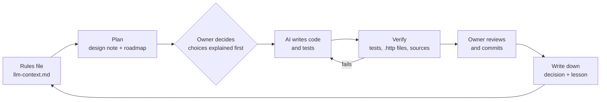

# AI usage

How AI tooling was used to build this backend, how its output was checked, and what we learned. This is the source
for the chapter *Verantwoording AI-gebruik* in the development document. Add a row to the [log](#8-log) every time AI
plays a real part in a decision or in code.

Items marked **(to confirm)** could not be verified from the repository or the session notes; the owner fills them in.

**Project history.** The team's first version was the `brul2` project. It was rebuilt as a clean base in a separate
repository (`example`, phases 1–13), which was copied and renamed to `brul` on 2026-11-06 (commit `f03f6c1`) and
extended from there (phases 14–16). The session journals of phases 1–13 therefore refer to the project as
`example`.

---

## 1. Tools

| Tool | What it was used for | Why this tool |
|---|---|---|
| **Orchestrator** with several agents **(to confirm: name)** | Runs coding agents (Claude Code, Codex) in their own workspaces and keeps track of the project through the brain below | One place to start, follow and hand over agent work; the brain gives every agent the same project state |
| **Brain**: Obsidian vault (`example`) | Project memory for the agents: status, decisions with reasons, lessons learned, open questions, a journal per session | An AI session forgets everything; the next session starts from the recorded state instead of guessing. Built for `example`; a brain for `brul` is planned |
| **Claude Code** (CLI agent, Anthropic) | Planning phases, writing code and tests, reviews, documentation. Main pair programmer for every phase | Works directly in the repository: reads and edits files, runs `./kotlin test`, follows the project rules in `CLAUDE.md`. A chat app can only see what you paste |
| Model in Claude Code | Claude Opus 5.5 in the sessions of 2026-11-16/17; earlier sessions **(to confirm)** | The largest model, because the work spans many files at once (route, service, repository, fake, tests, docs) and reviews need the whole project in view |
| **CodeGraph** | A local index of the code (symbols, callers, dependencies) that the agent queries before it edits | Shows the callers and "blast radius" of a change, e.g. before deleting files or when mapping the dependencies between features |
| **ChatGPT** | Turning the lesson slides (AIP les 1–7) into readable study text | Fast summary of course material; used for studying, not for code |
| **Chat apps as tutors**: ChatGPT, Claude, Grok, Gemini | Explaining code and concepts ("what does this line do?", "why a sealed class here?"), and other questions | Several models, because a second explanation shows whether you really understand it, and models make different mistakes; see §2a |
| Codex (OpenAI) | Three sessions **(to confirm what for)** | **(to confirm)** |
| GitNexus | The owner's own code visualization. **Not** used by the AI agents (rule in `CLAUDE.md`) | Personal overview of the code |

## 2. How we worked with AI

The student stays in the lead. AI proposes; the student decides, commits and must be able to explain every line.

1. **One rules file for every assistant.** `docs/guide/llm-context.md` holds the stack, the layers, the security rules
   and the known pitfalls. `CLAUDE.md` imports it, and fellow students paste it into their own assistant
   (ChatGPT, Copilot, ...). So every assistant follows the same rules, and a lesson learned once is applied by all.
2. **Design before code.** Every larger step started as a design note (`conversatie/`, in Dutch) with options and a
   recommendation, then a roadmap with one commit per checkpoint (e.g. `conversatie/images/02-roadmap-afbeeldingen.md`).
3. **Choices explained first.** The AI presents the alternatives with pros and cons; the owner picks. Example: four
   logout strategies were compared before the token version was chosen (decision table *Security* in
   `docs/implementation-plan.md`).
4. **Small steps, owner commits.** The AI does not commit. Each checkpoint ends with green tests and a commit by the
   owner.
5. **Constraints that keep the code explainable:** no new dependency without asking, no DI framework, no `!!`, no
   clever generics. The AI must say when it is unsure whether an API exists instead of guessing.

## 2a. AI as a tutor

Next to the coding agent, chat apps (ChatGPT, Claude, Grok, Gemini) are used as **teachers**: to understand code
that was written, to learn the Kotlin, Ktor and Exposed concepts behind it, and for other questions. They do not
write code for the repository.

The coding agent and the tutors have different jobs:

| | Coding agent (Claude Code) | Tutors (chat apps) |
|---|---|---|
| Role | Pair programmer in the repository | Teacher outside the repository |
| Sees | The whole project and the rules file | Only what you paste into the chat |
| Output | Code, tests, documentation | Explanations, examples, answers |
| Goal | A working, tested backend | Being able to explain every line yourself |

How we use them:

- **Ask more than one.** When an explanation is unclear or seems wrong, ask a second model. When two models
  disagree, the answer is in the code, a test or the official documentation, not in a third chat.
- **Paste the rules file for project questions.** `docs/guide/llm-context.md` makes a tutor's answer fit this
  project, for example `requireValid()` instead of `require()`.
- **Explain it back.** A concept counts as understood when you can explain it without the chat and point to it in
  your own code (assessment question type: "where in your code do you use ...?").
- **Paste no secrets.** Only code and questions; never `.env`, tokens or passwords.

## 3. AI per development activity

| Activity (LU 1) | How AI helped | Example |
|---|---|---|
| Analysis | Comparing the project with the course material and the assessment criteria | `conversatie/hardening/04-toets-aan-stof-en-criteria.md` |
| Design | Options with trade-offs; Mermaid diagrams (ER, sequence, class) | Logout strategy; images stored per feature; report domain (`conversatie/reports/01-domein-reports.md`) |
| Implementation | Code per checkpoint, following the reference feature `feedback` | Phases 1–16 |
| Testing | Test cases for the happy flow and 400/401/403/404/409; fakes that behave like the real repository | 158 tests; `ProfileImageRepositoryTest` with an image of exactly 2 MB |
| Review | Whole-project reviews looking for bugs, readability and scalability | `conversatie/hardening/01-projectreview.md`, `03-leesbaarheid-en-schaalbaarheid.md` |
| Documentation | Feature READMEs, the learning guide, `openapi.yaml`, the decision tables | `docs/guide/`, `backend/src/features/*/README.md` |

## 4. How AI output was verified

We never accepted AI output on its word.

**Limitation.** The reviews in this project were also done by AI, the same kind of model that wrote the code. A
model that misunderstood something once can miss it again when it reviews. That is why the checks below rely on
something outside the AI: a test that runs, the library's source code, a real server, or the assessment criteria.

The checks we used:

| Check | What it catches | Example |
|---|---|---|
| Automated tests (`./kotlin test`) after every step | Code that compiles but behaves wrongly | The `upsert` bug below |
| Repository tests against a real H2 database | Differences between the fake and the database | Binary data, timestamps, unique constraints |
| The owner runs every `.http` file against the real server | Problems the test host does not show | Rate limit hit by a full run of the files |
| Reading the library's source code | Wrong assumptions about default behaviour | Rate limit key (below) |
| Throwaway probe tests, deleted afterwards | "What really happens if ...?" | Wrong `Content-Type` gives 500 (below) |
| Tutorial code built and tested in a throwaway copy of the repository | Guide code that does not compile | The `categories` tutorial: 137 tests passed before it went into the guide |
| Comparing advice with the assessment criteria | Advice that is technically fine but wrong for this course | The report model (below) |

## 5. Examples

### Correct, and verified

| What the AI said | How we checked | Result |
|---|---|---|
| A JWT cannot be revoked; a token version per user makes logout work | Tests: after logout the old token gives 401 | Built as phase 8; reused for deactivation and password change |
| The rate limiter has no `requestKey`, so all clients share one bucket | Read `RateLimitConfig.kt` in the Ktor 3.6 sources: the default is `requestKey = { }` | Fixed in hardening checkpoint 1: a key per IP address, and per user for password changes |
| A missing or wrong `Content-Type` returns 500 | A temporary test against `configureTestApp` | Fixed in hardening checkpoint 2: 415 `UNSUPPORTED_MEDIA_TYPE` |
| `YYYY` in `logback.xml` is the week-based year | Known Java date-format behaviour | Fixed in hardening checkpoint 2: `yyyy` |
| `update(user)` writes every column, so two concurrent requests can undo each other's change | Read the repository code | Fixed in hardening checkpoints 3 (`user`) and 4 (`feedback`): one function per column |

### Errors found while building (code that had to be changed)

These are now rules in `llm-context.md` §9, so no assistant makes them again.

| Problem | How it showed | Fix |
|---|---|---|
| `upsert` on a `binary` column damages the bytes on H2 (every byte above `0x7F` became `EF BF BD`) | A repository test with real image bytes failed | `deleteWhere` + `insert` in one transaction |
| Implicit joins across link tables fail ("no matching primary key/foreign key pair") | The permission query crashed | Explicit `join(..., JoinType.INNER, ...)` |
| Exposed retries a failed transaction three times | A duplicate insert was retried three times before it failed | `maxAttempts = 1`, map SQL state 23505 to 409 |
| Importing `io.ktor.server.plugins.statuspages.status` | Did not compile | `status(...)` is a member of the configuration |
| CallLogging loads the native Jansi library | Four "restricted method" warnings at startup | `disableDefaultColors()`; `--enable-native-access` was rejected because it hides the cause |

### Advice that had to be changed or was rejected

| AI advice | Why it changed | Who caught it |
|---|---|---|
| Logout "out of scope" for the base | The owner asked "what if a token is stolen?"; a strong base needs logout | Owner |
| A flat `data class Report` with nullable fields | The criteria require three similar classes with shared behaviour and inheritance in the class diagram. Replaced by `sealed class Report` with three subclasses | AI, after reading the criteria the owner supplied |
| Build demo data now | The main domain (reports) does not exist yet; the seeder would be rewritten. Moved to after reports | Owner |
| Call the phase "refactor" | A refactor does not change behaviour, but half of the checkpoints fix bugs. Renamed to *hardening* | Owner asked; AI proposed the new name |
| Tables, rules and explanations copied into four to six files | They drifted apart. Rule since phase 13: one source per fact | Review |
| One "simplification" that would rely on authentication having run (drop the user check in `hasPermission`) | Each security check should stand on its own | Review, kept as it was |
| `Services` holder: rejected in phase 13 ("only worth it around eight features"), proposed again in the hardening review | The test wiring had drifted from the real wiring (missing CallLogging). Without the decision table, nobody would have noticed that the advice reversed | Review; see `conversatie/hardening/03-leesbaarheid-en-schaalbaarheid.md` §S1 |

## 6. Confidentiality and sources

- Secrets stay out of the repository and out of prompts: `.env` is in `.gitignore`; only `.env.example` with
  placeholders is committed.
- Course material is kept locally (`docs/school/` is in `.gitignore`); it is not published with the product.
- Local AI indexes (`.codegraph`, `.gitnexus`) are in `.gitignore`.
- No personal data in the code or the test data: tests and `.http` files use `example.com` and `example.org` addresses.
- Attribution: AI-assisted work is recorded here and in the session journals. **(to confirm)** whether the course
  wants a marker in commit messages as well.

## 7. Lessons learned and advice

1. **Give the AI the rules, not just the question.** The rules file (`llm-context.md`) prevented most layer and
   naming mistakes; without it, every session invents its own style.
2. **Separate the builder from the teacher.** The coding agent builds; tutor chats explain. Asking a second model
   about code the first one wrote is a cheap check on your own understanding.
3. **Let it explain the options before it writes code.** The choice is then yours, and you can defend it at the
   assessment.
4. **Verify against reality, not against the AI.** Tests, the library's source and a real server run caught every
   error in §5. "It looks right" caught none of them.
5. **Write decisions down with the alternative and the reason.** AI sessions forget; the decision table is what
   showed that advice had reversed between two sessions.
6. **Give the AI the assessment context.** Technically good advice (the flat report model) was wrong for this course
   until the criteria were part of the prompt.
7. **Small checkpoints, you commit.** A small diff is one you can read and explain.
8. **Turn every surprise into a rule.** Each pitfall in §5 is now in `llm-context.md` §9, so the next assistant
   avoids it.

Advice for similar projects: use AI as a fast colleague who drafts and reviews, never as the author. Keep a rules
file in the repository, make the AI present options, test everything it writes, and keep this log from the first
week.

## 8. Log

One row per moment where AI played a real part. Newest at the bottom.

| Date | Tool | Purpose | Outcome | Verification | Kept? |
|---|---|---|---|---|---|
| 2026-11-04 | Claude Code | Plan and build the RBAC base (phases 1–7) | Feature-first structure, permissions enum, seeder | Tests, `.http` files | Yes |
| 2026-11-04 | Claude Code | Logout strategy | Four options compared; token version chosen by the owner | Tests: old token gives 401 | Yes (phase 8) |
| 2026-11-05 | Claude Code | Reactivate, change password, feedback, search and paging (phases 9–12) | 84 → 128 tests | Tests; owner ran every `.http` file | Yes |
| 2026-11-05 | Claude Code | Learning guide and `llm-context.md` | 15 chapters, quiz, rules file for students' assistants | Tutorial built in a throwaway copy, 137 tests | Yes |
| 2026-11-05 | Claude Code | Simplification pass (phase 13) | One access check fewer, one `FeedbackRequest`, one source per fact | 128 tests, no API change | Partly (several proposals rejected) |
| 2026-11-16 | Claude Code | One owner rule (phase 14) | Owner read first, then the check; `owner_id` | 4 new tests | Yes |
| 2026-11-16 | Claude Code | Documentation restructure (phase 15) | Guide 15 → 10 chapters, one job per document | Link check | Yes |
| 2026-11-16 | Claude Code | Profile images (phase 16) | `ImageType`, table, service, endpoints | 26 new tests; found the `upsert` bug | Yes |
| 2026-11-16 | Claude Code + CodeGraph | Whole-project review | Rate limit, lost updates, 415, `YYYY` | Ktor sources, probe test | Planned (hardening) |
| 2026-11-17 | Claude Code | Compare the project with the course material and criteria | Missing: UML, test report, this log, demo data; report model revised | Criteria supplied by the owner | Yes |
| 2026-11-17 | Claude Code | Naming and order of the hardening work | "Hardening" instead of "refactor"; demo data moved after reports | Owner's judgement | Yes |
| 2026-11-17 | Claude Code | Hardening checkpoint 1: rate limit per client | `requestKey` on the IP address; on the user id for password changes | Ktor sources (`rateLimit` inside `authenticate` runs after the token check); new test: user A's limit does not block user B | Yes |
| 2026-11-17 | Claude Code | Hardening checkpoint 2: 415, 405 and the log year | `ContentTransformationException` → 415, `MethodNotAllowed` → 405, `yyyy`. The guide said `StatusPages` picks "the first matching handler"; corrected to "the most specific class" | Ktor sources (`DefaultEnginePipeline.kt`, `StatusPages.kt`); 4 new tests | Yes |
| 2026-11-17 | Claude Code | Hardening checkpoint 3: targeted updates in `user` | `update(user)` replaced by `updateDisplayName`, `updatePasswordHash`, `setActive`; the fake was simplified to plain functions instead of a helper with a lambda, to stay explainable | H2 tests: each function changes only its own column | Yes |
| 2026-11-17 | Claude Code | Hardening checkpoint 4: targeted updates in `feedback` and the guide | `updateMessage`, `updateStatus`; guide chapters 02, 05, 07, 08 and `llm-context.md` follow the new pattern. The rule "never `update(model)`" was softened, because the `categories` tutorial has one changeable field and keeps its verified code | H2 tests: a status change and a message change keep each other | Yes |
| 2026-11-17 | Claude Code | Hardening checkpoint 5: small improvements | `JWT_SECRET` of at least 32 characters, one constant per limit, `UserService.requireExists`, open routes marked with a comment, four decision rows. Found while checking: `GET /users/me` and `GET .../profile-image` lacked the "open for every logged-in user" comment that the new rule asks for | Started the server with a short secret: it refuses with the expected message; a test for an unknown JSON field (400); 174 tests | Yes |
| Ongoing | ChatGPT, Claude, Grok, Gemini (chat) | Tutors: explaining code and concepts, other questions | Explanations, no code for the repository | Compared between models; checked against the code, tests and official docs | Used for understanding |
| **(to confirm)** | ChatGPT | Lesson slides 1–7 to study text | Study notes | Compared with the slides | Yes, for studying |
| **(to confirm)** | Codex | **(to confirm)** | | | |

**Each student** adds their own rows for their part of the work (period 1 portfolio, individual contribution).
