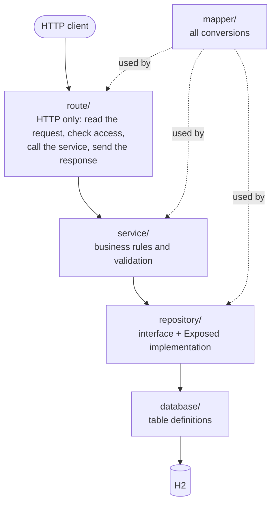
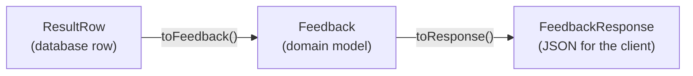
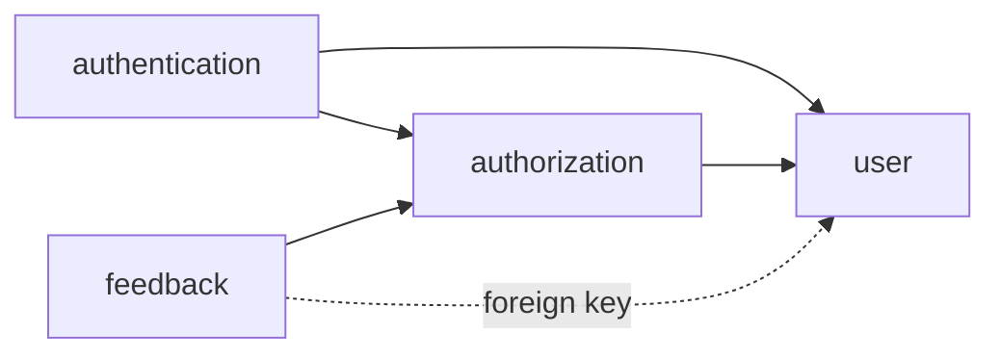

# 4. Architecture

This chapter explains how the code is organised and why. Once you understand this, you can find anything in the
project.

## A feature-first modular monolith

That is a long name for two simple ideas:

- **Monolith**: one application, one deployable program, one database. No microservices.
- **Feature-first (modular)**: the code is grouped by *what it is about* (users, feedback, roles), not by *what kind of
  code it is* (all controllers together, all services together).

```text
backend/src/
├── Application.kt          entry point; creates every object and wires them together
├── config/                 AppConfig (settings), DatabaseFactory (connection, tables)
├── plugins/                Ktor plugin setup only; no business logic
├── shared/                 code that every feature uses
│   ├── error/              AppException, ErrorResponse
│   ├── http/               reading path and query parameters
│   ├── paging/             Page, SortDirection, PageResponse
│   └── database/           Exposed helpers for search and sorting
└── features/
    ├── authentication/     who is the caller? register, login, tokens
    ├── authorization/      what may the caller do? roles, permissions
    ├── user/               user accounts
    ├── feedback/           the reference feature: copy this one
    └── health/             GET /health
```

Why by feature? When you work on feedback, everything you need is in `features/feedback/`. When you delete a feature,
you delete one folder (and its wiring). Features stay small and independent.

## The layers inside a feature

Every feature uses the same layers, always in the same folders:



| Folder | Contains | Rule |
|---|---|---|
| `route/` | `FeedbackRoutes.kt` | Only HTTP. No business rules, no database code |
| `service/` | `FeedbackService.kt` | Business rules. Never sees `ApplicationCall` or `ResultRow` |
| `repository/` | `FeedbackRepository` (interface) and `ExposedFeedbackRepository` | Only database access. Returns domain models |
| `database/` | `FeedbackTable` | Exposed table definitions |
| `model/` | `Feedback`, `FeedbackStatus`, `FeedbackQuery` | Domain objects: what the application works with |
| `dto/` | `FeedbackRequest`, `FeedbackResponse` | Data Transfer Objects: the JSON the client sends and receives |
| `mapper/` | `toResponse()`, `toFeedback()`, `toFeedbackQuery()` | Every conversion between representations |

A feature only has the folders it needs. `health/` has just `route/`.

### Why so many layers?

Each layer has **one reason to change** (the Single Responsibility Principle):

- The JSON contract changes? Only `dto/` and `mapper/`.
- A business rule changes ("a message may be 5000 characters")? Only `service/`.
- We switch from H2 to PostgreSQL? Only `repository/` and `database/`.

It also makes testing easy: the service can be tested with a fake repository, without a database (chapter 11).

### Three representations of the same thing

A feedback item exists in three shapes, and mappers convert between them:



Why not send the model directly? Look at `User`: it has `passwordHash` and `tokenVersion`. `UserResponse` leaves them
out. Because only DTOs are `@Serializable`, a password hash can never end up in a response by accident.

## Wiring: `Application.kt`

Somewhere, every object has to be created and handed what it needs. Many frameworks do this automatically (Spring,
Koin). This project does it **by hand**, in one place:

```kotlin
// backend/src/Application.kt (shortened)
fun Application.module(config: AppConfig = AppConfig.load()) {
    // Repositories
    val userRepository = ExposedUserRepository()
    val authorizationRepository = ExposedAuthorizationRepository()
    val feedbackRepository = ExposedFeedbackRepository()

    AuthorizationSeeder(authorizationRepository).seed()

    // Services
    val jwtService = JwtService(config)
    val authorizationService = AuthorizationService(authorizationRepository, userRepository)
    val userService = UserService(userRepository)
    val feedbackService = FeedbackService(feedbackRepository)
    ...

    // Plugins and routes
    configureSerialization()
    configureStatusPages()
    configureAuthentication(jwtService, userRepository)
    configureRouting(authenticationService, userService, roleService, authorizationService, feedbackService)
}
```

This is called **constructor injection**: a class gets its dependencies through its constructor
(`class UserService(private val repository: UserRepository)`) instead of creating them itself. Benefits:

- You can read the whole object graph in 30 lines.
- Tests can pass in different objects (fakes) through the same constructor.
- No framework magic to explain.

The tests have their own version of this wiring: `TestServices` in `backend/test/TestFixtures.kt`.

## Shared code

`shared/` contains code that more than one feature needs. It must not depend on any feature. If something is used by
one feature only, it belongs in that feature.

## How the features depend on each other



- `authentication` uses `UserRepository` to find and store users, and `RoleService` to give a new user a role.
- `authorization` uses `UserRepository` to check that a user is active.
- `feedback` uses `AuthorizationService` for its access checks; its table points to `users`.

## Check yourself

[Quiz, chapter 4](14-quiz.md#chapter-4-architecture). Next: [chapter 5, the life of a request](05-request-lifecycle.md).
