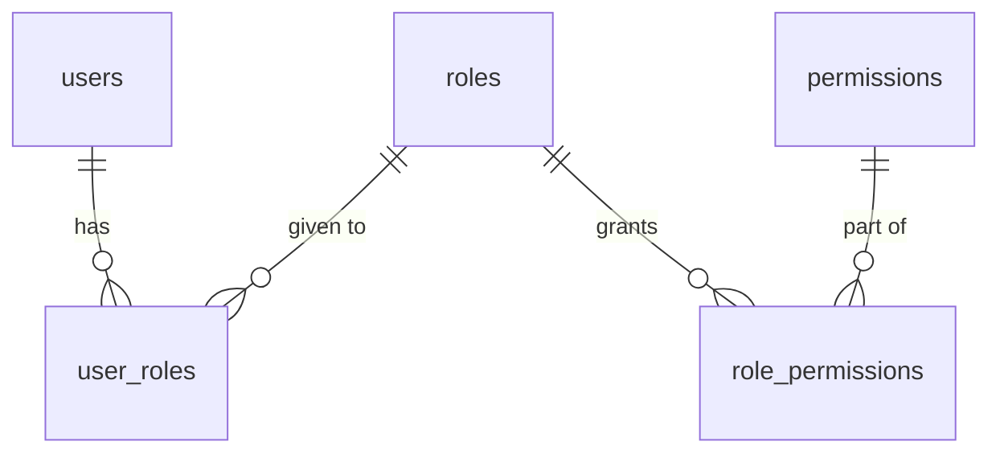

# 4. Security: authentication and authorization

**Authentication** answers *who is the caller?* **Authorization** answers *what may the caller do?* The code
always writes both words in full, because "auth" could mean either. Only the URL prefix is short: `/api/v1/auth`.

---

## Authentication

Files: `backend/src/features/authentication/` and `backend/src/plugins/Authentication.kt`.

### The endpoints

| Endpoint | What it does | Answer |
|---|---|---|
| `POST /api/v1/auth/register` | Create an account | 201 + token |
| `POST /api/v1/auth/login` | Log in | 200 + token |
| `POST /api/v1/auth/logout` | Log out on every device | 204 |
| `POST /api/v1/users/me/password` | Change your own password | 200 + new token |

Register and login are public but **rate limited**: at most 10 requests per minute (`plugins/RateLimiting.kt`).
That slows down someone who tries thousands of passwords. Password changes have their own limit of 5 per minute.

### Registering

`AuthenticationService.register`:

1. Normalise and check the input: the email is trimmed and lowercased; the display name must be 1–120 characters; the
   password 12–72 characters.
2. Refuse an email that is already registered: **409** `EMAIL_ALREADY_REGISTERED`.
3. **Hash** the password and store the user.
4. Give the user the `USER` role. If the email equals `BOOTSTRAP_ADMIN_EMAIL`, also give `ADMIN`.
5. Return a token, so the user is logged in immediately.

### Passwords: hashing with BCrypt

A password is never stored. The database holds a **hash**: the result of a one-way function. You cannot turn a hash
back into the password; you can only check whether a password produces the same hash.

```kotlin
// backend/src/features/authentication/service/PasswordHasher.kt
fun hash(password: String): String = BCrypt.hashpw(password, BCrypt.gensalt(12))
fun verify(password: String, passwordHash: String): Boolean = BCrypt.checkpw(password, passwordHash)
```

- **Salt**: `gensalt` adds random data, so two users with the same password get different hashes.
- **Cost 12**: BCrypt is deliberately slow (2^12 rounds). For one login that is fine; for an attacker who tries
  billions of passwords it is a wall.
- **Why at most 72 characters?** BCrypt ignores everything after 72 bytes. Rejecting longer passwords is more honest
  than silently cutting them.

### Logging in

```kotlin
fun login(request: LoginRequest): AuthenticationResponse {
    val email = request.email.trim().lowercase()
    val user = userRepository.findByEmail(email)

    if (user == null || !user.active || !passwordHasher.verify(request.password, user.passwordHash)) {
        throw AppException.Unauthorized("Invalid email or password", "INVALID_CREDENTIALS")
    }
    return createResponse(user)
}
```

Notice that an unknown email, a deactivated account and a wrong password all give **the same error**. If the API said
"unknown email", an attacker could find out who has an account.

### The token: a JWT

After a successful login the client receives:

```json
{
  "accessToken": "eyJhbGciOiJIUzI1NiJ9.eyJzdWIiOiI4YTFk...",
  "tokenType": "Bearer",
  "expiresIn": 3600,
  "user": { "id": "8a1d...", "email": "test@example.com", ... }
}
```

The client sends the token with every later request: `Authorization: Bearer <accessToken>`.

A **JWT** (JSON Web Token) has three parts separated by dots: header, payload and signature. The payload is only
Base64-encoded, not encrypted: anyone can read it (try <https://jwt.io>). So it must never contain secrets. In this
project it contains only:

| Claim | Meaning |
|---|---|
| `sub` | Subject: the user id |
| `ver` | Token version (see logout below) |
| `iss` | Issuer: who created the token |
| `aud` | Audience: who the token is for |
| `iat` | Issued at |
| `exp` | Expires at (1 hour later) |

No email, no roles, no password hash.

The **signature** is what makes the token trustworthy. The server computes it with `HMAC256` and the `JWT_SECRET`.
If someone changes even one character of the payload (for example their `sub`), the signature no longer matches and
the token is rejected. Without the secret, nobody can create a valid signature.

```kotlin
// backend/src/features/authentication/service/JwtService.kt
JWT.create()
    .withSubject(userId.toString())
    .withClaim(TOKEN_VERSION_CLAIM, tokenVersion)
    .withIssuer(issuer)
    .withAudience(audience)
    .withIssuedAt(Date.from(now))
    .withExpiresAt(Date.from(now.plusSeconds(expiresInSeconds)))
    .sign(algorithm)
```

### Checking the token on every request

`plugins/Authentication.kt` installs the JWT plugin. For every route inside `authenticate(JWT_AUTHENTICATION)`:

1. The **verifier** checks signature, issuer, audience and expiry.
2. **`validate`** then checks the database: does the user still exist, are they active, and is the `ver` in the token
   the same as `token_version` in the database?

Only then does the handler run. `call.currentUserId()` returns the `sub` of that token.

### Logout: the token version

A JWT is valid until it expires; the server does not keep a list of issued tokens. So how do you log someone out?

Every user has a `token_version` column (start: 0). It is copied into each token as `ver`. Step 2 above rejects a
token whose `ver` differs from the database. To invalidate every token of a user, increase the number:

```kotlin
fun logout(userId: UUID) {
    userRepository.incrementTokenVersion(userId)   // UPDATE users SET token_version = token_version + 1
}
```

The same trick is used when an admin **deactivates** a user and when a user **changes their password**. Trade-off:
logout ends the sessions on *all* devices, not just one. For this project that is acceptable and much simpler than
storing every token.

### Changing the password

`POST /api/v1/users/me/password` with `currentPassword` and `newPassword`:

- The current password is required. A stolen token alone is not enough to take over the account.
- A wrong current password gives **400** `INVALID_CURRENT_PASSWORD`, not 401. The token itself is valid; a client
  treats 401 as "your session has expired, log in again", which would be confusing here.
- The token version goes up, so every other device is logged out. The response contains a new token, so the device
  that changed the password stays logged in.

### The first admin

There is no admin in an empty database, and no endpoint to create one (that would be a security hole). The setting
`BOOTSTRAP_ADMIN_EMAIL` solves this: whoever registers with that email gets the `ADMIN` role as well. No password is
stored in the code or in the configuration.

---

## Authorization

This project uses **role-based access control (RBAC)**: users
have roles, roles have permissions, and the code checks permissions.

Files: `backend/src/features/authorization/`.

### The model



- A user has one or more roles (`user_roles`).
- A role has one or more permissions (`role_permissions`).
- A user's permissions are the permissions of all their roles together. There are **no** permissions given directly
  to a user.

### Permissions are an enum

```kotlin
// backend/src/features/authorization/model/Permission.kt
enum class Permission(val key: String) {
    USER_READ("user.read"),
    USER_UPDATE("user.update"),
    USER_DELETE("user.delete"),
    ROLE_READ("role.read"),
    ROLE_ASSIGN("role.assign"),
    FEEDBACK_READ("feedback.read"),
    FEEDBACK_UPDATE("feedback.update"),
    FEEDBACK_DELETE("feedback.delete");
}
```

Why an enum and not just strings in the database? Because every permission only means something if there is code that
checks it. With an enum, `Permission.USER_RAED` is a compile error; the string `"user.raed"` would silently never
match. **Always check with the enum, never with a string literal.**

### Roles are an enum too: the permission matrix

```kotlin
// backend/src/features/authorization/model/DefaultRole.kt
enum class DefaultRole(val permissions: Set<Permission>) {
    ADMIN(Permission.entries.toSet()),   // every permission, including new ones
    USER(emptySet())
}
```

So ADMIN may do everything and USER has no permissions at all. Yet a normal user can still read their own account
and delete their own feedback. That is **not** a permission: it is the rule "owners may always access what is theirs",
in `requireOwnerOrPermission` (below). The complete matrix, with what "own" means per permission, is in
`TECHNICAL_DESIGN.md` §4.

`AuthorizationSeeder` writes both enums into the database at every start. It only adds what is missing, so it is safe
to run repeatedly. The API cannot create roles or permissions; it can only assign roles to users and remove them.

### The checks: `AuthorizationService`

All rules live in one class. Routes call it; they never decide access themselves.

```kotlin
// backend/src/features/authorization/service/AuthorizationService.kt
fun hasPermission(userId: UUID, permission: Permission): Boolean {
    val user = userRepository.findById(userId) ?: return false
    return user.active && permission in authorizationRepository.findPermissionsForUser(userId)
}

/** Throws 403 unless the user has [permission]. */
fun requirePermission(userId: UUID, permission: Permission) {
    if (!hasPermission(userId, permission)) {
        throw AppException.Forbidden("Missing permission: ${permission.key}")
    }
}

/** Owners may always access their own resource; others need [permission]. */
fun requireOwnerOrPermission(currentUserId: UUID, ownerId: UUID, permission: Permission) {
    if (currentUserId != ownerId) {
        requirePermission(currentUserId, permission)
    }
}
```

There are only two checks. What is the owner? For a feedback item, the user who created it (`feedback.ownerId`). For
a user account, the user themselves: **users own their account**, so the account id is the owner id.

#### Which check do I use?

| Situation | Check | Example |
|---|---|---|
| Only some users may do this at all | `requirePermission` | `GET /users` needs `user.read` |
| The owner may always, others need a permission | `requireOwnerOrPermission` | `GET /users/{id}`: yourself, or `user.read`. `DELETE /feedback/{id}`: the owner, or `feedback.delete` |
| Every logged-in user may do this | nothing extra | `POST /feedback` |

#### Where the check goes

The check is the **first thing** in a route, before the work:

```kotlin
get {
    authorizationService.requirePermission(call.currentUserId(), Permission.USER_READ)
    val query = call.request.queryParameters.toUserQuery()
    call.respond(userService.search(query))
}
```

With `requireOwnerOrPermission` there is one rule everywhere: **read the owner first, then check**. You only know the
owner after reading the item, so the route asks the service with `getOwnerId(id)`:

```kotlin
delete("/{id}") {
    val id = call.uuidParameter("id")
    authorizationService.requireOwnerOrPermission(
        call.currentUserId(), feedbackService.getOwnerId(id), Permission.FEEDBACK_DELETE
    )
    feedbackService.delete(id)
    call.respond(HttpStatusCode.NoContent)
}
```

An unknown id then gives 404 before the access check. That is acceptable because ids are random UUIDs: guessing one is
practically impossible.

User accounts follow the same rule. Users own their account, so `userService.getOwnerId(id)` returns the account's
own id, or 404 when the account does not exist.

### Permissions come from the database, every time

`hasPermission` reads the user's permissions from the database **on every request**. The token does not contain roles.

Why? Suppose an admin removes the `ADMIN` role from Bob. If Bob's roles were inside his token, he would stay admin until
the token expires. Now the change counts from the very next request. `3-roles.http` shows exactly this: the same token
is first refused, then allowed, then refused again.

### 401 versus 403

| Status | Meaning | Example |
|---|---|---|
| **401 Unauthorized** | We don't know who you are | No token, expired token, logged out |
| **403 Forbidden** | We know who you are, but you may not do this | A normal user calls `GET /users` |

Everything is denied unless a rule allows it (**deny by default**).

### Protecting the last admin

Two small rules make sure the system always keeps at least one admin:

- Users cannot deactivate their own account.
- Admins cannot remove their own `ADMIN` role.

Removing a role needs `role.assign`, which only admins have. So only *another* admin can take an admin's role away,
and that other admin remains.

### Adding a permission for a new feature

1. Add it to `Permission` (for example `CATEGORY_MANAGE("category.manage")`).
2. Decide who gets it. `ADMIN` gets every permission automatically; for other roles, add it to their set in
   `DefaultRole`.
3. Check it in the route with `authorizationService.requirePermission(..., Permission.CATEGORY_MANAGE)`.
4. Restart: the seeder adds it to the database.

## Check yourself

Quiz: [authentication](09-quiz.md#authentication-chapter-4) and [authorization](09-quiz.md#authorization-chapter-4).
Next: [chapter 5, errors and the database](05-errors-and-database.md).
