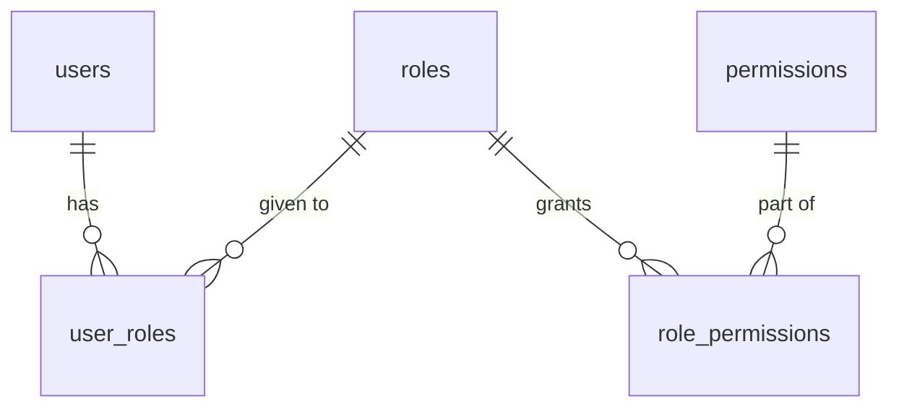

# 7. Authorization

**Authorization** answers *what may the caller do?* This project uses **role-based access control (RBAC)**: users
have roles, roles have permissions, and the code checks permissions.

Files: `backend/src/features/authorization/`.

## The model



- A user has one or more roles (`user_roles`).
- A role has one or more permissions (`role_permissions`).
- A user's permissions are the permissions of all their roles together. There are **no** permissions given directly
  to a user.

## Permissions are an enum

```kotlin
// backend/src/features/authorization/model/Permission.kt
enum class Permission(val key: String) {
    USER_READ("user.read"),
    USER_UPDATE("user.update"),
    USER_DELETE("user.delete"),
    ROLE_READ("role.read"),
    ROLE_ASSIGN("role.assign"),
    FEEDBACK_READ("feedback.read"),
    FEEDBACK_UPDATE("feedback.update"),
    FEEDBACK_DELETE("feedback.delete");
}
```

Why an enum and not just strings in the database? Because every permission only means something if there is code that
checks it. With an enum, `Permission.USER_RAED` is a compile error; the string `"user.raed"` would silently never
match. **Always check with the enum, never with a string literal.**

## Roles are an enum too: the permission matrix

```kotlin
// backend/src/features/authorization/model/DefaultRole.kt
enum class DefaultRole(val permissions: Set<Permission>) {
    ADMIN(Permission.entries.toSet()),   // every permission, including new ones
    USER(emptySet())
}
```

So ADMIN may do everything and USER has no permissions at all. Yet a normal user can still read their own account
and delete their own feedback. That is **not** a permission: it is the rule "owners may always access what is theirs",
in `requireOwnerOrPermission` (below). The complete matrix, with what "own" means per permission, is in
`TECHNICAL_DESIGN.md` §4.

`AuthorizationSeeder` writes both enums into the database at every start. It only adds what is missing, so it is safe
to run repeatedly. The API cannot create roles or permissions; it can only assign roles to users and remove them.

## The checks: `AuthorizationService`

All rules live in one class. Routes call it; they never decide access themselves.

```kotlin
// backend/src/features/authorization/service/AuthorizationService.kt
fun hasPermission(userId: UUID, permission: Permission): Boolean {
    val user = userRepository.findById(userId) ?: return false
    return user.active && permission in authorizationRepository.findPermissionsForUser(userId)
}

/** Throws 403 unless the user has [permission]. */
fun requirePermission(userId: UUID, permission: Permission) {
    if (!hasPermission(userId, permission)) {
        throw AppException.Forbidden("Missing permission: ${permission.key}")
    }
}

/** Owners may always access their own resource; others need [permission]. */
fun requireOwnerOrPermission(currentUserId: UUID, ownerId: UUID, permission: Permission) {
    if (currentUserId != ownerId) {
        requirePermission(currentUserId, permission)
    }
}
```

There are only two checks. What is the owner? For a feedback item, the user who created it (`feedback.userId`). For
a user account, the user themselves: **users own their account**, so the account id is the owner id.

### Which check do I use?

| Situation | Check | Example |
|---|---|---|
| Only some users may do this at all | `requirePermission` | `GET /users` needs `user.read` |
| The owner may always, others need a permission | `requireOwnerOrPermission` | `GET /users/{id}`: yourself, or `user.read`. `DELETE /feedback/{id}`: the owner, or `feedback.delete` |
| Every logged-in user may do this | nothing extra | `POST /feedback` |

### Where the check goes

The check is the **first thing** in a route, before the work:

```kotlin
get {
    authorizationService.requirePermission(call.currentUserId(), Permission.USER_READ)
    val query = call.request.queryParameters.toUserQuery()
    call.respond(userService.search(query))
}
```

For user accounts the check even comes before the lookup: the id in the URL *is* the owner id, so nothing has to be
read first. A caller without access gets 403 for every id, so they cannot find out which ids exist.

For **owned items** (feedback) that is impossible: you only know the owner after reading the item. So the route reads
the owner first, then checks:

```kotlin
delete("/{id}") {
    val id = call.uuidParameter("id")
    authorizationService.requireOwnerOrPermission(
        call.currentUserId(), feedbackService.getOwnerId(id), Permission.FEEDBACK_DELETE
    )
    feedbackService.delete(id)
    call.respond(HttpStatusCode.NoContent)
}
```

An unknown id then gives 404 before the access check. That is acceptable because ids are random UUIDs: guessing one is
practically impossible.

## Permissions come from the database, every time

`hasPermission` reads the user's permissions from the database **on every request**. The token does not contain roles.

Why? Suppose an admin removes the `ADMIN` role from Bob. If Bob's roles were inside his token, he would stay admin until
the token expires. Now the change counts from the very next request. `3-roles.http` shows exactly this: the same token
is first refused, then allowed, then refused again.

## 401 versus 403

| Status | Meaning | Example |
|---|---|---|
| **401 Unauthorized** | We don't know who you are | No token, expired token, logged out |
| **403 Forbidden** | We know who you are, but you may not do this | A normal user calls `GET /users` |

Everything is denied unless a rule allows it (**deny by default**).

## Protecting the last admin

Two small rules make sure the system always keeps at least one admin:

- Users cannot deactivate their own account.
- Admins cannot remove their own `ADMIN` role.

Removing a role needs `role.assign`, which only admins have. So only *another* admin can take an admin's role away,
and that other admin remains.

## Adding a permission for a new feature

1. Add it to `Permission` (for example `CATEGORY_MANAGE("category.manage")`).
2. Decide who gets it. `ADMIN` gets every permission automatically; for other roles, add it to their set in
   `DefaultRole`.
3. Check it in the route with `authorizationService.requirePermission(..., Permission.CATEGORY_MANAGE)`.
4. Restart: the seeder adds it to the database.

## Check yourself

[Quiz, chapter 7](14-quiz.md#chapter-7-authorization). Next: [chapter 8, errors](08-errors-and-validation.md).
