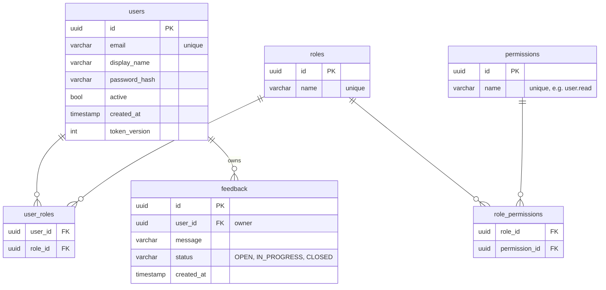

# 9. Database

This chapter covers the tables, how a repository talks to the database, and what to do when you change a table.

Files: `backend/src/config/DatabaseFactory.kt`, every `database/` and `repository/` folder.

## The data model



- **IDs are UUIDs** generated by the server, such as `3f2c4a1e-...`. They cannot be guessed, unlike 1, 2, 3, and the
  client never chooses them.
- **Times are UTC** (`Instant`) and are sent as ISO 8601: `2026-11-05T09:30:00Z`. The `Z` means UTC.
- **Users are never deleted**, only deactivated (`active = false`). Feedback is deleted for real.

## Connecting and creating tables

```kotlin
// backend/src/config/DatabaseFactory.kt
object DatabaseFactory {
    fun init(config: AppConfig) {
        Database.connect(url = config.databaseUrl, driver = config.databaseDriver, ...)

        transaction {
            SchemaUtils.create(UsersTable, RolesTable, PermissionsTable, UserRolesTable, RolePermissionsTable, FeedbackTable)
        }
    }
}
```

`SchemaUtils.create` creates every table that does not exist yet. It is called at startup, before the server accepts
requests.

### Changing a table: delete the local database

`SchemaUtils.create` only **creates missing tables**. It does not add a column to a table that already exists. So:

| You did | What to do |
|---|---|
| Added a new table | Nothing: it is created at the next start |
| Added, removed or changed a column of an existing table | Stop the server, delete `data/example*`, start again |

Deleting the file also deletes your test data; run `1-authentication.http` again afterwards. A real production system
would use a **migration tool** such as Flyway, which applies numbered SQL scripts. That is a deliberate omission to
keep this project small.

## Repositories

A repository is the only code that talks to the database. Each one has an **interface** and an **Exposed
implementation**:

```kotlin
// backend/src/features/feedback/repository/FeedbackRepository.kt
interface FeedbackRepository {
    fun findById(id: UUID): Feedback?
    fun search(query: FeedbackQuery): List<Feedback>
    fun count(query: FeedbackQuery): Long
    fun save(feedback: Feedback): Feedback
    fun update(feedback: Feedback): Boolean
    fun delete(id: UUID): Boolean
}
```

The service only knows the interface. That has two effects:

1. The service cannot accidentally run SQL or see a `ResultRow`.
2. Tests replace the database with a fake that keeps the data in a map (chapter 11).

### One transaction per method

```kotlin
// backend/src/features/feedback/repository/ExposedFeedbackRepository.kt
override fun update(feedback: Feedback): Boolean = transaction {
    FeedbackTable.update({ FeedbackTable.id eq feedback.id }) {
        it[message] = feedback.message
        it[status] = feedback.status
    } > 0
}
```

Each repository method opens its own `transaction { }`. For this project that is enough: no operation needs several
statements to succeed or fail together.

### From row to model: database mappers

```kotlin
// backend/src/features/feedback/mapper/FeedbackDatabaseMapper.kt
fun ResultRow.toFeedback(): Feedback =
    Feedback(
        id = this[FeedbackTable.id],
        userId = this[FeedbackTable.userId],
        message = this[FeedbackTable.message],
        status = this[FeedbackTable.status],
        createdAt = this[FeedbackTable.createdAt]
    )
```

## Constraints: let the database guard the rules

Some rules are checked twice: once in the service (for a clear error) and once by the database (as the final guard).

### Unique values

`email` has a unique index. The service first checks `findByEmail(email) != null` and throws 409. But two
registrations with the same email could arrive at the same moment, both pass the check, and both insert. The unique
index makes the second insert fail, and the repository turns that failure into 409 too:

```kotlin
// backend/src/features/user/repository/ExposedUserRepository.kt
override fun save(user: User): User =
    try {
        transaction {
            maxAttempts = 1          // see below
            UsersTable.insert { ... }
        }
        user
    } catch (exception: ExposedSQLException) {
        if (exception.sqlState == UNIQUE_VIOLATION) {      // "23505"
            throw AppException.Conflict("Email address is already registered", "EMAIL_ALREADY_REGISTERED")
        }
        throw exception
    }
```

`23505` is the standard SQL code for "unique constraint violated".

`maxAttempts = 1`: Exposed **retries a failed transaction** three times by default. For a duplicate email a retry can
never succeed, so it would only waste time and fill the log.

### Foreign keys

`feedback.user_id` references `users.id`:

```kotlin
val userId = reference("user_id", UsersTable.id)
```

The database refuses a feedback item for a user that does not exist.

## Atomic updates

Logging out increases the token version. Reading the value, adding 1 in Kotlin and writing it back could lose an
update if two requests run at the same time. So the increment is one SQL statement:

```kotlin
UsersTable.update({ UsersTable.id eq id }) {
    with(SqlExpressionBuilder) {
        it[tokenVersion] = tokenVersion + 1        // UPDATE users SET token_version = token_version + 1
    }
}
```

## Timestamps

```kotlin
createdAt = Instant.now().truncatedTo(ChronoUnit.SECONDS)
```

`Instant.now()` has nanosecond precision; the database column does not store that much. Cutting it to whole seconds
makes the stored value exactly equal to the value in memory (tests compare them) and gives clean timestamps in the API.

## Check yourself

[Quiz, chapter 9](14-quiz.md#chapter-9-database). Next: [chapter 10, lists](10-lists-search-paging.md).
