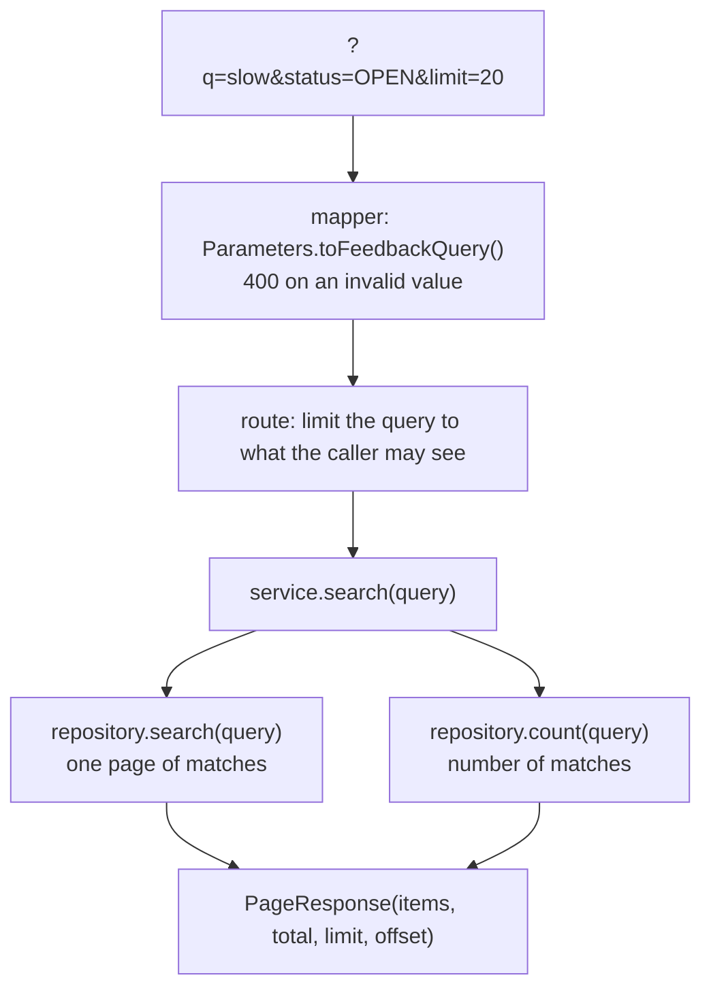

# 10. Lists: search, filter, sort and paging

Every list endpoint in this project works the same way: the client asks with query parameters, and gets one page
back. Learn it once, use it in every feature.

Files: `backend/src/shared/http/QueryParameters.kt`, `backend/src/shared/paging/`,
`backend/src/shared/database/QueryConditions.kt`, and the `search` code in `features/feedback/` and `features/user/`.

## What the client sends and gets

```http
GET /api/v1/feedback?q=slow&status=OPEN&sort=createdAt&order=desc&limit=20&offset=0
```

```json
{
  "items": [ { "id": "...", "message": "The app is slow", "status": "OPEN", ... } ],
  "total": 42,
  "limit": 20,
  "offset": 0
}
```

| Parameter | Meaning | Default |
|---|---|---|
| `q` | Free text (max 100 characters), matches part of a text field, ignoring upper/lower case | no text filter |
| filters | Exact matches, different per feature (`status`, `userId`, `active`) | no filter |
| `sort` | Field to sort on, from a fixed list per feature | `createdAt` |
| `order` | `asc` (A→Z, old→new) or `desc` | `desc` (newest first) |
| `limit` | Page size, 1–100 | 20 |
| `offset` | How many matches to skip | 0 |

Which text fields, filters and sort fields each list has is in `TECHNICAL_DESIGN.md` §6. For example, `GET /users`
searches in email and display name and filters on `active`; `GET /feedback` searches in the message and filters on
`status` and `userId`.

## Paging with `limit` and `offset`

Think of the matches as one long list; `offset` says where the page starts and `limit` how long it is.

```text
matches:   [1] [2] [3] [4] [5] [6] [7] [8] [9]          total = 9
limit=4, offset=0  →  [1] [2] [3] [4]
limit=4, offset=4  →                  [5] [6] [7] [8]
limit=4, offset=8  →                                  [9]
```

`total` counts all matches, not just the page. A client knows there is a next page as long as
`offset + items.size < total`.

## The flow through the layers



### 1. Mapper: query parameters to a model

```kotlin
// backend/src/features/feedback/mapper/FeedbackQueryMapper.kt
fun Parameters.toFeedbackQuery(): FeedbackQuery =
    FeedbackQuery(
        text = searchText("q"),
        status = oneOf("status", FeedbackStatus.entries.associateBy { it.name }),
        userId = uuidOrNull("userId"),
        sortField = oneOf("sort", FeedbackSortField.entries.associateBy { it.key }) ?: FeedbackSortField.CREATED_AT,
        sortDirection = sortDirection(),
        page = page()
    )
```

The small readers come from `shared/http/QueryParameters.kt`. Each one returns `null` (or a default) when the
parameter is missing, and throws **400 with the parameter name** when it is invalid:

| Reader | Accepts | Invalid example |
|---|---|---|
| `searchText("q")` | trimmed text up to 100 characters; empty means no filter | 101 characters |
| `oneOf("sort", options)` | one of the keys in a map | `sort=password` |
| `booleanOrNull("active")` | `true` or `false` | `active=yes` |
| `uuidOrNull("userId")` | a UUID | `userId=bob` |
| `sortDirection()` | `asc` or `desc` | `order=up` |
| `page()` | `limit` 1–100, `offset` 0 or more | `limit=500`, `limit=ten` |

Why 400 instead of quietly using the default? A typo such as `limit=1O` (letter O) should be noticed by the developer,
not hidden.

The result is a plain data class:

```kotlin
// backend/src/features/feedback/model/FeedbackQuery.kt
data class FeedbackQuery(
    val text: String? = null,
    val status: FeedbackStatus? = null,
    val userId: UUID? = null,
    val sortField: FeedbackSortField = FeedbackSortField.CREATED_AT,
    val sortDirection: SortDirection = SortDirection.DESC,
    val page: Page = Page()
)
```

`null` means "this filter is not used".

### 2. Route: filters never widen access

```kotlin
// backend/src/features/feedback/route/FeedbackRoutes.kt
get {
    val currentUserId = call.currentUserId()
    val query = call.request.queryParameters.toFeedbackQuery()
    val allowedQuery = if (authorizationService.hasPermission(currentUserId, Permission.FEEDBACK_READ)) {
        query
    } else {
        query.copy(userId = currentUserId)
    }
    call.respond(feedbackService.search(allowedQuery))
}
```

A normal user who sends `?userId=<someone else>` still only sees their own items, because the route overwrites
`userId`. **A filter may only make the result smaller, never show more than the caller is allowed to see.** This is
tested in `FeedbackRoutesTest`: `userId filter cannot widen a regular user's search`.

### 3. Service: one page plus the total

```kotlin
fun search(query: FeedbackQuery): PageResponse<FeedbackResponse> =
    PageResponse(
        items = repository.search(query).map { it.toResponse() },
        total = repository.count(query),
        limit = query.page.limit,
        offset = query.page.offset
    )
```

`PageResponse<T>` is generic: the `T` is the type of the items. The same class is used for users
(`PageResponse<UserResponse>`) and feedback (`PageResponse<FeedbackResponse>`).

### 4. Repository: building the query

```kotlin
// backend/src/features/feedback/repository/ExposedFeedbackRepository.kt
override fun search(query: FeedbackQuery): List<Feedback> = transaction {
    filtered(query)
        .orderBy(
            sortColumn(query.sortField) to query.sortDirection.toSortOrder(),
            FeedbackTable.id to SortOrder.ASC
        )
        .limit(query.page.limit)
        .offset(query.page.offset.toLong())
        .map { it.toFeedback() }
}

override fun count(query: FeedbackQuery): Long = transaction {
    filtered(query).count()
}

/** Starts with every row and adds one AND condition for each filter that is set. */
private fun filtered(query: FeedbackQuery): Query {
    val rows = FeedbackTable.selectAll()
    query.userId?.let { userId -> rows.andWhere { FeedbackTable.userId eq userId } }
    query.status?.let { status -> rows.andWhere { FeedbackTable.status eq status } }
    query.text?.let { text -> rows.andWhere { FeedbackTable.message.containsIgnoringCase(text) } }
    return rows
}
```

Read `filtered` as: *start with everything; for each filter that was given, add `AND <condition>`*. With
`?q=slow&status=OPEN` the SQL becomes roughly:

```sql
SELECT * FROM feedback
WHERE status = 'OPEN' AND LOWER(message) LIKE '%slow%'
ORDER BY created_at DESC, id ASC
LIMIT 20 OFFSET 0
```

`search` and `count` share `filtered`, so the total always matches the same filters.

## Three details worth explaining

### Why also sort on the id?

Suppose 30 items have the status `OPEN` and you sort on status. The database may return equal values in any order,
and that order can differ between two requests. Then an item could appear on page 1 *and* page 2, or on neither.
Adding the id as a second sort key makes the order unique, so pages never overlap.

### Why escape `%` and `_`?

In SQL `LIKE`, `%` means "any text" and `_` means "any single character". If a user searches for `50%`, a naive query
`LIKE '%50%%'` would also match "50 people". `containsIgnoringCase` escapes these characters so they match literally:

```kotlin
// backend/src/shared/database/QueryConditions.kt
fun Expression<String>.containsIgnoringCase(text: String): Op<Boolean> {
    val literal = LikePattern.ofLiteral(text.lowercase())
    return lowerCase() like LikePattern("%${literal.pattern}%", literal.escapeChar)
}
```

### Why a fixed list of sort fields?

`sort` comes from the client. If any column name were accepted, a client could sort on `password_hash` and learn
something about the hashes. Each feature lists exactly which fields are sortable:

```kotlin
enum class FeedbackSortField(val key: String) {
    CREATED_AT("createdAt"),
    STATUS("status")
}
```

## Adding search to your own list

1. A `<Name>Query` data class and a `<Name>SortField` enum in `model/`.
2. `Parameters.to<Name>Query()` in `mapper/`, using the readers from `shared/http/QueryParameters.kt`.
3. `search(query)` and `count(query)` in the repository interface, the Exposed implementation and the fake.
4. `search(query): PageResponse<...>` in the service.
5. In the route: read the query, limit it to what the caller may see, call the service.

Chapter 12 does exactly this for categories.

## Check yourself

[Quiz, chapter 10](14-quiz.md#chapter-10-lists). Next: [chapter 11, testing](11-testing.md).
