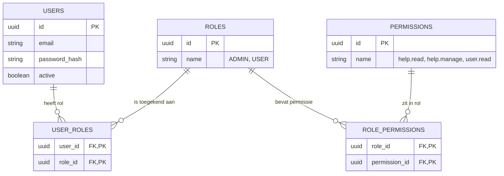
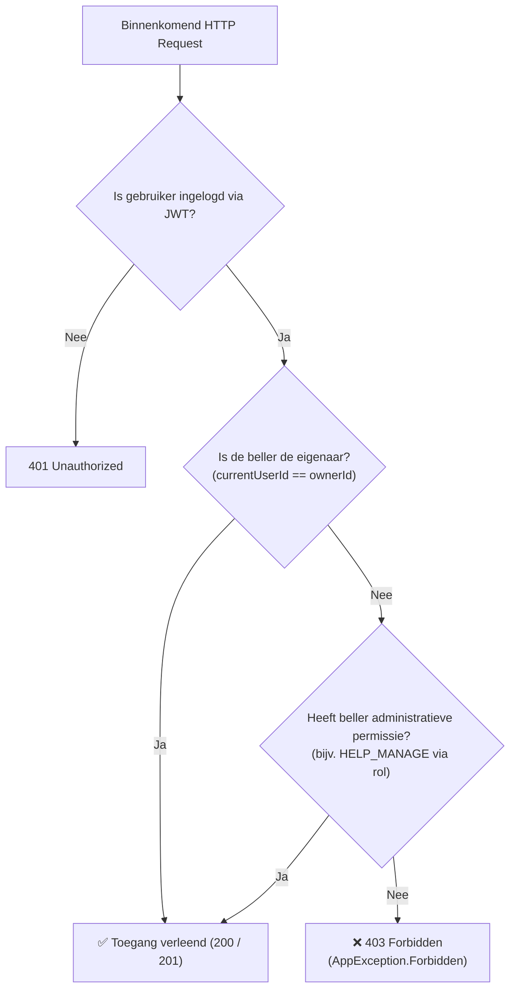

# Stap 1: Autorisatie & RBAC (Role-Based Access Control)

Dit document legt uit hoe autorisatie (toegangscontrole) werkt in de Brul API, waarom we overstappen van simpele rol-checks naar RBAC, en hoe dit toegepast wordt op de **Help** (vrijwilligers) feature.

---

## 1. Wat is het verschil tussen Authenticatie en Autorisatie?

* **Authenticatie (AuthN) — "Wie ben je?"**
  * De gebruiker logt in met e-mail en wachtwoord via `POST /api/v1/auth/login`.
  * De server verifieert het wachtwoord (via BCrypt hashing) en retourneert een JWT (JSON Web Token).
  * In het token staat het unieke `id` (UUID) van de gebruiker in het `sub` (subject) veld.
  * Bij ieder volgend verzoek stuurt de client dit token mee in de header: `Authorization: Bearer <token>`.
* **Autorisatie (AuthZ) — "Wat mag je doen?"**
  * Zodra bekend is wie de beller is, controleert het systeem of deze specifieke actie is toegestaan.
  * Mag deze gebruiker een check-in code genereren? Mag deze gebruiker een andere vrijwilliger verwijderen? Mag deze gebruiker alle inschrijvingen inzien?

---

## 2. Waarom RBAC in plaats van simpele rol-checks?

In eerdere versies (zoals `Brul2`) had een gebruiker vaak een eenvoudig veld zoals `role: String = "USER"`. In endpoints werd gecontroleerd met:
```kotlin
if (currentUser.role != "ADMIN") {
    call.respond(HttpStatusCode.Forbidden)
}
```

### Nadelen van de oude aanpak:
1. **Niet schaalbaar (Tight Coupling):** Als er later een nieuwe rol bijkomt (zoals `MODERATOR` of `WIJKCOORDINATOR`), moeten alle routes handmatig worden aangepast (`if (role == ADMIN || role == MODERATOR)`). Dit schendt het *Open/Closed Principle*.
2. **Rollen zijn te grof:** Een rol is een verzamelnaam voor rechten. Je hoort in je software niet te controleren op *wie iemand is* (de rol), maar op *wat iemand wil doen* (de actie/permissie).

### De RBAC oplossing:
* **Permissies:** Hele specifieke acties in het systeem (bijvoorbeeld: `help.read`, `help.manage`, `feedback.delete`).
* **Rollen:** Een logische bundel van permissies (bijvoorbeeld: de rol `ADMIN` bezit alle permissies).
* **Gebruiker:** Krijgt één of meerdere rollen toegewezen.

---

## 3. Het Datamodel van RBAC (ERD)

In de database wordt RBAC gerealiseerd via een klassieke veel-op-veel (m:n) structuur met twee koppeltabellen (*junction tables*):



### Uitleg van de relaties en symbolen (Crow's Foot notatie):
* **`||` (aan de linkerkant):** Betekent *"precies één"* (verplicht). Een koppeling in `user_roles` verwijst altijd naar precies één bestaande gebruiker en precies één bestaande rol.
* **`o{` (aan de rechterkant):** Betekent *"nul, één of meer"* (optioneel veel). Een gebruiker kan 0 rollen hebben, maar ook meerdere rollen.
* **Koppeltabellen (`USER_ROLES` en `ROLE_PERMISSIONS`):**
  * Eén gebruiker kan meerdere rollen hebben. Eén rol kan aan meerdere gebruikers toebehoren (Veel-op-veel: `Users <-> Roles`).
  * Eén rol kan meerdere permissies bevatten. Eén permissie kan in meerdere rollen zitten (Veel-op-veel: `Roles <-> Permissions`).
  * De primaire sleutel (PK) van de koppeltabel is een *samengestelde sleutel* (`composite key`) bestaande uit de twee foreign keys (`user_id` + `role_id`). Dit voorkomt automatisch dat een gebruiker twee keer dezelfde rol kan krijgen.

---

## 4. Hoe werkt `AuthorizationService.kt` in de praktijk?

De centrale autorisatielogica bevindt zich in `backend/src/features/authorization/service/AuthorizationService.kt`.

### Hoe haalt de service permissies op?
Bij elk verzoek voert `ExposedAuthorizationRepository` een SQL INNER JOIN uit over de tabellen:
```sql
SELECT permissions.name 
FROM user_roles 
INNER JOIN role_permissions ON user_roles.role_id = role_permissions.role_id 
INNER JOIN permissions ON role_permissions.permission_id = permissions.id 
WHERE user_roles.user_id = :userId;
```
Dit geeft direct de complete set permissies terug die bij de rollen van die gebruiker horen.

### Functie 1: `requirePermission(userId, permission)`
Controleert of de gebruiker de opgegeven permissie heeft. Zo niet, dan gooit het systeem direct een `AppException.Forbidden` (HTTP 403).

### Functie 2: `requireOwnerOrPermission(currentUserId, ownerId, permission)` — Resource Ownership
Dit is een cruciaal concept:
* **Eigenaarschap:** Als jij de eigenaar bent van de data (`currentUserId == ownerId`), krijg je automatisch toegang.
* **Geen eigenaar?** Dan mag je de actie alleen uitvoeren als je een administratieve permissie hebt (zoals `HELP_MANAGE`).



> **Waarom heeft een normale `USER` 0 expliciete permissies in de database?**
> Een gewone vrijwilliger mag zijn *eigen* aanmeldingen doen, inzien en intrekken. Omdat `requireOwnerOrPermission` dit toestaat op basis van eigenaarschap, hoeven we de database niet vol te stoppen met duizenden overbodige permissierijen.

---

## 5. Hoe werken `DefaultRole` en `AuthorizationSeeder`?

* **`DefaultRole.kt`:** Definieert de standaard rollenmatrix in code:
  * `ADMIN`: Heeft `Permission.entries.toSet()` (alle beschikbare permissies).
  * `USER`: Heeft `emptySet()` (gebruikt uitsluitend eigenaarschap).
* **`AuthorizationSeeder.kt`:** Draait automatisch bij het opstarten van de server (`Application.kt`):
  1. Loopt over alle items in het `Permission` enum heen. Staat een permissie (zoals `help.read`) nog niet in de `permissions` tabel? Dan voegt de seeder hem direct toe.
  2. Loopt over alle `DefaultRole` entries heen. Bestaat de rol `ADMIN` nog niet? Dan wordt deze aangemaakt.
  3. Koppelt in de tabel `role_permissions` alle permissies aan de rol `ADMIN`.
* **Bootstrap Admin:** Als de omgevingsvariabele `BOOTSTRAP_ADMIN_EMAIL` is ingesteld, krijgt het account dat zich met dat e-mailadres registreert automatisch de rol `ADMIN` toegekend.

---

## 6. Toegevoegde Permissies voor de Help Feature

In `Permission.kt` zijn de volgende twee permissies toegevoegd:
* `HELP_READ("help.read")`: Geeft beheerders het recht om alle vrijwilligersactiviteiten van alle meldingen in te zien.
* `HELP_MANAGE("help.manage")`: Geeft beheerders het recht om handmatig inschrijvingen van anderen aan te passen of te annuleren.
