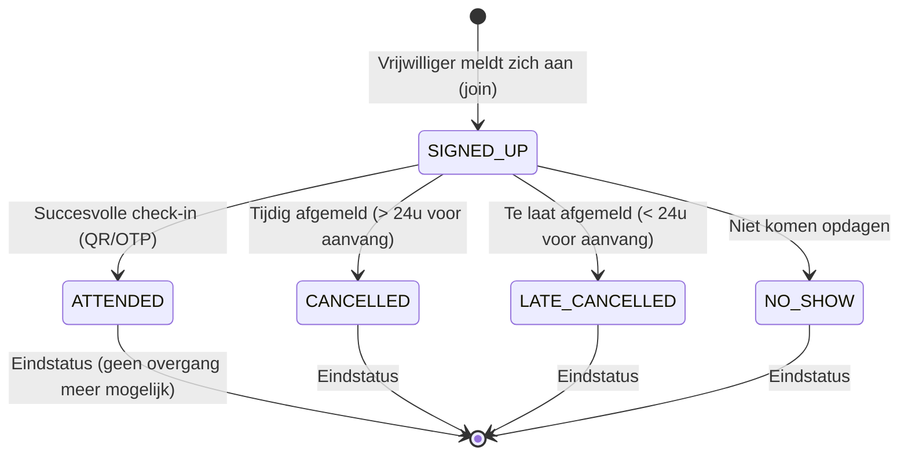
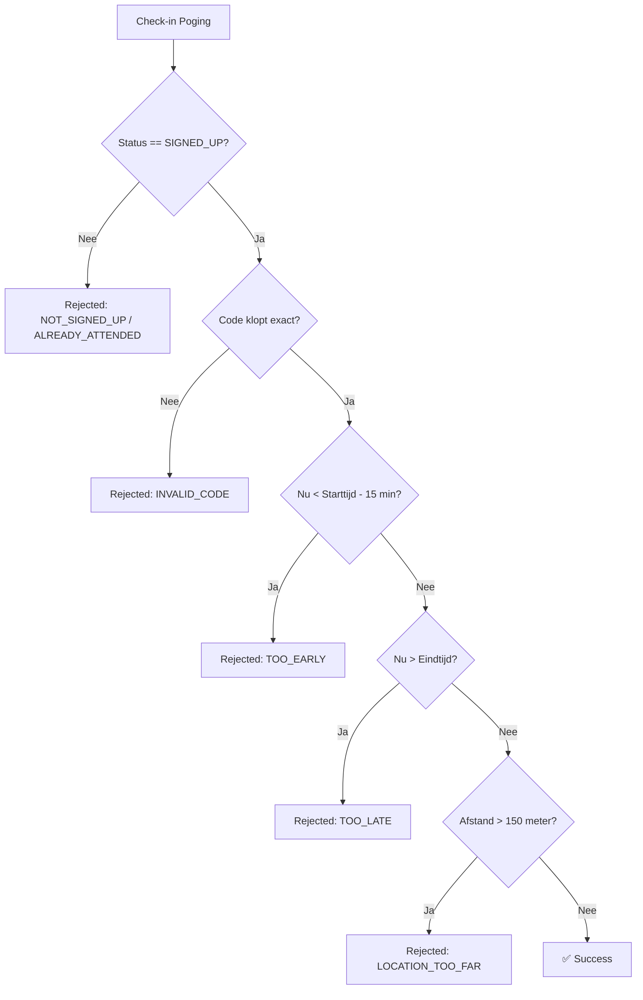

# Stap 2: Pure Logica & Value Objects

In deze stap hebben we de **pure domeinlogica** en **value objects** van de help-feature gemigreerd naar `Brul`. Dit zijn de onderdelen die de wiskunde, regels en standaarden bevatten zonder dat er een database of HTTP-laag bij komt kijken.

---

## 1. Wat is een Value Object? (`Location.kt`)

In Domain-Driven Design (DDD) is een **Value Object** een object dat gekarakteriseerd wordt door zijn *waarden*, niet door een uniek ID.
* Twee adressen of coördinaten met dezelfde lengte- en breedtegraad zijn aan elkaar gelijk (`Location(51.5, 4.7) == Location(51.5, 4.7)`).
* Een Value Object is **onveranderlijk (immutable)**.

### Eigenschappen van `Location.kt`:
1. **Zelfvaliderend (`init` block):**
   ```kotlin
   init {
       require(latitude in -90.0..90.0) { "Latitude must be between -90 and 90." }
       require(longitude in -180.0..180.0) { "Longitude must be between -180 and 180." }
   }
   ```
   Het is onmogelijk om een ongeldige `Location` aan te maken in het geheugen.
2. **Domeinberekening via de Haversine formule (`distanceTo`):**
   Berekent de afstand over de aardbol in kilometers. Dit vormt de wiskundige basis voor de geofencing-check.

---

## 2. De State Machine (`ParticipationStatus.kt`)

De status van een vrijwilligersaanmelding volgt strikte gedragsregels. In plaats van deze regels te verspreiden over controllers of services met `if/else`, is de **state machine direct in het enum gemodelleerd**:



### Waarom is dit belangrijk voor het examen?
* `canTransitionTo(next)` garandeert dat niemand vanuit `ATTENDED` terug kan naar `SIGNED_UP`, of vanuit `CANCELLED` alsnog kan inchecken.
* Het domeinmodel beschermt zijn eigen integriteit (*Encapsulation*).

---

## 3. Sealed Interfaces voor Uitkomsten (`CheckInResult.kt`)

In plaats van exceptions te gooien voor verwachte bedrijfsresultaten (zoals "te vroeg" of "code fout"), gebruiken we een **`sealed interface`**:

```kotlin
sealed interface CheckInResult {
    data object Success : CheckInResult
    data class Rejected(val reason: CheckInRejection) : CheckInResult
}
```

### Voordelen:
* **Exhaustive pattern matching:** De service kan met een `when (result)` alle scenario's afhandelen. De compiler dwingt af dat elk geval behandeld wordt.
* **Functionele stijl:** Een afwijzing bij het inchecken is geen onverwachte crash, maar een geldige uitkomst van een domeincontrole.

---

## 4. Geofencing en Tijdsvalidatie (`CheckInValidator.kt`)

`CheckInValidator` is een **Pure Domain Service**. Hij heeft:
* Geen database-verbinding.
* Geen HTTP-framework dependencies.
* Geen verborgen afhankelijkheid van de systeemklok!



### Waarom geven we `now: Instant` mee als parameter? (*Deterministic Testing*)
Als je in `CheckInValidator` direct `Instant.now()` aanroept, kun je de tijd niet manipuleren in testen zonder complexe mocks.
Door `now: Instant` als parameter mee te geven:
* Kun je in één milliseconde testen wat er gebeurt om 09:40 (te vroeg), om 09:50 (precies goed) en om 12:05 (te laat).
* De test is 100% voorspelbaar, deterministisch en razendsnel.

---

## 5. Agenda-export via RFC 5545 (`CalendarFeedService.kt`)

`CalendarFeedService` genereert een iCalendar (`.ics`) bestand volgens de wereldwijde standaard **RFC 5545**:
* **CRLF Line Endings (`\r\n`):** Verplicht volgens de internetstandaard.
* **Escaping:** Komma's, puntkomma's en enters worden ge-escaped (`\,`, `\;`, `\n`).
* **VALARM:** Bevat een automatische herinnering 60 minuten voor aanvang (`TRIGGER:-PT60M`).
* **Ontkoppeling via `HelpCalendarItem`:** In plaats van direct de hele `Report` entiteit te eisen, vraagt de service alleen om de specifieke velden die nodig zijn voor een afspraak (titel, beschrijving, categorie, locatie). Hierdoor werkt deze service volledig zelfstandig.
