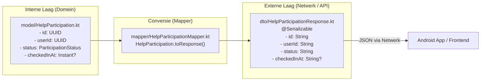

# Stap 3: Domeinmodel, DTO's en Mappers

In deze stap scheiden we de **interne bedrijfslogica** (het domeinmodel) strikt van het **externe netwerkcontract** (de Data Transfer Objects / DTO's) en implementeren we idiomatische Kotlin **mappers**.

---

## 1. Waarom scheiden we het Domeinmodel van de DTO's?

In simpele projecten of vroege versies (zoals `Brul2`) zag je vaak dat dezelfde klasse werd gebruikt voor de database, de bedrijfslogica én de JSON-output:
```kotlin
// SLECHTE PRAKTIJK: Domeinmodel gemixt met netwerk-serializatie
@Serializable
data class HelpParticipation(
    val id: Long,
    val userId: Long,
    val status: ParticipationStatus
)
```

### Waarom eist het Brul-framework een strikte scheiding?
1. **Separation of Concerns (SoC):** 
   * Het **Domeinmodel** (`model/HelpParticipation.kt`) representeert de kern van jouw applicatie. Het gebruikt rijke types zoals `UUID`, `Instant`, en specifieke enums. Het mag **geen** `@Serializable` hebben; het domein hoort niets te weten over JSON of het internet.
   * Het **DTO** (`dto/HelpParticipationResponse.kt`) representeert het *netwerkcontract* met de buitenwereld (de Android-app). Het gebruikt simpele serialiseerbare types zoals `String`, `Int`, `Boolean`.
2. **Beveiliging & Informatie-afscherming (Information Hiding):**
   * Als een domeinmodel interne gegevens bevat (zoals wachtwoordhashes, interne database-versies, of gevoelige beheerdersvlaggen), wil je die **nooit** per ongeluk meesturen in een HTTP-response. Door aparte DTO's te gebruiken, bepaal je exact welke velden de client te zien krijgt.
3. **Onafhankelijke evolutie:**
   * Je kunt het interne datamodel aanpassen zonder dat de Android-app direct crasht door een gewijzigde JSON-structuur.



---

## 2. De Transformatie: UUID's en ISO-8601 Timestamps

| Veld in `Brul2` | Nieuw type in `Brul` (Domein) | Type in DTO (JSON) | Waarom? |
| :--- | :--- | :--- | :--- |
| `id: Long` (auto-increment) | `id: UUID` | `id: String` | **Veiligheid:** Opeenvolgende Long ID's (`1, 2, 3...`) maken het triviaal voor kwaadwillenden om records te 'scrapen' (*enumeration attack*). UUID's zijn willekeurig en niet te raden. |
| `userId: Long` | `userId: UUID` | `userId: String` | Consistent met de centrale `UsersTable` in `Brul`. |
| `checkedInAt: Long?` (epoch millis) | `checkedInAt: Instant?` | `checkedInAt: String?` | **Leesbaarheid & Standaarden:** Ruwe milliseconden (`1700000000000`) zijn foutgevoelig voor tijdzones. ISO-8601 (`"2026-11-20T10:05:00Z"`) is de wereldwijde internetstandaard voor UTC-tijdstempels. |
| `status: ParticipationStatus` | `status: ParticipationStatus` | `status: String` | De client ontvangt een betrouwbare string (`"SIGNED_UP"`, `"ATTENDED"`). |

---

## 3. Mappers als Kotlin Extension Functions

In Java of frameworks zoals Spring worden mappers vaak gebouwd met logge bibliotheken (zoals MapStruct of ModelMapper) die via *runtime reflection* velden kopiëren. Dit is traag, lastig te debuggen en kan onverwacht falen.

In `Brul` gebruiken we idiomatische **Kotlin Extension Functions**:

```kotlin
// backend/src/features/help/mapper/HelpParticipationMapper.kt
fun HelpParticipation.toResponse(): HelpParticipationResponse =
    HelpParticipationResponse(
        id = id.toString(),
        helpRequestId = helpRequestId.toString(),
        userId = userId.toString(),
        status = status.name,
        checkedInAt = checkedInAt?.toString()
    )
```

### Voordelen:
* **Compile-time veilig:** Als je een veld toevoegt of hernoemt, weigert de code direct te compileren tot de mapper is bijgewerkt.
* **Geen reflection:** Draait met de maximale snelheid van een gewone statische functie.
* **Null-safe:** `checkedInAt?.toString()` levert automatisch `null` op als de vrijwilliger nog niet is ingecheckt.

---

## 4. Testen van de Mappers (`HelpParticipationMapperTest.kt`)

Omdat mappers de brug vormen tussen het domein en de buitenwereld, worden ze grondig gedekt met unit-tests:
* `maps HelpParticipation with check-in timestamp to response`: verifieert dat alle UUID's, enums en `Instant` timestamps correct naar strings worden geconverteerd.
* `maps HelpParticipation without check-in to response with null checkedInAt`: verifieert dat ontbrekende check-in tijden netjes `null` blijven.
* `maps HelpParticipationSummary to response`: verifieert de capaciteitsberekeningen en tellers.
