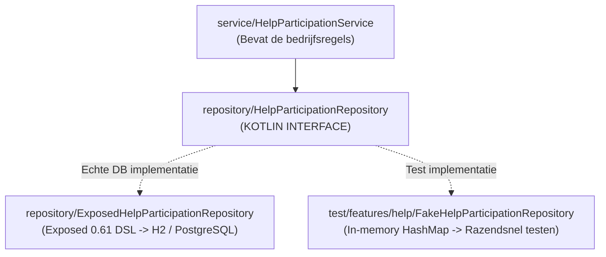

# Stap 5: De Repository Laag & In-Memory Fakes

In deze stap hebben we het **Repository Pattern** geïmplementeerd volgens het **Dependency Inversion Principle (DIP)**. We hebben een abstracte interface gemaakt, een echte **Exposed 0.61 implementatie** voor de database, én een **In-Memory Fake** voor razendsnelle unit- en routetesten.

---

## 1. Wat is het Repository Pattern en waarom gebruiken we een Interface?

Het Repository Pattern fungeert als een buffer tussen de bedrijfslogica (Services) en de database (SQL/Exposed).



### Het Dependency Inversion Principle (de 'D' in SOLID):
* **Slechte architectuur:** De servicelaag roept rechtstreeks Exposed SQL-functies aan. Als je overstapt van H2 naar MongoDB of PostgreSQL, moet je de hele servicelaag herschrijven.
* **Goede architectuur (onze opzet):** De servicelaag kent **alleen de interface** (`HelpParticipationRepository`). De service weet niet eens of data opgeslagen wordt in H2, Postgres of een geheugenlijstje. Dit maakt de code maximaal ontkoppeld en herbruikbaar.

---

## 2. De Interface ([`HelpParticipationRepository.kt`](file:///C:/Users/k.schouten/Documents/GitHub/Brul/backend/src/features/help/repository/HelpParticipationRepository.kt))

De interface definieert wat we kunnen doen met aanmeldingen, in pure domeintermen (geen SQL):

```kotlin
interface HelpParticipationRepository {
    fun findById(id: UUID): HelpParticipation?
    fun findByHelpRequest(helpRequestId: UUID): List<HelpParticipation>
    fun findByHelpRequestAndUser(helpRequestId: UUID, userId: UUID): HelpParticipation?
    fun countByHelpRequest(helpRequestId: UUID): Int
    fun save(participation: HelpParticipation): HelpParticipation
    fun updateStatus(
        helpRequestId: UUID,
        userId: UUID,
        status: ParticipationStatus,
        checkedInAt: Instant? = null
    ): Boolean
    fun delete(helpRequestId: UUID, userId: UUID): Boolean
    fun deleteById(id: UUID): Boolean
}
```

---

## 3. De Exposed Implementatie ([`ExposedHelpParticipationRepository.kt`](file:///C:/Users/k.schouten/Documents/GitHub/Brul/backend/src/features/help/repository/ExposedHelpParticipationRepository.kt))

Hier schrijven we de daadwerkelijke queries in Exposed 0.61 DSL:

```kotlin
override fun save(participation: HelpParticipation): HelpParticipation = transaction {
    maxAttempts = 1
    try {
        HelpParticipationsTable.insert {
            it[id] = participation.id
            it[helpRequestId] = participation.helpRequestId
            it[userId] = participation.userId
            it[status] = participation.status
            it[checkedInAt] = participation.checkedInAt
        }
        participation
    } catch (e: ExposedSQLException) {
        if (e.sqlState == "23505") {
            throw AppException.Conflict("You already participate in this help request.", "ALREADY_PARTICIPATING")
        }
        throw e
    }
}
```

### Belangrijke details voor het examen:
1. **`maxAttempts = 1`:** Standaard probeert Exposed mislukte transacties 3 keer opnieuw uit te voeren. Maar bij een *unique constraint violation* (SQL State 23505) heeft opnieuw proberen geen zin (de rij bestaat immers al). Door `maxAttempts = 1` in te stellen, faalt de transactie direct zonder vertraging.
2. **Vertaalslag van SQL-fout naar Domeinfout:** De repository vangt de ruwe SQL databasefout (`23505`) op en vertaalt deze direct naar een nette `AppException.Conflict`. Zo lekt er geen database-specifieke uitzondering naar hogere lagen.

---

## 4. Waarom Fakes in plaats van Mocks (Mockito / MockK)?

In `Brul` gebruiken we **géén** externe mocking-frameworks zoals Mockito of MockK. In plaats daarvan schrijven we een **`FakeHelpParticipationRepository`** met een `mutableMapOf<UUID, HelpParticipation>()`.

| Eigenschap | Mock (Mockito / MockK) | Fake (Onze In-Memory Fake) |
| :--- | :--- | :--- |
| **Werking** | Simuleert gedrag via *bytecode manipulation* tijdens runtime (`when(repo.find()).thenReturn(...)`). | Een échte, werkende implementatie in het geheugen (`items[id] = participation`). |
| **Snelheid** | Traag (starten van reflection engines). | **Razendsnel:** draait honderden tests binnen enkele milliseconden. |
| **Onderhoud** | Breekbaar: als je methode-handtekeningen wijzigt, breken al je `verify()` regels. | Robuust: de compiler controleert of de fake voldoet aan de interface. |
| **Toestand** | Vaak stateless (onthoudt niet wat je eerder hebt opgeslagen). | Stateful: wat je opslaat met `save()` kun je direct daarna ophalen met `findById()`. |

---

## 5. Hoe testen we de Repository? ([`HelpParticipationRepositoryTest.kt`](file:///C:/Users/k.schouten/Documents/GitHub/Brul/backend/test/features/help/HelpParticipationRepositoryTest.kt))

We testen de echte Exposed repository tegen een **in-memory H2 database** (`jdbc:h2:mem:...`):
* `saves and retrieves a participation`: test of een rij correct wordt weggeschreven en weer uitgelezen.
* `findByHelpRequestAndUser`: test de samengestelde zoekquery.
* `countByHelpRequest`: verifieert dat de SQL `count()` klopt.
* `updateStatus`: test of het status-enum en de `Instant` check-in tijdstempel correct worden geüpdatet.
* `delete`: test het verwijderen via de unieke sleutelcombinatie.
* `duplicate save throws Conflict`: **bewijst dat onze `uniqueIndex` constraint in de database werkt** en resulteert in een nette `AppException.Conflict`!

Alle 6 de tests slagen 100% groen in de test-suite.
