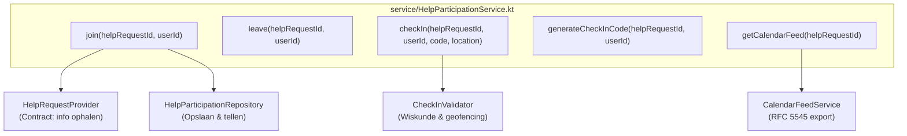

# Stap 6: De Service Laag & Contracten

In deze stap hebben we de **`HelpParticipationService`** gebouwd. Dit is het kloppende hart van de feature: hier worden alle bedrijfsregels, capaciteitscontroles en check-in workflows georkestreerd.

Bovendien hebben we de help-feature volledig **ontkoppeld van de meldingen-feature (`report`)** via het `HelpRequestProvider` contract.

---

## 1. Wat is de verantwoordelijkheid van de Servicelaag?

In een schone architectuur heeft elke laag strikte grenzen (SRP):
* **Mag WEL in de Service:** Bedrijfsregels bewaken (vol = vol, eigenaar mag niet meedoen, check-in valideren), UUID's genereren, en `AppException` gooien.
* **Mag NIET in de Service:**
  * Geen HTTP-concepten (geen `ApplicationCall`, `HttpStatusCode` of headers). De service weet niet of hij wordt aangeroepen door Ktor, een console-script of een test.
  * Geen SQL of Exposed-code (geen `Table`, `ResultRow` of transacties). De service praat uitsluitend met de repository-interface.



---

## 2. Ontkoppeling via `HelpRequestProvider` (Dependency Inversion)

Een van de grootste uitdagingen in een team van 5 studenten is: **hoe bouw je jouw feature als je teamgenoot nog bezig is met `report`?**

In `Brul2` was de service hard gekoppeld aan `ReportRepository`. In `Brul` hebben we een minimale interface gedefinieerd:

```kotlin
// backend/src/features/help/service/HelpRequestProvider.kt
data class HelpRequestInfo(
    val id: UUID,
    val ownerId: UUID,
    val title: String,
    val description: String,
    val category: String,
    val location: Location,
    val volunteersNeeded: Int,
    val isOpen: Boolean = true,
    val startTime: Instant,
    val endTime: Instant
)

interface HelpRequestProvider {
    fun findHelpRequest(id: UUID): HelpRequestInfo?
    fun setCheckInCode(helpRequestId: UUID, code: String, expiresAt: Instant)
    fun getCheckInCode(helpRequestId: UUID): ActiveCheckInCode?
}
```

### Waarom is dit een meesterzet voor het assessment?
1. **Zero Blocker:** Jij hoeft niet 2 weken te wachten tot je teamgenoot `report` af heeft. Jouw feature draait en test nu al 100% zelfstandig met `FakeHelpRequestProvider`.
2. **Koppeling later is kinderspel:** Zodra je teamgenoot klaar is met `ReportRepository`, schrijf je een adapter van 10 regels (`ExposedHelpRequestProvider`) die de data doorgeeft.

---

## 3. Deterministische Tijd (`currentTime: () -> Instant`)

In de constructor van `HelpParticipationService` staat:
```kotlin
class HelpParticipationService(
    private val participationRepository: HelpParticipationRepository,
    private val helpRequestProvider: HelpRequestProvider,
    private val currentTime: () -> Instant = Instant::now
)
```

`currentTime: () -> Instant` is een **functie-type** in Kotlin. 
* In de echte server gebruikt hij de default `Instant::now` (de actuele systeemtijd).
* In tests geven we een lambda mee: `{ currentTime }`. Zo kunnen we in tests de tijd naar wens vooruit- of terugspoelen zonder `Thread.sleep()`!

---

## 4. Bedrijfsregels & Foutafhandeling via `AppException`

In `Brul` geven services geen statuscodes (zoals 404 of 409) terug. In plaats daarvan gooien ze specifieke subtypes van `AppException`:

| Bedrijfsregel | Exceptie | Resulterende HTTP Status |
| :--- | :--- | :--- |
| Hulpvraag bestaat niet | `AppException.NotFound("Help request not found.", "HELP_REQUEST_NOT_FOUND")` | **404 Not Found** |
| Eigenaar probeert zich aan te melden voor eigen hulpvraag | `AppException.Forbidden("You cannot join your own help request.")` | **403 Forbidden** |
| Niet-eigenaar probeert een check-in code te genereren | `AppException.Forbidden("Only the owner can generate a check-in code.")` | **403 Forbidden** |
| Hulpvraag is al gesloten | `AppException.Conflict("This help request is closed.", "HELP_REQUEST_CLOSED")` | **409 Conflict** |
| Vrijwilliger is al aangemeld | `AppException.Conflict("You already participate in this help request.", "ALREADY_PARTICIPATING")` | **409 Conflict** |
| Benodigd aantal vrijwilligers is bereikt (vol = vol) | `AppException.Conflict("This help request is full.", "HELP_REQUEST_FULL")` | **409 Conflict** |
| Foutieve OTP-code / Buiten 150m / Buiten tijdvenster | `AppException.BadRequest("...", "INVALID_CHECK_IN_CODE" / "LOCATION_TOO_FAR" / ...)` | **400 Bad Request** |

Ktor's `StatusPages` plugin vangt deze excepties centraal op en vertaalt ze automatisch naar een uniforme JSON error response:
```json
{
  "code": "HELP_REQUEST_FULL",
  "message": "This help request is full."
}
```

---

## 5. Testen van de Servicelaag ([`HelpParticipationServiceTest.kt`](file:///C:/Users/k.schouten/Documents/GitHub/Brul/backend/test/features/help/HelpParticipationServiceTest.kt))

Omdat we `FakeHelpParticipationRepository` en `FakeHelpRequestProvider` gebruiken, draait de complete servicetest in het geheugen in minder dan 50 milliseconden:
* **Aanmelden & Capaciteit:** 5 tests die join, eigen vraag blokkeren, gesloten meldingen, dubbele aanmeldingen en capaciteitsgrenzen testen.
* **Afmelden:** 2 tests voor succesvol afmelden en 404 bij niet-bestaande deelnames.
* **Overzichten & Tellers:** test of `availablePlaces` en `isFull` correct meebewegen met inschrijvingen.
* **Code Generatie:** test autorisatie (alleen eigenaar) en statuscontrole.
* **Check-In Validatie:** 5 tests die geldige check-ins, foute codes, te vroege check-ins, te verre locaties (>150m) en niet-aangemelde gebruikers verifiëren.
* **Agenda Export:** test of de `.ics` string correct wordt gegenereerd.

Alle 17 tests slagen direct groen!
